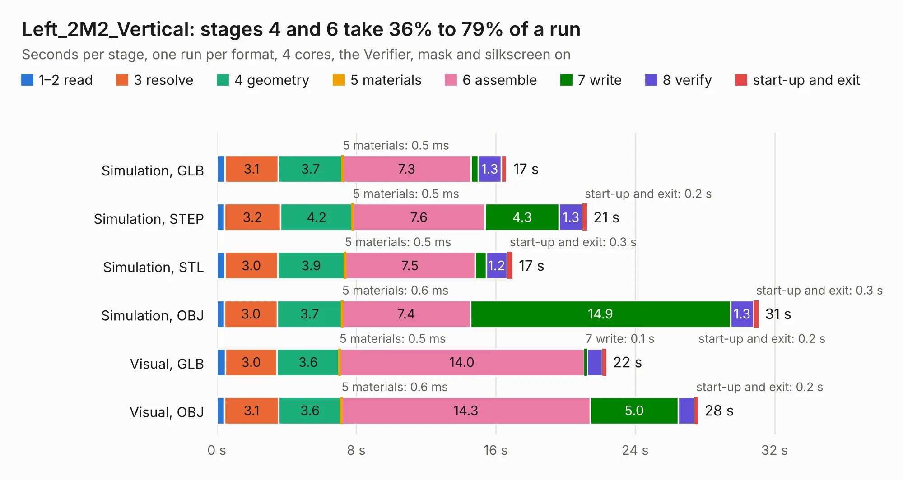

# 1303. Left_2M2_Vertical

Board 1,303 of the 3,138 of [Corpus Testing](../Corpus-Testing.md), on [Corpus Page 13](../CorpusTestingPages/Corpus-Testing-13.md#1303-left_2m2_vertical).

| Mode and format | 1–2 read | 3 resolve | 4 geometry | 5 materials | 6 assemble | 7 write | 8 verify | start-up and exit | Total |
|---|---:|---:|---:|---:|---:|---:|---:|---:|---:|
| Simulation, GLB | 0.5 | 3.1 | 3.7 | 0.5&nbsp;ms | 7.3 | 0.4 | 1.3 | 0.3 | 16.6 |
| Simulation, STEP | 0.5 | 3.2 | 4.2 | 0.5&nbsp;ms | 7.6 | 4.3 | 1.3 | 0.2 | 21.2 |
| Simulation, STL | 0.5 | 3.0 | 3.9 | 0.5&nbsp;ms | 7.5 | 0.6 | 1.2 | 0.3 | 17.0 |
| Simulation, OBJ | 0.4 | 3.0 | 3.7 | 0.6&nbsp;ms | 7.4 | 14.9 | 1.3 | 0.3 | 31.1 |
| Visual, GLB | 0.5 | 3.0 | 3.6 | 0.5&nbsp;ms | 14.0 | 0.1 | 0.9 | 0.2 | 22.4 |
| Visual, OBJ | 0.4 | 3.1 | 3.6 | 0.6&nbsp;ms | 14.3 | 5.0 | 0.9 | 0.2 | 27.6 |

<table align="center"><tr><td valign="top">

| Board | Repo: [isarmg/pcie-switch-2](https://github.com/isarmg/pcie-switch-2) Board: `Left_2M2_Vertical.kicad_pcb` |
|---|---|
| Folder | outputs / PCIe_3board_RevI / Left_2M2_Vertical |
| Complexity | 271&nbsp;/&nbsp;1000 (size&nbsp;226, features&nbsp;45) |
| KESE&nbsp;features | through vias, rounded, trapezoid or chamfered pads, filled zones |
| Tested | 9th November 2026 |
| Copper&nbsp;layers | 12 |
| File&nbsp;format | KiCad 10 (20260206) |
| Parts,&nbsp;tracks,&nbsp;vias | 62, 794, 266 |
| Triangles,&nbsp;simulation | 2,743,606 in 133 parts |
| Verifier | PASS in all six runs |

</td><td valign="top">

<table>
<tr><th>File type</th><th>File size</th><th>Peak memory used</th></tr>
<tr><th colspan="3" align="left">Simulation</th></tr>
<tr><td>GLB</td><td align="right">88&nbsp;MB</td><td align="right">761&nbsp;MB</td></tr>
<tr><td>STEP</td><td align="right">181&nbsp;MB</td><td align="right">866&nbsp;MB</td></tr>
<tr><td>STL</td><td align="right">137&nbsp;MB</td><td align="right">733&nbsp;MB</td></tr>
<tr><td>OBJ</td><td align="right">295&nbsp;MB</td><td align="right">1.8&nbsp;GB</td></tr>
<tr><th colspan="3" align="left">Visual</th></tr>
<tr><td>GLB</td><td align="right">30&nbsp;MB</td><td align="right">677&nbsp;MB</td></tr>
<tr><td>OBJ</td><td align="right">97&nbsp;MB</td><td align="right">801&nbsp;MB</td></tr>
</table>

</td></tr></table>

| Previous | Next |
|:---|---:|
| [1302. Assembly_View](b1302b_pcie-switch-2_outputs-PCIe-3board-RevI-Assembly-View_Assembly-View.md) | [1304. Main_10E1S](b1304b_pcie-switch-2_outputs-PCIe-3board-RevI-Main-10E1S_Main-10E1S.md) |
