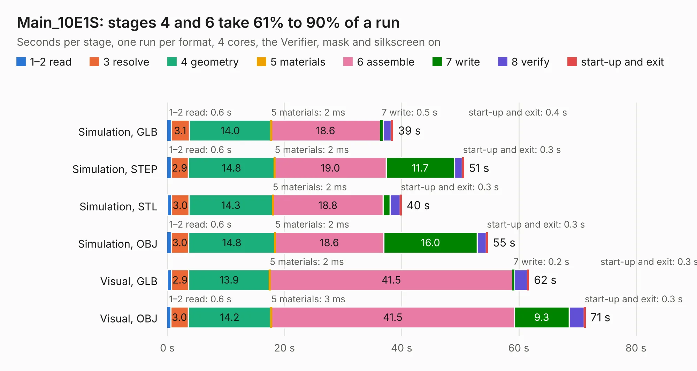

# 1304. Main_10E1S

Board 1,304 of the 3,119 of [Corpus Testing](../Corpus-Testing.md), on [Corpus Page 13](../CorpusTestingPages/Corpus-Testing-13.md#1304-main_10e1s).

| Mode and format | 1–2 read | 3 resolve | 4 geometry | 5 materials | 6 assemble | 7 write | 8 verify | start-up and exit | Total |
|---|---:|---:|---:|---:|---:|---:|---:|---:|---:|
| Simulation, GLB | 0.6 | 3.1 | 14.0 | 2&nbsp;ms | 18.6 | 0.5 | 1.3 | 0.4 | 38.5 |
| Simulation, STEP | 0.6 | 2.9 | 14.8 | 2&nbsp;ms | 19.0 | 11.7 | 1.3 | 0.3 | 50.6 |
| Simulation, STL | 0.7 | 3.0 | 14.3 | 2&nbsp;ms | 18.8 | 1.2 | 1.7 | 0.3 | 40.0 |
| Simulation, OBJ | 0.6 | 3.0 | 14.8 | 2&nbsp;ms | 18.6 | 16.0 | 1.5 | 0.3 | 54.7 |
| Visual, GLB | 0.7 | 2.9 | 13.9 | 2&nbsp;ms | 41.5 | 0.2 | 2.2 | 0.3 | 61.7 |
| Visual, OBJ | 0.6 | 3.0 | 14.2 | 3&nbsp;ms | 41.5 | 9.3 | 2.6 | 0.3 | 71.4 |

<table align="center"><tr><td valign="top">

| Board | Repo: [isarmg/pcie-switch-2](https://github.com/isarmg/pcie-switch-2) Board: `Main_10E1S.kicad_pcb` |
|---|---|
| Folder | outputs / PCIe_3board_RevK / Main_10E1S |
| Complexity | 213&nbsp;/&nbsp;1000 (size&nbsp;193, features&nbsp;20) |
| KESE&nbsp;features | slotted holes, rounded, trapezoid or chamfered pads |
| Tested | 9th November 2026 |
| Copper&nbsp;layers | 32 |
| File&nbsp;format | KiCad 10 (20260206) |
| Parts,&nbsp;tracks,&nbsp;vias | 209, 0, 0 |
| Triangles,&nbsp;simulation | 2,545,900 in 1042 parts |
| Note | mostly unrouted |
| Verifier | PASS in all six runs |

</td><td valign="top">

<table>
<tr><th>File type</th><th>File size</th><th>Peak memory used</th></tr>
<tr><th colspan="3" align="left">Simulation</th></tr>
<tr><td>GLB</td><td align="right">88&nbsp;MB</td><td align="right">1.0&nbsp;GB</td></tr>
<tr><td>STEP</td><td align="right">499&nbsp;MB</td><td align="right">1.5&nbsp;GB</td></tr>
<tr><td>STL</td><td align="right">127&nbsp;MB</td><td align="right">997&nbsp;MB</td></tr>
<tr><td>OBJ</td><td align="right">278&nbsp;MB</td><td align="right">1.8&nbsp;GB</td></tr>
<tr><th colspan="3" align="left">Visual</th></tr>
<tr><td>GLB</td><td align="right">54&nbsp;MB</td><td align="right">1.1&nbsp;GB</td></tr>
<tr><td>OBJ</td><td align="right">167&nbsp;MB</td><td align="right">1.2&nbsp;GB</td></tr>
</table>

</td></tr></table>

| Previous | Next |
|:---|---:|
| [1303. Assembly_View](b1303b_pcie-switch-2_outputs-PCIe-3board-RevK-Assembly-View_Assembly-View.md) | [1305. Assembly_View](b1305b_pcie-switch-2_outputs-PCIe-3board-RevL-Assembly-View_Assembly-View.md) |
