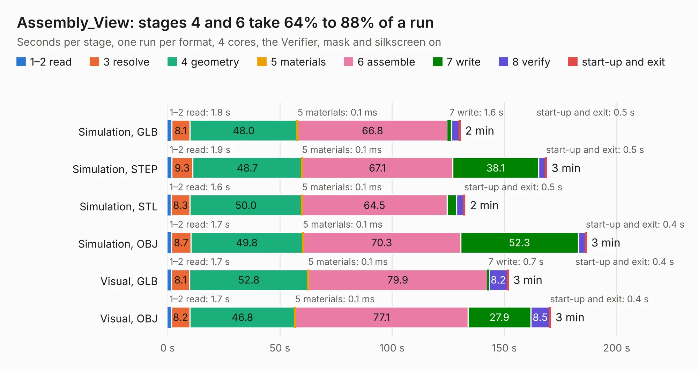

# 1305. Assembly_View

Board 1,305 of the 3,119 of [Corpus Testing](../Corpus-Testing.md), on [Corpus Page 13](../CorpusTestingPages/Corpus-Testing-13.md#1305-assembly_view).

| Mode and format | 1–2 read | 3 resolve | 4 geometry | 5 materials | 6 assemble | 7 write | 8 verify | start-up and exit | Total |
|---|---:|---:|---:|---:|---:|---:|---:|---:|---:|
| Simulation, GLB | 1.8 | 8.1 | 48.0 | 0.1&nbsp;ms | 66.8 | 1.6 | 3.6 | 0.5 | 130.4 |
| Simulation, STEP | 1.9 | 9.3 | 48.7 | 0.1&nbsp;ms | 67.1 | 38.1 | 3.2 | 0.5 | 168.8 |
| Simulation, STL | 1.6 | 8.3 | 50.0 | 0.1&nbsp;ms | 64.5 | 4.2 | 3.2 | 0.5 | 132.4 |
| Simulation, OBJ | 1.7 | 8.7 | 49.8 | 0.1&nbsp;ms | 70.3 | 52.3 | 3.2 | 0.4 | 186.5 |
| Visual, GLB | 1.7 | 8.1 | 52.8 | 0.1&nbsp;ms | 79.9 | 0.7 | 8.2 | 0.4 | 151.8 |
| Visual, OBJ | 1.7 | 8.2 | 46.8 | 0.1&nbsp;ms | 77.1 | 27.9 | 8.5 | 0.4 | 170.5 |

<table align="center"><tr><td valign="top">

| Board | Repo: [isarmg/pcie-switch-2](https://github.com/isarmg/pcie-switch-2) Board: `Assembly_View.kicad_pcb` |
|---|---|
| Folder | outputs / PCIe_3board_RevL / Assembly_View |
| Complexity | 153&nbsp;/&nbsp;1000 (size&nbsp;143, features&nbsp;10) |
| KESE&nbsp;features | rounded, trapezoid or chamfered pads |
| Tested | 9th November 2026 |
| Copper&nbsp;layers | 2 |
| File&nbsp;format | KiCad 10 (20260206) |
| Parts,&nbsp;tracks,&nbsp;vias | 510, 0, 0 |
| Triangles,&nbsp;simulation | 6,665,036 in 9 parts |
| Note | mostly unrouted |
| Verifier | PASS in all six runs |

</td><td valign="top">

<table>
<tr><th>File type</th><th>File size</th><th>Peak memory used</th></tr>
<tr><th colspan="3" align="left">Simulation</th></tr>
<tr><td>GLB</td><td align="right">236&nbsp;MB</td><td align="right">3.1&nbsp;GB</td></tr>
<tr><td>STEP</td><td align="right">1.4&nbsp;GB</td><td align="right">3.7&nbsp;GB</td></tr>
<tr><td>STL</td><td align="right">333&nbsp;MB</td><td align="right">3.0&nbsp;GB</td></tr>
<tr><td>OBJ</td><td align="right">735&nbsp;MB</td><td align="right">4.5&nbsp;GB</td></tr>
<tr><th colspan="3" align="left">Visual</th></tr>
<tr><td>GLB</td><td align="right">138&nbsp;MB</td><td align="right">2.5&nbsp;GB</td></tr>
<tr><td>OBJ</td><td align="right">438&nbsp;MB</td><td align="right">2.8&nbsp;GB</td></tr>
</table>

</td></tr></table>

| Previous | Next |
|:---|---:|
| [1304. Main_10E1S](b1304b_pcie-switch-2_outputs-PCIe-3board-RevK-Main-10E1S_Main-10E1S.md) | [1306. Main_10E1S](b1306b_pcie-switch-2_outputs-PCIe-3board-RevL-Main-10E1S_Main-10E1S.md) |
