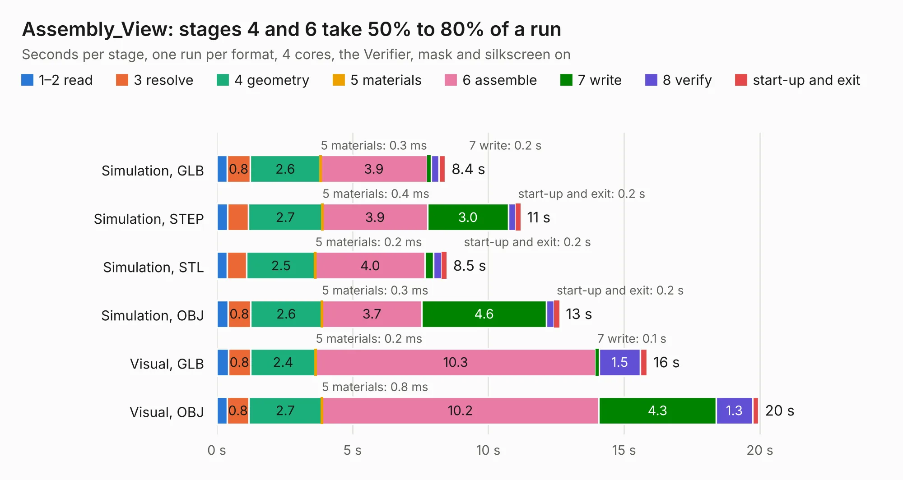

# 1306 Assembly_View

Board 1,306 of the 3,138 of [Corpus Testing](../Corpus-Testing.md), on [Corpus Page 13](../CorpusTestingPages/Corpus-Testing-13.md#1306-assembly_view).

| Mode and format | 1–2 read | 3 resolve | 4 geometry | 5 materials | 6 assemble | 7 write | 8 verify | start-up and exit | Total |
|---|---:|---:|---:|---:|---:|---:|---:|---:|---:|
| Simulation, GLB | 0.4 | 0.8 | 2.6 | 0.3&nbsp;ms | 3.9 | 0.2 | 0.3 | 0.2 | 8.4 |
| Simulation, STEP | 0.4 | 0.8 | 2.7 | 0.4&nbsp;ms | 3.9 | 3.0 | 0.3 | 0.2 | 11.2 |
| Simulation, STL | 0.4 | 0.7 | 2.5 | 0.2&nbsp;ms | 4.0 | 0.3 | 0.3 | 0.2 | 8.5 |
| Simulation, OBJ | 0.4 | 0.8 | 2.6 | 0.3&nbsp;ms | 3.7 | 4.6 | 0.3 | 0.2 | 12.6 |
| Visual, GLB | 0.4 | 0.8 | 2.4 | 0.2&nbsp;ms | 10.3 | 0.1 | 1.5 | 0.3 | 15.8 |
| Visual, OBJ | 0.4 | 0.8 | 2.7 | 0.8&nbsp;ms | 10.2 | 4.3 | 1.3 | 0.2 | 20.0 |

<table align="center"><tr><td valign="top">

| Board | Repo: [isarmg/pcie-switch-2](https://github.com/isarmg/pcie-switch-2) Board: `Assembly_View.kicad_pcb` |
|---|---|
| Folder | outputs / PCIe_3board_RevJ / Assembly_View |
| Complexity | 143&nbsp;/&nbsp;1000 (size&nbsp;133, features&nbsp;10) |
| KESE&nbsp;features | rounded, trapezoid or chamfered pads |
| Tested | 9th November 2026 |
| Copper&nbsp;layers | 2 |
| File&nbsp;format | KiCad 10 (20260206) |
| Parts,&nbsp;tracks,&nbsp;vias | 370, 0, 0 |
| Triangles,&nbsp;simulation | 1,065,008 in 9 parts |
| Note | mostly unrouted |
| Verifier | PASS in all six runs |

</td><td valign="top">

<table>
<tr><th>File type</th><th>File size</th><th>Peak memory used</th></tr>
<tr><th colspan="3" align="left">Simulation</th></tr>
<tr><td>GLB</td><td align="right">40&nbsp;MB</td><td align="right">575&nbsp;MB</td></tr>
<tr><td>STEP</td><td align="right">174&nbsp;MB</td><td align="right">670&nbsp;MB</td></tr>
<tr><td>STL</td><td align="right">53&nbsp;MB</td><td align="right">580&nbsp;MB</td></tr>
<tr><td>OBJ</td><td align="right">116&nbsp;MB</td><td align="right">791&nbsp;MB</td></tr>
<tr><th colspan="3" align="left">Visual</th></tr>
<tr><td>GLB</td><td align="right">37&nbsp;MB</td><td align="right">726&nbsp;MB</td></tr>
<tr><td>OBJ</td><td align="right">110&nbsp;MB</td><td align="right">963&nbsp;MB</td></tr>
</table>

</td></tr></table>

| Previous | Next |
|:---|---:|
| [1305 Right_M2_Upstream](b1305b_pcie-switch-2_outputs-PCIe-3board-RevI-Right-M2-Upstream_Right-M2-Upstream.md) | [1307 Left_2M2_Vertical](b1307b_pcie-switch-2_outputs-PCIe-3board-RevJ-Left-2M2-Vertical_Left-2M2-Vertical.md) |
