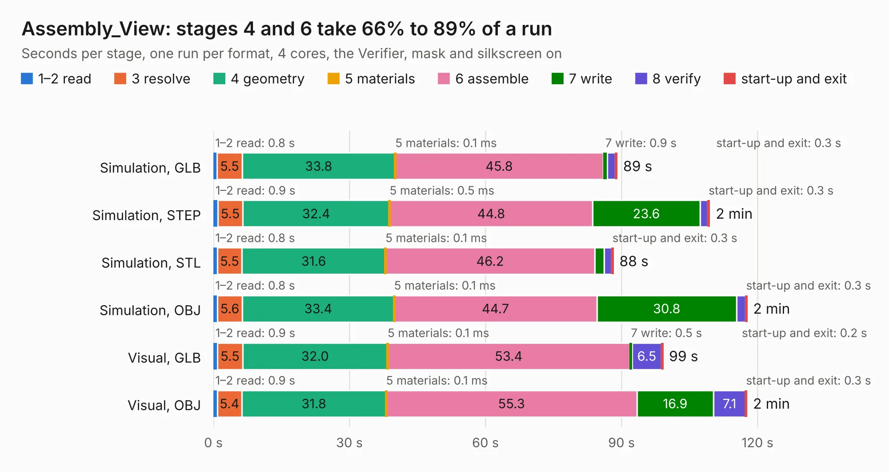

# 1306. Assembly_View

Board 1,306 of the 3,108 of [Corpus Testing](../Corpus-Testing.md), on [Corpus Page 13](../CorpusTestingPages/Corpus-Testing-13.md#1306-assembly_view).

| Mode and format | 1–2 read | 3 resolve | 4 geometry | 5 materials | 6 assemble | 7 write | 8 verify | start-up and exit | Total |
|---|---:|---:|---:|---:|---:|---:|---:|---:|---:|
| Simulation, GLB | 0.8 | 5.5 | 33.8 | 0.1&nbsp;ms | 45.8 | 0.9 | 1.7 | 0.3 | 89.0 |
| Simulation, STEP | 0.9 | 5.5 | 32.4 | 0.5&nbsp;ms | 44.8 | 23.6 | 1.7 | 0.3 | 109.4 |
| Simulation, STL | 0.8 | 5.5 | 31.6 | 0.1&nbsp;ms | 46.2 | 2.0 | 1.7 | 0.3 | 88.1 |
| Simulation, OBJ | 0.8 | 5.6 | 33.4 | 0.1&nbsp;ms | 44.7 | 30.8 | 2.0 | 0.3 | 117.6 |
| Visual, GLB | 0.9 | 5.5 | 32.0 | 0.1&nbsp;ms | 53.4 | 0.5 | 6.5 | 0.2 | 99.1 |
| Visual, OBJ | 0.9 | 5.4 | 31.8 | 0.1&nbsp;ms | 55.3 | 16.9 | 7.1 | 0.3 | 117.6 |

<table align="center"><tr><td valign="top">

| Board | Repo: [isarmg/pcie-switch-2](https://github.com/isarmg/pcie-switch-2) Board: `Assembly_View.kicad_pcb` |
|---|---|
| Folder | outputs / PCIe_Main_RevM / Assembly_View |
| Complexity | 149&nbsp;/&nbsp;1000 (size&nbsp;139, features&nbsp;10) |
| KESE&nbsp;features | rounded, trapezoid or chamfered pads |
| Tested | 9th November 2026 |
| Copper&nbsp;layers | 2 |
| File&nbsp;format | KiCad 10 (20260206) |
| Parts,&nbsp;tracks,&nbsp;vias | 364, 0, 0 |
| Triangles,&nbsp;simulation | 6,504,356 in 9 parts |
| Note | mostly unrouted |
| Verifier | PASS in all six runs |

</td><td valign="top">

<table>
<tr><th>File type</th><th>File size</th><th>Peak memory used</th></tr>
<tr><th colspan="3" align="left">Simulation</th></tr>
<tr><td>GLB</td><td align="right">229&nbsp;MB</td><td align="right">2.7&nbsp;GB</td></tr>
<tr><td>STEP</td><td align="right">1.3&nbsp;GB</td><td align="right">3.5&nbsp;GB</td></tr>
<tr><td>STL</td><td align="right">325&nbsp;MB</td><td align="right">2.9&nbsp;GB</td></tr>
<tr><td>OBJ</td><td align="right">715&nbsp;MB</td><td align="right">4.5&nbsp;GB</td></tr>
<tr><th colspan="3" align="left">Visual</th></tr>
<tr><td>GLB</td><td align="right">132&nbsp;MB</td><td align="right">2.4&nbsp;GB</td></tr>
<tr><td>OBJ</td><td align="right">417&nbsp;MB</td><td align="right">2.7&nbsp;GB</td></tr>
</table>

</td></tr></table>

| Previous | Next |
|:---|---:|
| [1305. Main_10E1S](b1305b_pcie-switch-2_outputs-PCIe-E1S-Only-RevQ-Main-10E1S_Main-10E1S.md) | [1307. Main_10E1S](b1307b_pcie-switch-2_outputs-PCIe-Main-RevM-Main-10E1S_Main-10E1S.md) |
