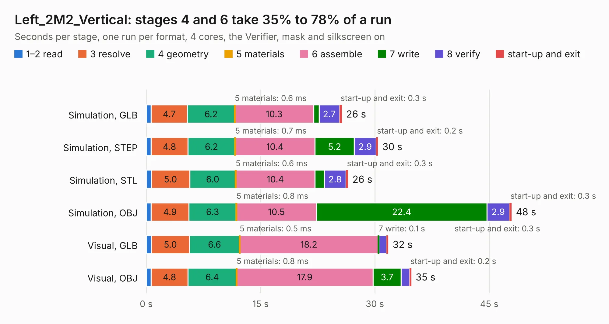

# 1307. Left_2M2_Vertical

Board 1,307 of the 3,138 of [Corpus Testing](../Corpus-Testing.md), on [Corpus Page 13](../CorpusTestingPages/Corpus-Testing-13.md#1307-left_2m2_vertical).

| Mode and format | 1–2 read | 3 resolve | 4 geometry | 5 materials | 6 assemble | 7 write | 8 verify | start-up and exit | Total |
|---|---:|---:|---:|---:|---:|---:|---:|---:|---:|
| Simulation, GLB | 0.7 | 4.7 | 6.2 | 0.6&nbsp;ms | 10.3 | 0.7 | 2.7 | 0.3 | 25.7 |
| Simulation, STEP | 0.7 | 4.8 | 6.2 | 0.7&nbsp;ms | 10.4 | 5.2 | 2.9 | 0.2 | 30.4 |
| Simulation, STL | 0.7 | 5.0 | 6.0 | 0.6&nbsp;ms | 10.4 | 1.2 | 2.8 | 0.3 | 26.5 |
| Simulation, OBJ | 0.7 | 4.9 | 6.3 | 0.8&nbsp;ms | 10.5 | 22.4 | 2.9 | 0.3 | 47.9 |
| Visual, GLB | 0.7 | 5.0 | 6.6 | 0.5&nbsp;ms | 18.2 | 0.1 | 1.0 | 0.3 | 31.8 |
| Visual, OBJ | 0.6 | 4.8 | 6.4 | 0.8&nbsp;ms | 17.9 | 3.7 | 1.1 | 0.2 | 34.8 |

<table align="center"><tr><td valign="top">

| Board | Repo: [isarmg/pcie-switch-2](https://github.com/isarmg/pcie-switch-2) Board: `Left_2M2_Vertical.kicad_pcb` |
|---|---|
| Folder | outputs / PCIe_3board_RevJ / Left_2M2_Vertical |
| Complexity | 345&nbsp;/&nbsp;1000 (size&nbsp;260, features&nbsp;85) |
| KESE&nbsp;features | through vias, blind and buried vias, rounded, trapezoid or chamfered pads, filled zones |
| Tested | 9th November 2026 |
| Copper&nbsp;layers | 32 |
| File&nbsp;format | KiCad 10 (20260206) |
| Parts,&nbsp;tracks,&nbsp;vias | 92, 1,023, 452 |
| Triangles,&nbsp;simulation | 5,219,168 in 207 parts |
| Verifier | PASS in all six runs |

</td><td valign="top">

<table>
<tr><th>File type</th><th>File size</th><th>Peak memory used</th></tr>
<tr><th colspan="3" align="left">Simulation</th></tr>
<tr><td>GLB</td><td align="right">177&nbsp;MB</td><td align="right">960&nbsp;MB</td></tr>
<tr><td>STEP</td><td align="right">229&nbsp;MB</td><td align="right">1.1&nbsp;GB</td></tr>
<tr><td>STL</td><td align="right">261&nbsp;MB</td><td align="right">1.1&nbsp;GB</td></tr>
<tr><td>OBJ</td><td align="right">577&nbsp;MB</td><td align="right">3.3&nbsp;GB</td></tr>
<tr><th colspan="3" align="left">Visual</th></tr>
<tr><td>GLB</td><td align="right">27&nbsp;MB</td><td align="right">808&nbsp;MB</td></tr>
<tr><td>OBJ</td><td align="right">93&nbsp;MB</td><td align="right">816&nbsp;MB</td></tr>
</table>

</td></tr></table>

| Previous | Next |
|:---|---:|
| [1306. Assembly_View](b1306b_pcie-switch-2_outputs-PCIe-3board-RevJ-Assembly-View_Assembly-View.md) | [1308. Main_10E1S](b1308b_pcie-switch-2_outputs-PCIe-3board-RevJ-Main-10E1S_Main-10E1S.md) |
