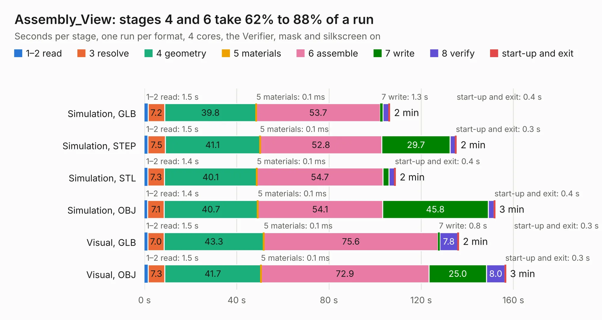

# 1308. Assembly_View

Board 1,308 of the 3,117 of [Corpus Testing](../Corpus-Testing.md), on [Corpus Page 13](../CorpusTestingPages/Corpus-Testing-13.md#1308-assembly_view).

| Mode and format | 1–2 read | 3 resolve | 4 geometry | 5 materials | 6 assemble | 7 write | 8 verify | start-up and exit | Total |
|---|---:|---:|---:|---:|---:|---:|---:|---:|---:|
| Simulation, GLB | 1.5 | 7.2 | 39.8 | 0.1&nbsp;ms | 53.7 | 1.3 | 2.5 | 0.4 | 106.4 |
| Simulation, STEP | 1.5 | 7.5 | 41.1 | 0.1&nbsp;ms | 52.8 | 29.7 | 2.3 | 0.3 | 135.2 |
| Simulation, STL | 1.4 | 7.3 | 40.1 | 0.1&nbsp;ms | 54.7 | 2.7 | 2.4 | 0.4 | 108.8 |
| Simulation, OBJ | 1.4 | 7.1 | 40.7 | 0.1&nbsp;ms | 54.1 | 45.8 | 2.6 | 0.4 | 152.0 |
| Visual, GLB | 1.5 | 7.0 | 43.3 | 0.1&nbsp;ms | 75.6 | 0.8 | 7.8 | 0.3 | 136.2 |
| Visual, OBJ | 1.5 | 7.3 | 41.7 | 0.1&nbsp;ms | 72.9 | 25.0 | 8.0 | 0.3 | 156.7 |

<table align="center"><tr><td valign="top">

| Board | Repo: [isarmg/pcie-switch-2](https://github.com/isarmg/pcie-switch-2) Board: `Assembly_View.kicad_pcb` |
|---|---|
| Folder | outputs / PCIe_AllM2_RevP / Assembly_View |
| Complexity | 180&nbsp;/&nbsp;1000 (size&nbsp;145, features&nbsp;35) |
| KESE&nbsp;features | custom pads, rounded, trapezoid or chamfered pads, copper drawings |
| Tested | 9th November 2026 |
| Copper&nbsp;layers | 2 |
| File&nbsp;format | KiCad 10 (20260206) |
| Parts,&nbsp;tracks,&nbsp;vias | 630, 0, 0 |
| Triangles,&nbsp;simulation | 7,314,096 in 8 parts |
| Note | mostly unrouted |
| Verifier | PASS in all six runs |

</td><td valign="top">

<table>
<tr><th>File type</th><th>File size</th><th>Peak memory used</th></tr>
<tr><th colspan="3" align="left">Simulation</th></tr>
<tr><td>GLB</td><td align="right">259&nbsp;MB</td><td align="right">3.2&nbsp;GB</td></tr>
<tr><td>STEP</td><td align="right">1.5&nbsp;GB</td><td align="right">3.9&nbsp;GB</td></tr>
<tr><td>STL</td><td align="right">366&nbsp;MB</td><td align="right">3.1&nbsp;GB</td></tr>
<tr><td>OBJ</td><td align="right">807&nbsp;MB</td><td align="right">5.0&nbsp;GB</td></tr>
<tr><th colspan="3" align="left">Visual</th></tr>
<tr><td>GLB</td><td align="right">154&nbsp;MB</td><td align="right">2.8&nbsp;GB</td></tr>
<tr><td>OBJ</td><td align="right">486&nbsp;MB</td><td align="right">3.1&nbsp;GB</td></tr>
</table>

</td></tr></table>

| Previous | Next |
|:---|---:|
| [1307. Main_27M2](b1307b_pcie-switch-2_Main-27M2.md) | [1309. Main_20M2](b1309b_pcie-switch-2_Main-20M2.md) |
