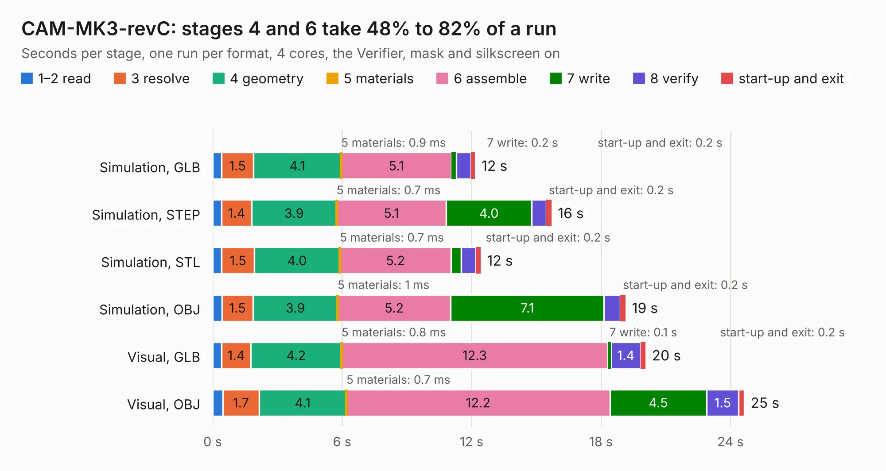

# 1309. CAM-MK3-revC

Board 1,309 of the 3,101 of [Corpus Testing](../Corpus-Testing.md), on [Corpus Page 13](../CorpusTestingPages/Corpus-Testing-13.md#1309-cam-mk3-revc).

| Mode and format | 1–2 read | 3 resolve | 4 geometry | 5 materials | 6 assemble | 7 write | 8 verify | start-up and exit | Total |
|---|---:|---:|---:|---:|---:|---:|---:|---:|---:|
| Simulation, GLB | 0.4 | 1.5 | 4.1 | 0.9&nbsp;ms | 5.1 | 0.2 | 0.7 | 0.2 | 12.2 |
| Simulation, STEP | 0.4 | 1.4 | 3.9 | 0.7&nbsp;ms | 5.1 | 4.0 | 0.7 | 0.2 | 15.7 |
| Simulation, STL | 0.4 | 1.5 | 4.0 | 0.7&nbsp;ms | 5.2 | 0.5 | 0.7 | 0.2 | 12.4 |
| Simulation, OBJ | 0.4 | 1.5 | 3.9 | 1&nbsp;ms | 5.2 | 7.1 | 0.8 | 0.2 | 19.1 |
| Visual, GLB | 0.4 | 1.4 | 4.2 | 0.8&nbsp;ms | 12.3 | 0.1 | 1.4 | 0.2 | 20.1 |
| Visual, OBJ | 0.5 | 1.7 | 4.1 | 0.7&nbsp;ms | 12.2 | 4.5 | 1.5 | 0.3 | 24.6 |

<table align="center"><tr><td valign="top">

| Board | Repo: [issuiuc/iss-pcb](https://github.com/issuiuc/iss-pcb) Board: `CAM-MK3-revC.kicad_pcb` |
|---|---|
| Folder | boards / CAM-MK3 / CAM-MK3-revC |
| Complexity | 382&nbsp;/&nbsp;1000 (size&nbsp;242, features&nbsp;140) |
| KESE&nbsp;features | through vias, slotted holes, custom pads, rounded, trapezoid or chamfered pads, filled zones, copper drawings, curved board outline, TrueType text, stack-up, dielectric εr and tanδ, mask and silkscreen colours |
| Tested | 9th November 2026 |
| Copper&nbsp;layers | 4 |
| File&nbsp;format | KiCad 9 (20241229) |
| Parts,&nbsp;tracks,&nbsp;vias | 110, 744, 198 |
| Triangles,&nbsp;simulation | 1,709,380 in 203 parts |
| Verifier | PASS in all six runs |

</td><td valign="top">

<table>
<tr><th>File type</th><th>File size</th><th>Peak memory used</th></tr>
<tr><th colspan="3" align="left">Simulation</th></tr>
<tr><td>GLB</td><td align="right">57&nbsp;MB</td><td align="right">723&nbsp;MB</td></tr>
<tr><td>STEP</td><td align="right">232&nbsp;MB</td><td align="right">757&nbsp;MB</td></tr>
<tr><td>STL</td><td align="right">85&nbsp;MB</td><td align="right">726&nbsp;MB</td></tr>
<tr><td>OBJ</td><td align="right">179&nbsp;MB</td><td align="right">1.2&nbsp;GB</td></tr>
<tr><th colspan="3" align="left">Visual</th></tr>
<tr><td>GLB</td><td align="right">36&nbsp;MB</td><td align="right">791&nbsp;MB</td></tr>
<tr><td>OBJ</td><td align="right">113&nbsp;MB</td><td align="right">846&nbsp;MB</td></tr>
</table>

</td></tr></table>

| Previous | Next |
|:---|---:|
| [1308. CAM-MK3-revB](b1308b_iss-pcb_CAM-MK3-revB.md) | [1310. drone_power_2_screws](b1310b_iss-pcb_drone-power-2-screws.md) |
