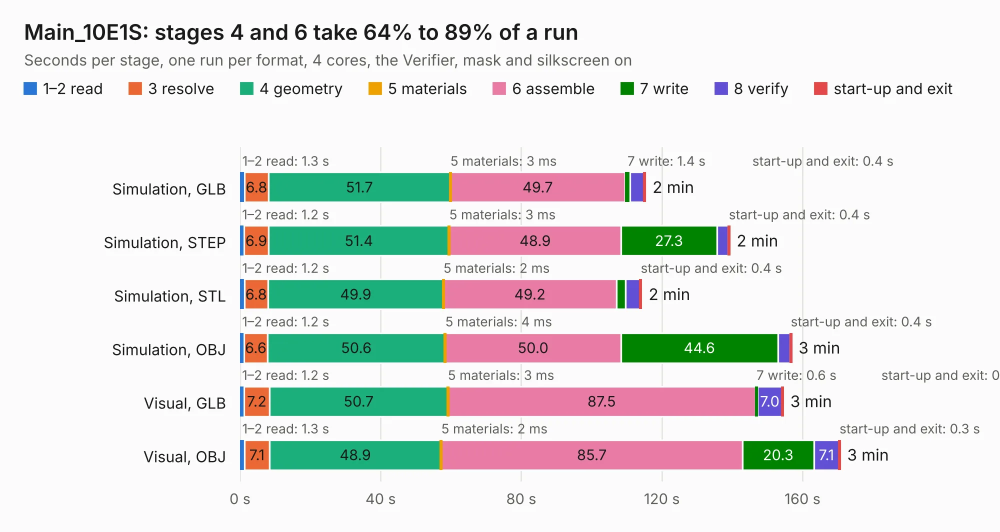

# 1309. Main_10E1S

Board 1,309 of the 3,129 of [Corpus Testing](../Corpus-Testing.md), on [Corpus Page 13](../CorpusTestingPages/Corpus-Testing-13.md#1309-main_10e1s).

| Mode and format | 1–2 read | 3 resolve | 4 geometry | 5 materials | 6 assemble | 7 write | 8 verify | start-up and exit | Total |
|---|---:|---:|---:|---:|---:|---:|---:|---:|---:|
| Simulation, GLB | 1.3 | 6.8 | 51.7 | 3&nbsp;ms | 49.7 | 1.4 | 4.1 | 0.4 | 115.3 |
| Simulation, STEP | 1.2 | 6.9 | 51.4 | 3&nbsp;ms | 48.9 | 27.3 | 3.2 | 0.4 | 139.2 |
| Simulation, STL | 1.2 | 6.8 | 49.9 | 2&nbsp;ms | 49.2 | 2.6 | 4.2 | 0.4 | 114.2 |
| Simulation, OBJ | 1.2 | 6.6 | 50.6 | 4&nbsp;ms | 50.0 | 44.6 | 3.5 | 0.4 | 156.8 |
| Visual, GLB | 1.2 | 7.2 | 50.7 | 3&nbsp;ms | 87.5 | 0.6 | 7.0 | 0.3 | 154.5 |
| Visual, OBJ | 1.3 | 7.1 | 48.9 | 2&nbsp;ms | 85.7 | 20.3 | 7.1 | 0.3 | 170.7 |

<table align="center"><tr><td valign="top">

| Board | Repo: [isarmg/pcie-switch-2](https://github.com/isarmg/pcie-switch-2) Board: `Main_10E1S.kicad_pcb` |
|---|---|
| Folder | outputs / PCIe_3board_RevL / Main_10E1S |
| Complexity | 382&nbsp;/&nbsp;1000 (size&nbsp;312, features&nbsp;70) |
| KESE&nbsp;features | blind and buried vias, rounded, trapezoid or chamfered pads, filled zones |
| Tested | 9th November 2026 |
| Copper&nbsp;layers | 32 |
| File&nbsp;format | KiCad 10 (20260206) |
| Parts,&nbsp;tracks,&nbsp;vias | 338, 432, 78 |
| Triangles,&nbsp;simulation | 6,983,624 in 1582 parts |
| Verifier | PASS in all six runs |

</td><td valign="top">

<table>
<tr><th>File type</th><th>File size</th><th>Peak memory used</th></tr>
<tr><th colspan="3" align="left">Simulation</th></tr>
<tr><td>GLB</td><td align="right">243&nbsp;MB</td><td align="right">2.9&nbsp;GB</td></tr>
<tr><td>STEP</td><td align="right">1.3&nbsp;GB</td><td align="right">3.4&nbsp;GB</td></tr>
<tr><td>STL</td><td align="right">349&nbsp;MB</td><td align="right">2.9&nbsp;GB</td></tr>
<tr><td>OBJ</td><td align="right">769&nbsp;MB</td><td align="right">4.8&nbsp;GB</td></tr>
<tr><th colspan="3" align="left">Visual</th></tr>
<tr><td>GLB</td><td align="right">129&nbsp;MB</td><td align="right">2.5&nbsp;GB</td></tr>
<tr><td>OBJ</td><td align="right">412&nbsp;MB</td><td align="right">2.7&nbsp;GB</td></tr>
</table>

</td></tr></table>

| Previous | Next |
|:---|---:|
| [1308. Assembly_View](b1308b_pcie-switch-2_outputs-PCIe-3board-RevL-Assembly-View_Assembly-View.md) | [1310. Assembly_View](b1310b_pcie-switch-2_outputs-PCIe-AllM2-RevN-Assembly-View_Assembly-View.md) |
