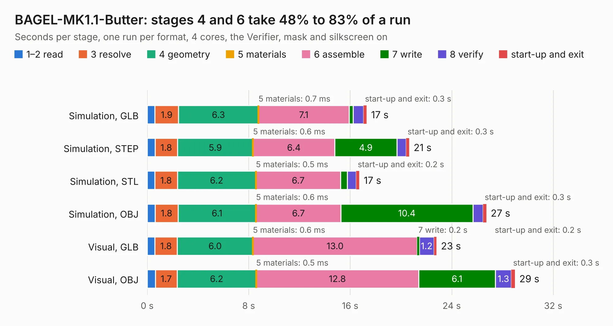

# 1311. BAGEL-MK1.1-Butter

Board 1,311 of the 3,109 of [Corpus Testing](../Corpus-Testing.md), on [Corpus Page 13](../CorpusTestingPages/Corpus-Testing-13.md#1311-bagel-mk11-butter).

| Mode and format | 1–2 read | 3 resolve | 4 geometry | 5 materials | 6 assemble | 7 write | 8 verify | start-up and exit | Total |
|---|---:|---:|---:|---:|---:|---:|---:|---:|---:|
| Simulation, GLB | 0.6 | 1.9 | 6.3 | 0.7&nbsp;ms | 7.1 | 0.3 | 0.8 | 0.3 | 17.3 |
| Simulation, STEP | 0.6 | 1.8 | 5.9 | 0.6&nbsp;ms | 6.4 | 4.9 | 0.7 | 0.3 | 20.7 |
| Simulation, STL | 0.6 | 1.8 | 6.2 | 0.5&nbsp;ms | 6.7 | 0.5 | 0.7 | 0.2 | 16.7 |
| Simulation, OBJ | 0.6 | 1.8 | 6.1 | 0.6&nbsp;ms | 6.7 | 10.4 | 0.8 | 0.3 | 26.7 |
| Visual, GLB | 0.6 | 1.8 | 6.0 | 0.6&nbsp;ms | 13.0 | 0.2 | 1.2 | 0.2 | 22.8 |
| Visual, OBJ | 0.6 | 1.7 | 6.2 | 0.5&nbsp;ms | 12.8 | 6.1 | 1.3 | 0.3 | 29.0 |

<table align="center"><tr><td valign="top">

| Board | Repo: [issuiuc/iss-pcb](https://github.com/issuiuc/iss-pcb) Board: `BAGEL-MK1.1-Butter.kicad_pcb` |
|---|---|
| Folder | boards / BAGEL-MK1 / BAGEL-MK1.1-Butter |
| Complexity | 391&nbsp;/&nbsp;1000 (size&nbsp;261, features&nbsp;130) |
| KESE&nbsp;features | through vias, custom pads, rounded, trapezoid or chamfered pads, arc tracks, filled zones, copper drawings, curved board outline, stack-up, dielectric εr and tanδ, mask and silkscreen colours |
| Tested | 9th November 2026 |
| Copper&nbsp;layers | 4 |
| File&nbsp;format | KiCad 9 (20241229) |
| Parts,&nbsp;tracks,&nbsp;vias | 120, 754, 378 |
| Triangles,&nbsp;simulation | 1,967,478 in 123 parts |
| Verifier | PASS in all six runs |

</td><td valign="top">

<table>
<tr><th>File type</th><th>File size</th><th>Peak memory used</th></tr>
<tr><th colspan="3" align="left">Simulation</th></tr>
<tr><td>GLB</td><td align="right">68&nbsp;MB</td><td align="right">706&nbsp;MB</td></tr>
<tr><td>STEP</td><td align="right">248&nbsp;MB</td><td align="right">837&nbsp;MB</td></tr>
<tr><td>STL</td><td align="right">98&nbsp;MB</td><td align="right">698&nbsp;MB</td></tr>
<tr><td>OBJ</td><td align="right">209&nbsp;MB</td><td align="right">1.3&nbsp;GB</td></tr>
<tr><th colspan="3" align="left">Visual</th></tr>
<tr><td>GLB</td><td align="right">39&nbsp;MB</td><td align="right">855&nbsp;MB</td></tr>
<tr><td>OBJ</td><td align="right">123&nbsp;MB</td><td align="right">923&nbsp;MB</td></tr>
</table>

</td></tr></table>

| Previous | Next |
|:---|---:|
| [1310. BAGEL-MK1.1-Avocado](b1310b_iss-pcb_BAGEL-MK1-1-Avocado.md) | [1312. SG_CAM](b1312b_iss-pcb_SG-CAM.md) |
