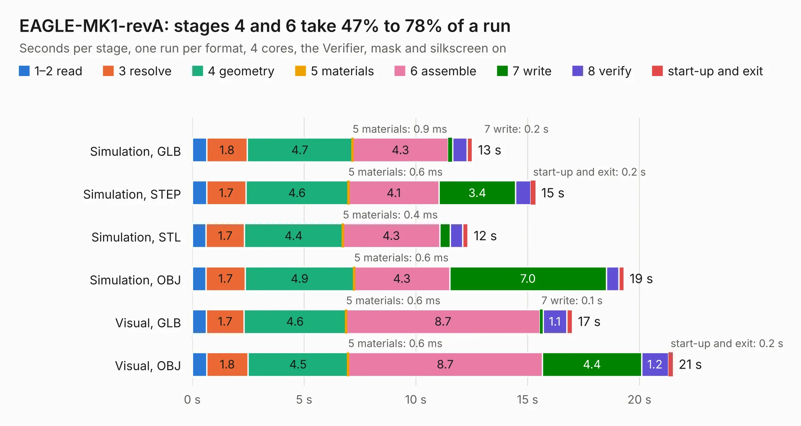

# 1312. EAGLE-MK1-revA

Board 1,312 of the 3,100 of [Corpus Testing](../Corpus-Testing.md), on [Corpus Page 13](../CorpusTestingPages/Corpus-Testing-13.md#1312-eagle-mk1-reva).

| Mode and format | 1–2 read | 3 resolve | 4 geometry | 5 materials | 6 assemble | 7 write | 8 verify | start-up and exit | Total |
|---|---:|---:|---:|---:|---:|---:|---:|---:|---:|
| Simulation, GLB | 0.7 | 1.8 | 4.7 | 0.9&nbsp;ms | 4.3 | 0.2 | 0.6 | 0.2 | 12.5 |
| Simulation, STEP | 0.6 | 1.7 | 4.6 | 0.6&nbsp;ms | 4.1 | 3.4 | 0.7 | 0.2 | 15.4 |
| Simulation, STL | 0.6 | 1.7 | 4.4 | 0.4&nbsp;ms | 4.3 | 0.5 | 0.6 | 0.2 | 12.3 |
| Simulation, OBJ | 0.6 | 1.7 | 4.9 | 0.6&nbsp;ms | 4.3 | 7.0 | 0.6 | 0.2 | 19.3 |
| Visual, GLB | 0.6 | 1.7 | 4.6 | 0.6&nbsp;ms | 8.7 | 0.1 | 1.1 | 0.2 | 17.0 |
| Visual, OBJ | 0.6 | 1.8 | 4.5 | 0.6&nbsp;ms | 8.7 | 4.4 | 1.2 | 0.2 | 21.5 |

<table align="center"><tr><td valign="top">

| Board | Repo: [issuiuc/iss-pcb](https://github.com/issuiuc/iss-pcb) Board: `EAGLE-MK1-revA.kicad_pcb` |
|---|---|
| Folder | boards / EAGLE-MK1 / EAGLE-MK1-revA |
| Complexity | 314&nbsp;/&nbsp;1000 (size&nbsp;194, features&nbsp;120) |
| KESE&nbsp;features | through vias, slotted holes, custom pads, rounded, trapezoid or chamfered pads, filled zones, copper drawings, curved board outline, stack-up, dielectric εr and tanδ |
| Tested | 9th November 2026 |
| Copper&nbsp;layers | 4 |
| File&nbsp;format | KiCad 9 (20241229) |
| Parts,&nbsp;tracks,&nbsp;vias | 68, 352, 259 |
| Triangles,&nbsp;simulation | 1,349,698 in 154 parts |
| Verifier | PASS in all six runs |

</td><td valign="top">

<table>
<tr><th>File type</th><th>File size</th><th>Peak memory used</th></tr>
<tr><th colspan="3" align="left">Simulation</th></tr>
<tr><td>GLB</td><td align="right">46&nbsp;MB</td><td align="right">631&nbsp;MB</td></tr>
<tr><td>STEP</td><td align="right">167&nbsp;MB</td><td align="right">679&nbsp;MB</td></tr>
<tr><td>STL</td><td align="right">67&nbsp;MB</td><td align="right">636&nbsp;MB</td></tr>
<tr><td>OBJ</td><td align="right">139&nbsp;MB</td><td align="right">944&nbsp;MB</td></tr>
<tr><th colspan="3" align="left">Visual</th></tr>
<tr><td>GLB</td><td align="right">29&nbsp;MB</td><td align="right">648&nbsp;MB</td></tr>
<tr><td>OBJ</td><td align="right">88&nbsp;MB</td><td align="right">683&nbsp;MB</td></tr>
</table>

</td></tr></table>

| Previous | Next |
|:---|---:|
| [1311. drone_power_3_screws](b1311b_iss-pcb_drone-power-3-screws.md) | [1313. EAGLE-MK1-revB](b1313b_iss-pcb_EAGLE-MK1-revB.md) |
