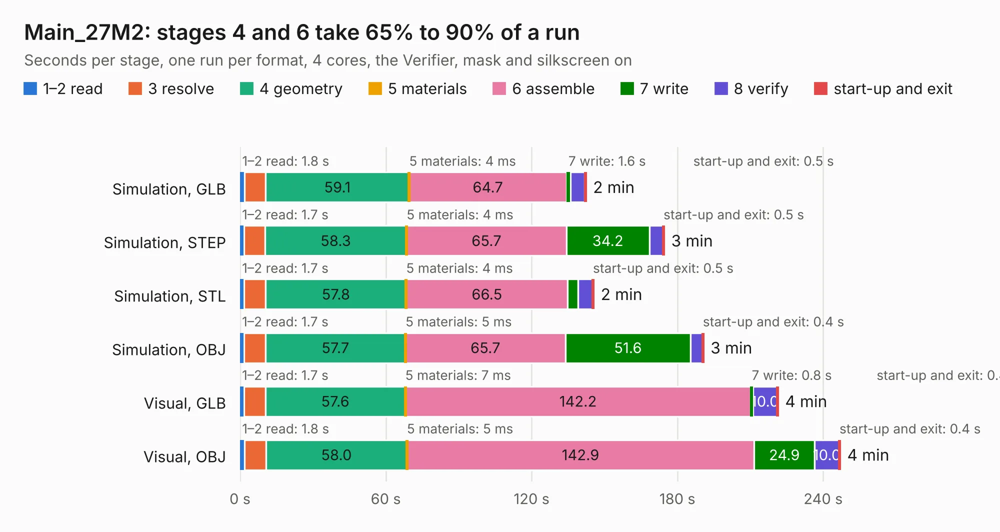

# 1312. Main_27M2

Board 1,312 of the 3,129 of [Corpus Testing](../Corpus-Testing.md), on [Corpus Page 13](../CorpusTestingPages/Corpus-Testing-13.md#1312-main_27m2).

| Mode and format | 1–2 read | 3 resolve | 4 geometry | 5 materials | 6 assemble | 7 write | 8 verify | start-up and exit | Total |
|---|---:|---:|---:|---:|---:|---:|---:|---:|---:|
| Simulation, GLB | 1.8 | 8.7 | 59.1 | 4&nbsp;ms | 64.7 | 1.6 | 5.9 | 0.5 | 142.3 |
| Simulation, STEP | 1.7 | 8.6 | 58.3 | 4&nbsp;ms | 65.7 | 34.2 | 5.6 | 0.5 | 174.5 |
| Simulation, STL | 1.7 | 8.9 | 57.8 | 4&nbsp;ms | 66.5 | 4.3 | 5.9 | 0.5 | 145.5 |
| Simulation, OBJ | 1.7 | 8.7 | 57.7 | 5&nbsp;ms | 65.7 | 51.6 | 4.9 | 0.4 | 190.7 |
| Visual, GLB | 1.7 | 8.7 | 57.6 | 7&nbsp;ms | 142.2 | 0.8 | 10.0 | 0.4 | 221.4 |
| Visual, OBJ | 1.8 | 8.9 | 58.0 | 5&nbsp;ms | 142.9 | 24.9 | 10.0 | 0.4 | 246.9 |

<table align="center"><tr><td valign="top">

| Board | Repo: [isarmg/pcie-switch-2](https://github.com/isarmg/pcie-switch-2) Board: `Main_27M2.kicad_pcb` |
|---|---|
| Folder | outputs / PCIe_AllM2_RevO / Main_27M2 |
| Complexity | 415&nbsp;/&nbsp;1000 (size&nbsp;320, features&nbsp;95) |
| KESE&nbsp;features | blind and buried vias, custom pads, rounded, trapezoid or chamfered pads, filled zones, copper drawings |
| Tested | 9th November 2026 |
| Copper&nbsp;layers | 32 |
| File&nbsp;format | KiCad 10 (20260206) |
| Parts,&nbsp;tracks,&nbsp;vias | 717, 432, 78 |
| Triangles,&nbsp;simulation | 8,236,800 in 2442 parts |
| Verifier | PASS in all six runs |

</td><td valign="top">

<table>
<tr><th>File type</th><th>File size</th><th>Peak memory used</th></tr>
<tr><th colspan="3" align="left">Simulation</th></tr>
<tr><td>GLB</td><td align="right">287&nbsp;MB</td><td align="right">3.1&nbsp;GB</td></tr>
<tr><td>STEP</td><td align="right">1.6&nbsp;GB</td><td align="right">3.8&nbsp;GB</td></tr>
<tr><td>STL</td><td align="right">412&nbsp;MB</td><td align="right">3.2&nbsp;GB</td></tr>
<tr><td>OBJ</td><td align="right">912&nbsp;MB</td><td align="right">5.5&nbsp;GB</td></tr>
<tr><th colspan="3" align="left">Visual</th></tr>
<tr><td>GLB</td><td align="right">166&nbsp;MB</td><td align="right">2.8&nbsp;GB</td></tr>
<tr><td>OBJ</td><td align="right">529&nbsp;MB</td><td align="right">3.4&nbsp;GB</td></tr>
</table>

</td></tr></table>

| Previous | Next |
|:---|---:|
| [1311. Main_23M2](b1311b_pcie-switch-2_Main-23M2.md) | [1313. Assembly_View](b1313b_pcie-switch-2_outputs-PCIe-AllM2-RevP-Assembly-View_Assembly-View.md) |
