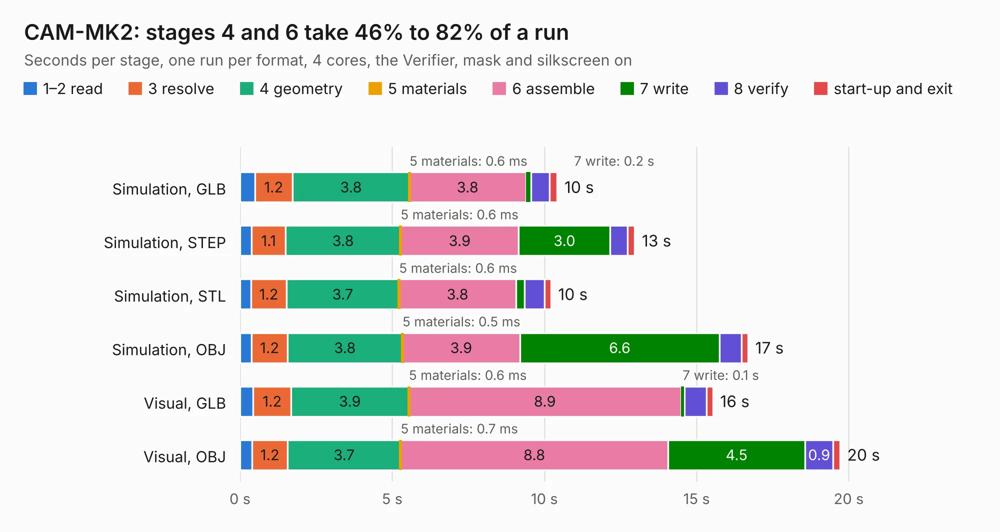

# 1313. CAM-MK2

Board 1,313 of the 3,109 of [Corpus Testing](../Corpus-Testing.md), on [Corpus Page 13](../CorpusTestingPages/Corpus-Testing-13.md#1313-cam-mk2).

| Mode and format | 1–2 read | 3 resolve | 4 geometry | 5 materials | 6 assemble | 7 write | 8 verify | start-up and exit | Total |
|---|---:|---:|---:|---:|---:|---:|---:|---:|---:|
| Simulation, GLB | 0.5 | 1.2 | 3.8 | 0.6&nbsp;ms | 3.8 | 0.2 | 0.6 | 0.2 | 10.4 |
| Simulation, STEP | 0.4 | 1.1 | 3.8 | 0.6&nbsp;ms | 3.9 | 3.0 | 0.6 | 0.2 | 13.0 |
| Simulation, STL | 0.4 | 1.2 | 3.7 | 0.6&nbsp;ms | 3.8 | 0.3 | 0.7 | 0.2 | 10.2 |
| Simulation, OBJ | 0.4 | 1.2 | 3.8 | 0.5&nbsp;ms | 3.9 | 6.6 | 0.7 | 0.2 | 16.7 |
| Visual, GLB | 0.4 | 1.2 | 3.9 | 0.6&nbsp;ms | 8.9 | 0.1 | 0.7 | 0.2 | 15.5 |
| Visual, OBJ | 0.4 | 1.2 | 3.7 | 0.7&nbsp;ms | 8.8 | 4.5 | 0.9 | 0.2 | 19.7 |

<table align="center"><tr><td valign="top">

| Board | Repo: [issuiuc/iss-pcb](https://github.com/issuiuc/iss-pcb) Board: `CAM-MK2.kicad_pcb` |
|---|---|
| Folder | boards / CAM-MK2 / CAM-MK2-revA |
| Complexity | 334&nbsp;/&nbsp;1000 (size&nbsp;194, features&nbsp;140) |
| KESE&nbsp;features | through vias, slotted holes, custom pads, rounded, trapezoid or chamfered pads, filled zones, copper drawings, curved board outline, TrueType text, stack-up, dielectric εr and tanδ, mask and silkscreen colours |
| Tested | 9th November 2026 |
| Copper&nbsp;layers | 4 |
| File&nbsp;format | KiCad 8 (20240108) |
| Parts,&nbsp;tracks,&nbsp;vias | 99, 500, 123 |
| Triangles,&nbsp;simulation | 1,231,990 in 146 parts |
| Verifier | PASS in all six runs |

</td><td valign="top">

<table>
<tr><th>File type</th><th>File size</th><th>Peak memory used</th></tr>
<tr><th colspan="3" align="left">Simulation</th></tr>
<tr><td>GLB</td><td align="right">42&nbsp;MB</td><td align="right">492&nbsp;MB</td></tr>
<tr><td>STEP</td><td align="right">163&nbsp;MB</td><td align="right">583&nbsp;MB</td></tr>
<tr><td>STL</td><td align="right">62&nbsp;MB</td><td align="right">487&nbsp;MB</td></tr>
<tr><td>OBJ</td><td align="right">125&nbsp;MB</td><td align="right">875&nbsp;MB</td></tr>
<tr><th colspan="3" align="left">Visual</th></tr>
<tr><td>GLB</td><td align="right">26&nbsp;MB</td><td align="right">625&nbsp;MB</td></tr>
<tr><td>OBJ</td><td align="right">79&nbsp;MB</td><td align="right">656&nbsp;MB</td></tr>
</table>

</td></tr></table>

| Previous | Next |
|:---|---:|
| [1312. SG_CAM](b1312b_iss-pcb_SG-CAM.md) | [1314. CAM-MK2.1](b1314b_iss-pcb_CAM-MK2-1.md) |
