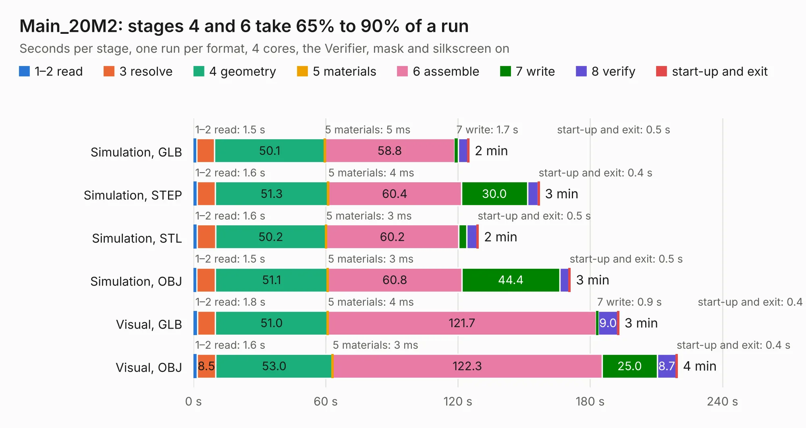

# 1314. Main_20M2

Board 1,314 of the 3,124 of [Corpus Testing](../Corpus-Testing.md), on [Corpus Page 13](../CorpusTestingPages/Corpus-Testing-13.md#1314-main_20m2).

| Mode and format | 1–2 read | 3 resolve | 4 geometry | 5 materials | 6 assemble | 7 write | 8 verify | start-up and exit | Total |
|---|---:|---:|---:|---:|---:|---:|---:|---:|---:|
| Simulation, GLB | 1.5 | 7.9 | 50.1 | 5&nbsp;ms | 58.8 | 1.7 | 4.4 | 0.5 | 125.0 |
| Simulation, STEP | 1.6 | 8.2 | 51.3 | 4&nbsp;ms | 60.4 | 30.0 | 4.9 | 0.4 | 156.8 |
| Simulation, STL | 1.6 | 8.3 | 50.2 | 3&nbsp;ms | 60.2 | 3.7 | 4.7 | 0.5 | 129.2 |
| Simulation, OBJ | 1.5 | 8.3 | 51.1 | 3&nbsp;ms | 60.8 | 44.4 | 4.3 | 0.5 | 170.9 |
| Visual, GLB | 1.8 | 8.2 | 51.0 | 4&nbsp;ms | 121.7 | 0.9 | 9.0 | 0.4 | 192.9 |
| Visual, OBJ | 1.6 | 8.5 | 53.0 | 3&nbsp;ms | 122.3 | 25.0 | 8.7 | 0.4 | 219.4 |

<table align="center"><tr><td valign="top">

| Board | Repo: [isarmg/pcie-switch-2](https://github.com/isarmg/pcie-switch-2) Board: `Main_20M2.kicad_pcb` |
|---|---|
| Folder | outputs / PCIe_AllM2_RevP / Main_20M2 |
| Complexity | 455&nbsp;/&nbsp;1000 (size&nbsp;320, features&nbsp;135) |
| KESE&nbsp;features | blind and buried vias, microvias, custom pads, rounded, trapezoid or chamfered pads, filled zones, copper drawings |
| Tested | 9th November 2026 |
| Copper&nbsp;layers | 32 |
| File&nbsp;format | KiCad 10 (20260206) |
| Parts,&nbsp;tracks,&nbsp;vias | 634, 452, 94 |
| Triangles,&nbsp;simulation | 7,968,712 in 2129 parts |
| Verifier | PASS in all six runs |

</td><td valign="top">

<table>
<tr><th>File type</th><th>File size</th><th>Peak memory used</th></tr>
<tr><th colspan="3" align="left">Simulation</th></tr>
<tr><td>GLB</td><td align="right">277&nbsp;MB</td><td align="right">3.1&nbsp;GB</td></tr>
<tr><td>STEP</td><td align="right">1.5&nbsp;GB</td><td align="right">3.9&nbsp;GB</td></tr>
<tr><td>STL</td><td align="right">399&nbsp;MB</td><td align="right">3.1&nbsp;GB</td></tr>
<tr><td>OBJ</td><td align="right">881&nbsp;MB</td><td align="right">5.3&nbsp;GB</td></tr>
<tr><th colspan="3" align="left">Visual</th></tr>
<tr><td>GLB</td><td align="right">157&nbsp;MB</td><td align="right">2.9&nbsp;GB</td></tr>
<tr><td>OBJ</td><td align="right">500&nbsp;MB</td><td align="right">3.3&nbsp;GB</td></tr>
</table>

</td></tr></table>

| Previous | Next |
|:---|---:|
| [1313. Assembly_View](b1313b_pcie-switch-2_outputs-PCIe-AllM2-RevP-Assembly-View_Assembly-View.md) | [1315. Main_10E1S](b1315b_pcie-switch-2_outputs-PCIe-E1S-82x45-FakePEX90064-RevS-Main-10E1S_Main-10E1S.md) |
