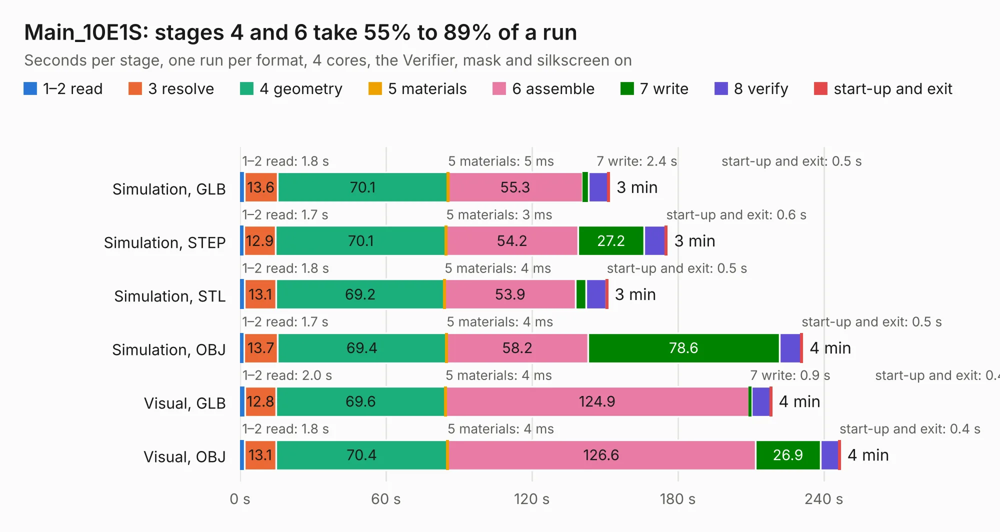

# 1315. Main_10E1S

Board 1,315 of the 3,126 of [Corpus Testing](../Corpus-Testing.md), on [Corpus Page 13](../CorpusTestingPages/Corpus-Testing-13.md#1315-main_10e1s).

| Mode and format | 1–2 read | 3 resolve | 4 geometry | 5 materials | 6 assemble | 7 write | 8 verify | start-up and exit | Total |
|---|---:|---:|---:|---:|---:|---:|---:|---:|---:|
| Simulation, GLB | 1.8 | 13.6 | 70.1 | 5&nbsp;ms | 55.3 | 2.4 | 8.1 | 0.5 | 151.8 |
| Simulation, STEP | 1.7 | 12.9 | 70.1 | 3&nbsp;ms | 54.2 | 27.2 | 8.8 | 0.6 | 175.5 |
| Simulation, STL | 1.8 | 13.1 | 69.2 | 4&nbsp;ms | 53.9 | 4.3 | 8.2 | 0.5 | 151.1 |
| Simulation, OBJ | 1.7 | 13.7 | 69.4 | 4&nbsp;ms | 58.2 | 78.6 | 8.9 | 0.5 | 231.1 |
| Visual, GLB | 2.0 | 12.8 | 69.6 | 4&nbsp;ms | 124.9 | 0.9 | 7.9 | 0.4 | 218.4 |
| Visual, OBJ | 1.8 | 13.1 | 70.4 | 4&nbsp;ms | 126.6 | 26.9 | 7.5 | 0.4 | 246.7 |

<table align="center"><tr><td valign="top">

| Board | Repo: [isarmg/pcie-switch-2](https://github.com/isarmg/pcie-switch-2) Board: `Main_10E1S.kicad_pcb` |
|---|---|
| Folder | outputs / PCIe_E1S_82x45_FakePEX90064_RevS / Main_10E1S |
| Complexity | 410&nbsp;/&nbsp;1000 (size&nbsp;340, features&nbsp;70) |
| KESE&nbsp;features | blind and buried vias, rounded, trapezoid or chamfered pads, filled zones |
| Tested | 9th November 2026 |
| Copper&nbsp;layers | 32 |
| File&nbsp;format | KiCad 10 (20260206) |
| Parts,&nbsp;tracks,&nbsp;vias | 344, 2,245, 488 |
| Triangles,&nbsp;simulation | 11,626,382 in 1479 parts |
| Verifier | PASS in all six runs |

</td><td valign="top">

<table>
<tr><th>File type</th><th>File size</th><th>Peak memory used</th></tr>
<tr><th colspan="3" align="left">Simulation</th></tr>
<tr><td>GLB</td><td align="right">396&nbsp;MB</td><td align="right">3.0&nbsp;GB</td></tr>
<tr><td>STEP</td><td align="right">1.3&nbsp;GB</td><td align="right">3.7&nbsp;GB</td></tr>
<tr><td>STL</td><td align="right">581&nbsp;MB</td><td align="right">2.8&nbsp;GB</td></tr>
<tr><td>OBJ</td><td align="right">1.3&nbsp;GB</td><td align="right">7.3&nbsp;GB</td></tr>
<tr><th colspan="3" align="left">Visual</th></tr>
<tr><td>GLB</td><td align="right">138&nbsp;MB</td><td align="right">2.8&nbsp;GB</td></tr>
<tr><td>OBJ</td><td align="right">476&nbsp;MB</td><td align="right">3.3&nbsp;GB</td></tr>
</table>

</td></tr></table>

| Previous | Next |
|:---|---:|
| [1314. Main_20M2](b1314b_pcie-switch-2_Main-20M2.md) | [1316. Main_10E1S](b1316b_pcie-switch-2_outputs-PCIe-E1S-82x45-RevR-Main-10E1S_Main-10E1S.md) |
