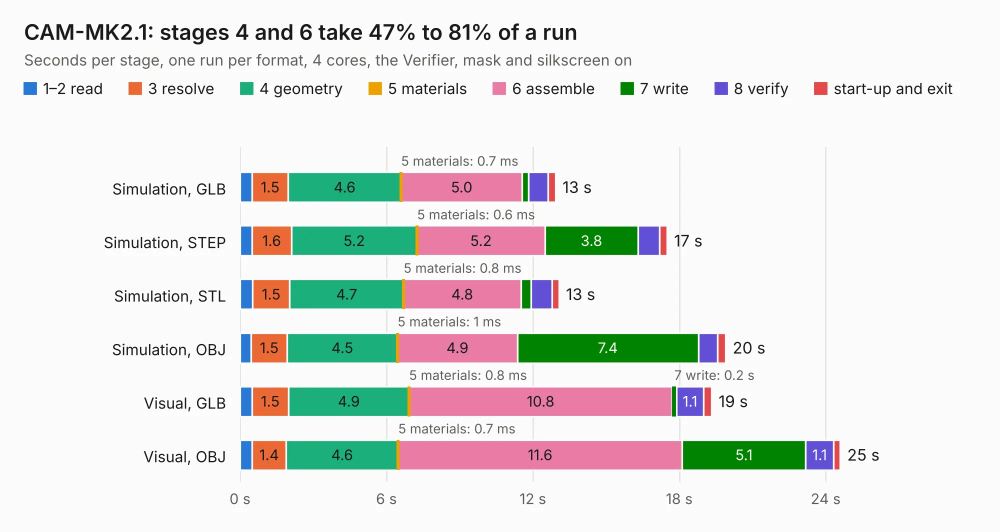

# 1316. CAM-MK2.1

Board 1,316 of the 3,111 of [Corpus Testing](../Corpus-Testing.md), on [Corpus Page 13](../CorpusTestingPages/Corpus-Testing-13.md#1316-cam-mk21).

| Mode and format | 1–2 read | 3 resolve | 4 geometry | 5 materials | 6 assemble | 7 write | 8 verify | start-up and exit | Total |
|---|---:|---:|---:|---:|---:|---:|---:|---:|---:|
| Simulation, GLB | 0.5 | 1.5 | 4.6 | 0.7&nbsp;ms | 5.0 | 0.3 | 0.8 | 0.3 | 12.9 |
| Simulation, STEP | 0.5 | 1.6 | 5.2 | 0.6&nbsp;ms | 5.2 | 3.8 | 0.9 | 0.3 | 17.5 |
| Simulation, STL | 0.5 | 1.5 | 4.7 | 0.8&nbsp;ms | 4.8 | 0.4 | 0.8 | 0.3 | 13.1 |
| Simulation, OBJ | 0.5 | 1.5 | 4.5 | 1&nbsp;ms | 4.9 | 7.4 | 0.8 | 0.3 | 19.9 |
| Visual, GLB | 0.5 | 1.5 | 4.9 | 0.8&nbsp;ms | 10.8 | 0.2 | 1.1 | 0.3 | 19.3 |
| Visual, OBJ | 0.5 | 1.4 | 4.6 | 0.7&nbsp;ms | 11.6 | 5.1 | 1.1 | 0.3 | 24.6 |

<table align="center"><tr><td valign="top">

| Board | Repo: [issuiuc/iss-pcb](https://github.com/issuiuc/iss-pcb) Board: `CAM-MK2.1.kicad_pcb` |
|---|---|
| Folder | boards / CAM-MK2 / CAM-MK2.1-revA |
| Complexity | 337&nbsp;/&nbsp;1000 (size&nbsp;197, features&nbsp;140) |
| KESE&nbsp;features | through vias, slotted holes, custom pads, rounded, trapezoid or chamfered pads, filled zones, copper drawings, curved board outline, TrueType text, stack-up, dielectric εr and tanδ, mask and silkscreen colours |
| Tested | 9th November 2026 |
| Copper&nbsp;layers | 4 |
| File&nbsp;format | KiCad 8 (20240108) |
| Parts,&nbsp;tracks,&nbsp;vias | 110, 521, 142 |
| Triangles,&nbsp;simulation | 1,327,446 in 165 parts |
| Verifier | PASS in all six runs |

</td><td valign="top">

<table>
<tr><th>File type</th><th>File size</th><th>Peak memory used</th></tr>
<tr><th colspan="3" align="left">Simulation</th></tr>
<tr><td>GLB</td><td align="right">45&nbsp;MB</td><td align="right">530&nbsp;MB</td></tr>
<tr><td>STEP</td><td align="right">176&nbsp;MB</td><td align="right">621&nbsp;MB</td></tr>
<tr><td>STL</td><td align="right">66&nbsp;MB</td><td align="right">537&nbsp;MB</td></tr>
<tr><td>OBJ</td><td align="right">135&nbsp;MB</td><td align="right">912&nbsp;MB</td></tr>
<tr><th colspan="3" align="left">Visual</th></tr>
<tr><td>GLB</td><td align="right">28&nbsp;MB</td><td align="right">664&nbsp;MB</td></tr>
<tr><td>OBJ</td><td align="right">86&nbsp;MB</td><td align="right">693&nbsp;MB</td></tr>
</table>

</td></tr></table>

| Previous | Next |
|:---|---:|
| [1315. CAM-MK2](b1315b_iss-pcb_CAM-MK2.md) | [1317. CAM-MK3-revA](b1317b_iss-pcb_CAM-MK3-revA.md) |
