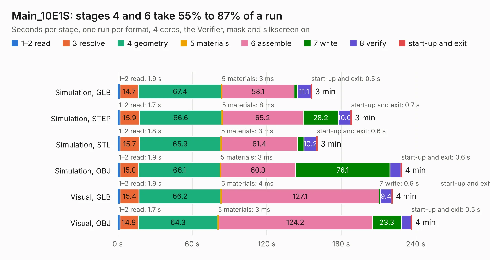

# 1317. Main_10E1S

Board 1,317 of the 3,126 of [Corpus Testing](../Corpus-Testing.md), on [Corpus Page 13](../CorpusTestingPages/Corpus-Testing-13.md#1317-main_10e1s).

| Mode and format | 1–2 read | 3 resolve | 4 geometry | 5 materials | 6 assemble | 7 write | 8 verify | start-up and exit | Total |
|---|---:|---:|---:|---:|---:|---:|---:|---:|---:|
| Simulation, GLB | 1.9 | 14.7 | 67.4 | 3&nbsp;ms | 58.1 | 2.6 | 11.1 | 0.5 | 156.3 |
| Simulation, STEP | 1.7 | 15.9 | 66.6 | 8&nbsp;ms | 65.2 | 28.2 | 10.0 | 0.7 | 188.3 |
| Simulation, STL | 1.8 | 15.7 | 65.9 | 3&nbsp;ms | 61.4 | 5.2 | 10.2 | 0.6 | 160.8 |
| Simulation, OBJ | 1.9 | 15.0 | 66.1 | 3&nbsp;ms | 60.3 | 76.1 | 8.9 | 0.6 | 228.7 |
| Visual, GLB | 1.9 | 15.4 | 66.2 | 4&nbsp;ms | 127.1 | 0.9 | 9.4 | 0.4 | 221.2 |
| Visual, OBJ | 1.7 | 14.9 | 64.3 | 3&nbsp;ms | 124.2 | 23.3 | 7.8 | 0.5 | 236.7 |

<table align="center"><tr><td valign="top">

| Board | Repo: [isarmg/pcie-switch-2](https://github.com/isarmg/pcie-switch-2) Board: `Main_10E1S.kicad_pcb` |
|---|---|
| Folder | outputs / PCIe_E1S_82x45_TB3Host_RevT / Main_10E1S |
| Complexity | 435&nbsp;/&nbsp;1000 (size&nbsp;365, features&nbsp;70) |
| KESE&nbsp;features | blind and buried vias, rounded, trapezoid or chamfered pads, filled zones |
| Tested | 9th November 2026 |
| Copper&nbsp;layers | 32 |
| File&nbsp;format | KiCad 10 (20260206) |
| Parts,&nbsp;tracks,&nbsp;vias | 479, 6,525, 802 |
| Triangles,&nbsp;simulation | 15,370,960 in 1670 parts |
| Verifier | PASS in all six runs |

</td><td valign="top">

<table>
<tr><th>File type</th><th>File size</th><th>Peak memory used</th></tr>
<tr><th colspan="3" align="left">Simulation</th></tr>
<tr><td>GLB</td><td align="right">522&nbsp;MB</td><td align="right">3.6&nbsp;GB</td></tr>
<tr><td>STEP</td><td align="right">1.6&nbsp;GB</td><td align="right">4.7&nbsp;GB</td></tr>
<tr><td>STL</td><td align="right">769&nbsp;MB</td><td align="right">3.7&nbsp;GB</td></tr>
<tr><td>OBJ</td><td align="right">1.7&nbsp;GB</td><td align="right">9.7&nbsp;GB</td></tr>
<tr><th colspan="3" align="left">Visual</th></tr>
<tr><td>GLB</td><td align="right">167&nbsp;MB</td><td align="right">3.2&nbsp;GB</td></tr>
<tr><td>OBJ</td><td align="right">591&nbsp;MB</td><td align="right">4.0&nbsp;GB</td></tr>
</table>

</td></tr></table>

| Previous | Next |
|:---|---:|
| [1316. Main_10E1S](b1316b_pcie-switch-2_outputs-PCIe-E1S-82x45-RevR-Main-10E1S_Main-10E1S.md) | [1318. Main_12E1S](b1318b_pcie-switch-2_outputs-PCIe-E1S-96x45-USB12mm-RevW-Main-12E1S_Main-12E1S.md) |
