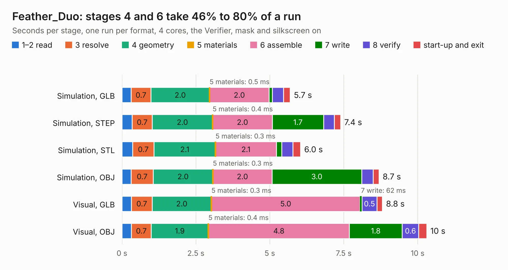

# 1319. Feather_Duo

Board 1,319 of the 3,105 of [Corpus Testing](../Corpus-Testing.md), on [Corpus Page 13](../CorpusTestingPages/Corpus-Testing-13.md#1319-feather_duo).

| Mode and format | 1–2 read | 3 resolve | 4 geometry | 5 materials | 6 assemble | 7 write | 8 verify | start-up and exit | Total |
|---|---:|---:|---:|---:|---:|---:|---:|---:|---:|
| Simulation, GLB | 0.3 | 0.7 | 2.0 | 0.5&nbsp;ms | 2.0 | 0.1 | 0.4 | 0.2 | 5.7 |
| Simulation, STEP | 0.3 | 0.7 | 2.0 | 0.4&nbsp;ms | 2.0 | 1.7 | 0.4 | 0.2 | 7.4 |
| Simulation, STL | 0.4 | 0.7 | 2.1 | 0.3&nbsp;ms | 2.1 | 0.2 | 0.4 | 0.3 | 6.0 |
| Simulation, OBJ | 0.3 | 0.7 | 2.0 | 0.3&nbsp;ms | 2.0 | 3.0 | 0.4 | 0.2 | 8.7 |
| Visual, GLB | 0.3 | 0.7 | 2.0 | 0.3&nbsp;ms | 5.0 | 62&nbsp;ms | 0.5 | 0.2 | 8.8 |
| Visual, OBJ | 0.3 | 0.7 | 1.9 | 0.4&nbsp;ms | 4.8 | 1.8 | 0.6 | 0.3 | 10.3 |

<table align="center"><tr><td valign="top">

| Board | Repo: [issuiuc/iss-pcb](https://github.com/issuiuc/iss-pcb) Board: `Feather_Duo.kicad_pcb` |
|---|---|
| Folder | boards / Feather_Duo |
| Complexity | 285&nbsp;/&nbsp;1000 (size&nbsp;175, features&nbsp;110) |
| KESE&nbsp;features | through vias, slotted holes, rounded, trapezoid or chamfered pads, filled zones, curved board outline, TrueType text, stack-up, dielectric εr and tanδ |
| Tested | 9th November 2026 |
| Copper&nbsp;layers | 4 |
| File&nbsp;format | KiCad 8 (20240108) |
| Parts,&nbsp;tracks,&nbsp;vias | 42, 255, 75 |
| Triangles,&nbsp;simulation | 748,228 in 106 parts |
| Verifier | PASS in all six runs |

</td><td valign="top">

<table>
<tr><th>File type</th><th>File size</th><th>Peak memory used</th></tr>
<tr><th colspan="3" align="left">Simulation</th></tr>
<tr><td>GLB</td><td align="right">25&nbsp;MB</td><td align="right">363&nbsp;MB</td></tr>
<tr><td>STEP</td><td align="right">98&nbsp;MB</td><td align="right">404&nbsp;MB</td></tr>
<tr><td>STL</td><td align="right">37&nbsp;MB</td><td align="right">367&nbsp;MB</td></tr>
<tr><td>OBJ</td><td align="right">76&nbsp;MB</td><td align="right">533&nbsp;MB</td></tr>
<tr><th colspan="3" align="left">Visual</th></tr>
<tr><td>GLB</td><td align="right">16&nbsp;MB</td><td align="right">408&nbsp;MB</td></tr>
<tr><td>OBJ</td><td align="right">47&nbsp;MB</td><td align="right">410&nbsp;MB</td></tr>
</table>

</td></tr></table>

| Previous | Next |
|:---|---:|
| [1318. EAGLE-MK1-revB](b1318b_iss-pcb_EAGLE-MK1-revB.md) | [1320. MIDAS-MK1](b1320b_iss-pcb_boards-MIDAS-MK1-MIDAS-MK1-revA_MIDAS-MK1.md) |
