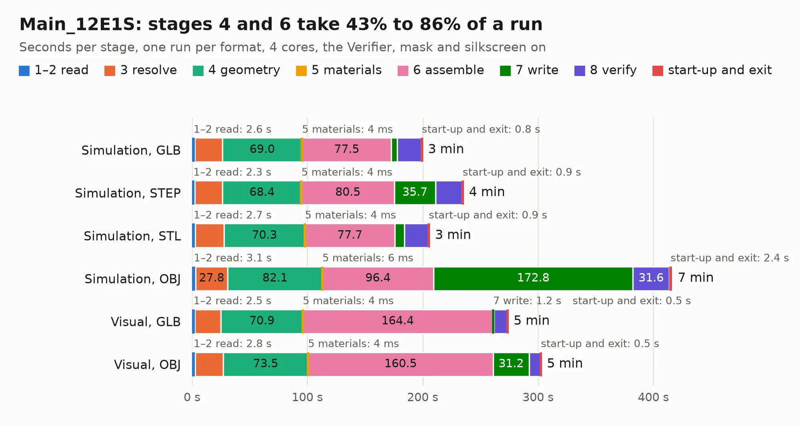

# 1319. Main_12E1S

Board 1,319 of the 3,132 of [Corpus Testing](../Corpus-Testing.md), on [Corpus Page 13](../CorpusTestingPages/Corpus-Testing-13.md#1319-main_12e1s).

| Mode and format | 1–2 read | 3 resolve | 4 geometry | 5 materials | 6 assemble | 7 write | 8 verify | start-up and exit | Total |
|---|---:|---:|---:|---:|---:|---:|---:|---:|---:|
| Simulation, GLB | 2.6 | 23.7 | 69.0 | 4&nbsp;ms | 77.5 | 5.1 | 20.9 | 0.8 | 199.6 |
| Simulation, STEP | 2.3 | 24.1 | 68.4 | 4&nbsp;ms | 80.5 | 35.7 | 23.2 | 0.9 | 235.1 |
| Simulation, STL | 2.7 | 25.0 | 70.3 | 4&nbsp;ms | 77.7 | 8.5 | 20.7 | 0.9 | 205.7 |
| Simulation, OBJ | 3.1 | 27.8 | 82.1 | 6&nbsp;ms | 96.4 | 172.8 | 31.6 | 2.4 | 416.1 |
| Visual, GLB | 2.5 | 22.7 | 70.9 | 4&nbsp;ms | 164.4 | 1.2 | 11.7 | 0.5 | 273.8 |
| Visual, OBJ | 2.8 | 24.2 | 73.5 | 4&nbsp;ms | 160.5 | 31.2 | 10.0 | 0.5 | 302.7 |

<table align="center"><tr><td valign="top">

| Board | Repo: [isarmg/pcie-switch-2](https://github.com/isarmg/pcie-switch-2) Board: `Main_12E1S.kicad_pcb` |
|---|---|
| Folder | outputs / PCIe_E1S_96x45_12slot_RevU / Main_12E1S |
| Complexity | 442&nbsp;/&nbsp;1000 (size&nbsp;372, features&nbsp;70) |
| KESE&nbsp;features | blind and buried vias, rounded, trapezoid or chamfered pads, filled zones |
| Tested | 9th November 2026 to 12th November 2026 |
| Copper&nbsp;layers | 32 |
| File&nbsp;format | KiCad 10 (20260206) |
| Parts,&nbsp;tracks,&nbsp;vias | 513, 10,254, 906 |
| Triangles,&nbsp;simulation | 24,169,032 in 1730 parts |
| Verifier | PASS in all six runs |
| Run&nbsp;again | Simulation, OBJ: failed in the corpus run, run again with no memory cap and no time limit (swap added to a 16 GB machine), and passed |

</td><td valign="top">

<table>
<tr><th>File type</th><th>File size</th><th>Peak memory used</th></tr>
<tr><th colspan="3" align="left">Simulation</th></tr>
<tr><td>GLB</td><td align="right">815&nbsp;MB</td><td align="right">4.9&nbsp;GB</td></tr>
<tr><td>STEP</td><td align="right">2.0&nbsp;GB</td><td align="right">5.4&nbsp;GB</td></tr>
<tr><td>STL</td><td align="right">1.2&nbsp;GB</td><td align="right">5.5&nbsp;GB</td></tr>
<tr><td>OBJ</td><td align="right">2.8&nbsp;GB</td><td align="right">15&nbsp;GB</td></tr>
<tr><th colspan="3" align="left">Visual</th></tr>
<tr><td>GLB</td><td align="right">218&nbsp;MB</td><td align="right">4.4&nbsp;GB</td></tr>
<tr><td>OBJ</td><td align="right">745&nbsp;MB</td><td align="right">5.0&nbsp;GB</td></tr>
</table>

</td></tr></table>

| Previous | Next |
|:---|---:|
| [1318. Main_10E1S](b1318b_pcie-switch-2_outputs-PCIe-E1S-82x45-TB3Host-RevT-Main-10E1S_Main-10E1S.md) | [1320. Main_12E1S](b1320b_pcie-switch-2_outputs-PCIe-E1S-96x45-12VPower-RevV-Main-12E1S_Main-12E1S.md) |
