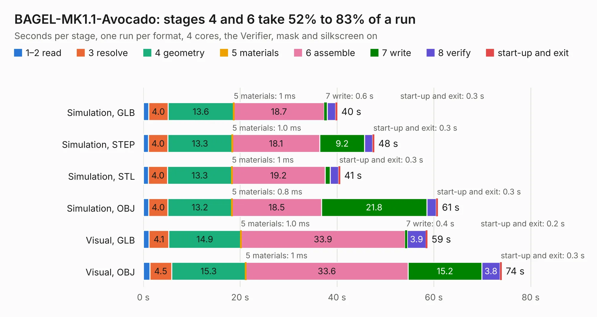

# 1320. BAGEL-MK1.1-Avocado

Board 1,320 of the 3,121 of [Corpus Testing](../Corpus-Testing.md), on [Corpus Page 13](../CorpusTestingPages/Corpus-Testing-13.md#1320-bagel-mk11-avocado).

| Mode and format | 1–2 read | 3 resolve | 4 geometry | 5 materials | 6 assemble | 7 write | 8 verify | start-up and exit | Total |
|---|---:|---:|---:|---:|---:|---:|---:|---:|---:|
| Simulation, GLB | 1.1 | 4.0 | 13.6 | 1&nbsp;ms | 18.7 | 0.6 | 1.7 | 0.3 | 40.0 |
| Simulation, STEP | 1.1 | 4.0 | 13.3 | 1.0&nbsp;ms | 18.1 | 9.2 | 1.7 | 0.3 | 47.6 |
| Simulation, STL | 1.0 | 4.0 | 13.3 | 1&nbsp;ms | 19.2 | 1.1 | 1.7 | 0.3 | 40.6 |
| Simulation, OBJ | 1.1 | 4.0 | 13.2 | 0.8&nbsp;ms | 18.5 | 21.8 | 1.9 | 0.3 | 60.8 |
| Visual, GLB | 1.2 | 4.1 | 14.9 | 1.0&nbsp;ms | 33.9 | 0.4 | 3.9 | 0.2 | 58.6 |
| Visual, OBJ | 1.3 | 4.5 | 15.3 | 1&nbsp;ms | 33.6 | 15.2 | 3.8 | 0.3 | 74.0 |

<table align="center"><tr><td valign="top">

| Board | Repo: [issuiuc/iss-pcb](https://github.com/issuiuc/iss-pcb) Board: `BAGEL-MK1.1-Avocado.kicad_pcb` |
|---|---|
| Folder | boards / BAGEL-MK1 / BAGEL-MK1.1-Avocado |
| Complexity | 411&nbsp;/&nbsp;1000 (size&nbsp;281, features&nbsp;130) |
| KESE&nbsp;features | through vias, custom pads, rounded, trapezoid or chamfered pads, arc tracks, filled zones, copper drawings, curved board outline, stack-up, dielectric εr and tanδ, mask and silkscreen colours |
| Tested | 9th November 2026 |
| Copper&nbsp;layers | 4 |
| File&nbsp;format | KiCad 9 (20241229) |
| Parts,&nbsp;tracks,&nbsp;vias | 204, 2,048, 820 |
| Triangles,&nbsp;simulation | 3,889,388 in 216 parts |
| Verifier | PASS in all six runs |

</td><td valign="top">

<table>
<tr><th>File type</th><th>File size</th><th>Peak memory used</th></tr>
<tr><th colspan="3" align="left">Simulation</th></tr>
<tr><td>GLB</td><td align="right">133&nbsp;MB</td><td align="right">1.1&nbsp;GB</td></tr>
<tr><td>STEP</td><td align="right">495&nbsp;MB</td><td align="right">1.4&nbsp;GB</td></tr>
<tr><td>STL</td><td align="right">194&nbsp;MB</td><td align="right">1.1&nbsp;GB</td></tr>
<tr><td>OBJ</td><td align="right">420&nbsp;MB</td><td align="right">2.6&nbsp;GB</td></tr>
<tr><th colspan="3" align="left">Visual</th></tr>
<tr><td>GLB</td><td align="right">78&nbsp;MB</td><td align="right">1.4&nbsp;GB</td></tr>
<tr><td>OBJ</td><td align="right">252&nbsp;MB</td><td align="right">1.8&nbsp;GB</td></tr>
</table>

</td></tr></table>

| Previous | Next |
|:---|---:|
| [1319. BAGEL-MK1](b1319b_iss-pcb_BAGEL-MK1.md) | [1321. BAGEL-MK1.1-Butter](b1321b_iss-pcb_BAGEL-MK1-1-Butter.md) |
