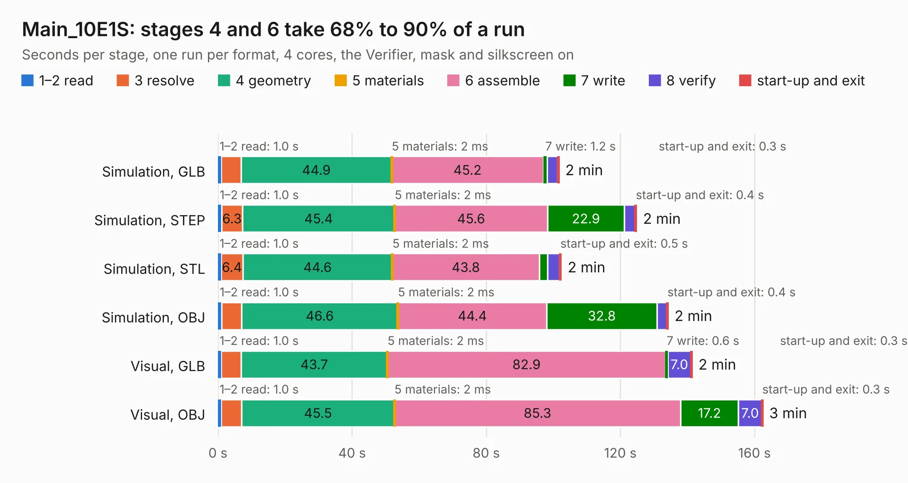

# 1321. Main_10E1S

Board 1,321 of the 3,124 of [Corpus Testing](../Corpus-Testing.md), on [Corpus Page 13](../CorpusTestingPages/Corpus-Testing-13.md#1321-main_10e1s).

| Mode and format | 1–2 read | 3 resolve | 4 geometry | 5 materials | 6 assemble | 7 write | 8 verify | start-up and exit | Total |
|---|---:|---:|---:|---:|---:|---:|---:|---:|---:|
| Simulation, GLB | 1.0 | 5.9 | 44.9 | 2&nbsp;ms | 45.2 | 1.2 | 3.1 | 0.3 | 101.6 |
| Simulation, STEP | 1.0 | 6.3 | 45.4 | 2&nbsp;ms | 45.6 | 22.9 | 3.2 | 0.4 | 124.8 |
| Simulation, STL | 1.0 | 6.4 | 44.6 | 2&nbsp;ms | 43.8 | 2.5 | 3.6 | 0.5 | 102.4 |
| Simulation, OBJ | 1.0 | 6.0 | 46.6 | 2&nbsp;ms | 44.4 | 32.8 | 3.0 | 0.4 | 134.2 |
| Visual, GLB | 1.0 | 5.9 | 43.7 | 2&nbsp;ms | 82.9 | 0.6 | 7.0 | 0.3 | 141.3 |
| Visual, OBJ | 1.0 | 6.1 | 45.5 | 2&nbsp;ms | 85.3 | 17.2 | 7.0 | 0.3 | 162.5 |

<table align="center"><tr><td valign="top">

| Board | Repo: [isarmg/pcie-switch-2](https://github.com/isarmg/pcie-switch-2) Board: `Main_10E1S.kicad_pcb` |
|---|---|
| Folder | outputs / PCIe_Main_RevM / Main_10E1S |
| Complexity | 383&nbsp;/&nbsp;1000 (size&nbsp;313, features&nbsp;70) |
| KESE&nbsp;features | blind and buried vias, rounded, trapezoid or chamfered pads, filled zones |
| Tested | 9th November 2026 |
| Copper&nbsp;layers | 32 |
| File&nbsp;format | KiCad 10 (20260206) |
| Parts,&nbsp;tracks,&nbsp;vias | 364, 432, 78 |
| Triangles,&nbsp;simulation | 7,157,680 in 1710 parts |
| Verifier | PASS in all six runs |

</td><td valign="top">

<table>
<tr><th>File type</th><th>File size</th><th>Peak memory used</th></tr>
<tr><th colspan="3" align="left">Simulation</th></tr>
<tr><td>GLB</td><td align="right">249&nbsp;MB</td><td align="right">2.8&nbsp;GB</td></tr>
<tr><td>STEP</td><td align="right">1.4&nbsp;GB</td><td align="right">3.5&nbsp;GB</td></tr>
<tr><td>STL</td><td align="right">358&nbsp;MB</td><td align="right">2.7&nbsp;GB</td></tr>
<tr><td>OBJ</td><td align="right">789&nbsp;MB</td><td align="right">4.8&nbsp;GB</td></tr>
<tr><th colspan="3" align="left">Visual</th></tr>
<tr><td>GLB</td><td align="right">135&nbsp;MB</td><td align="right">2.5&nbsp;GB</td></tr>
<tr><td>OBJ</td><td align="right">431&nbsp;MB</td><td align="right">2.9&nbsp;GB</td></tr>
</table>

</td></tr></table>

| Previous | Next |
|:---|---:|
| [1320. Assembly_View](b1320b_pcie-switch-2_outputs-PCIe-Main-RevM-Assembly-View_Assembly-View.md) | [1322. BAGEL-MK1](b1322b_iss-pcb_BAGEL-MK1.md) |
