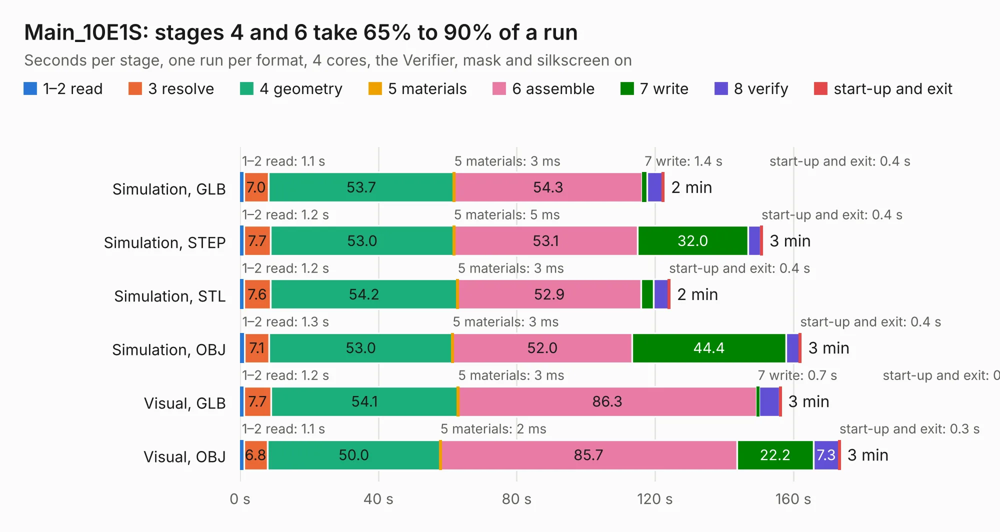

# 1322. Main_10E1S

Board 1,322 of the 3,132 of [Corpus Testing](../Corpus-Testing.md), on [Corpus Page 13](../CorpusTestingPages/Corpus-Testing-13.md#1322-main_10e1s).

| Mode and format | 1–2 read | 3 resolve | 4 geometry | 5 materials | 6 assemble | 7 write | 8 verify | start-up and exit | Total |
|---|---:|---:|---:|---:|---:|---:|---:|---:|---:|
| Simulation, GLB | 1.1 | 7.0 | 53.7 | 3&nbsp;ms | 54.3 | 1.4 | 4.5 | 0.4 | 122.5 |
| Simulation, STEP | 1.2 | 7.7 | 53.0 | 5&nbsp;ms | 53.1 | 32.0 | 3.6 | 0.4 | 151.0 |
| Simulation, STL | 1.2 | 7.6 | 54.2 | 3&nbsp;ms | 52.9 | 3.7 | 4.3 | 0.4 | 124.2 |
| Simulation, OBJ | 1.3 | 7.1 | 53.0 | 3&nbsp;ms | 52.0 | 44.4 | 3.9 | 0.4 | 162.2 |
| Visual, GLB | 1.2 | 7.7 | 54.1 | 3&nbsp;ms | 86.3 | 0.7 | 6.0 | 0.4 | 156.4 |
| Visual, OBJ | 1.1 | 6.8 | 50.0 | 2&nbsp;ms | 85.7 | 22.2 | 7.3 | 0.3 | 173.5 |

<table align="center"><tr><td valign="top">

| Board | Repo: [isarmg/pcie-switch-2](https://github.com/isarmg/pcie-switch-2) Board: `Main_10E1S.kicad_pcb` |
|---|---|
| Folder | outputs / PCIe_E1S_Only_RevQ / Main_10E1S |
| Complexity | 379&nbsp;/&nbsp;1000 (size&nbsp;309, features&nbsp;70) |
| KESE&nbsp;features | blind and buried vias, rounded, trapezoid or chamfered pads, filled zones |
| Tested | 9th November 2026 |
| Copper&nbsp;layers | 32 |
| File&nbsp;format | KiCad 10 (20260206) |
| Parts,&nbsp;tracks,&nbsp;vias | 264, 432, 78 |
| Triangles,&nbsp;simulation | 6,915,136 in 1546 parts |
| Verifier | PASS in all six runs |

</td><td valign="top">

<table>
<tr><th>File type</th><th>File size</th><th>Peak memory used</th></tr>
<tr><th colspan="3" align="left">Simulation</th></tr>
<tr><td>GLB</td><td align="right">240&nbsp;MB</td><td align="right">2.8&nbsp;GB</td></tr>
<tr><td>STEP</td><td align="right">1.3&nbsp;GB</td><td align="right">3.6&nbsp;GB</td></tr>
<tr><td>STL</td><td align="right">346&nbsp;MB</td><td align="right">2.9&nbsp;GB</td></tr>
<tr><td>OBJ</td><td align="right">761&nbsp;MB</td><td align="right">4.7&nbsp;GB</td></tr>
<tr><th colspan="3" align="left">Visual</th></tr>
<tr><td>GLB</td><td align="right">126&nbsp;MB</td><td align="right">2.4&nbsp;GB</td></tr>
<tr><td>OBJ</td><td align="right">403&nbsp;MB</td><td align="right">2.5&nbsp;GB</td></tr>
</table>

</td></tr></table>

| Previous | Next |
|:---|---:|
| [1321. Main_12E1S](b1321b_pcie-switch-2_outputs-PCIe-E1S-96x45-USB12mm-RevW-Main-12E1S_Main-12E1S.md) | [1323. Assembly_View](b1323b_pcie-switch-2_outputs-PCIe-Main-RevM-Assembly-View_Assembly-View.md) |
