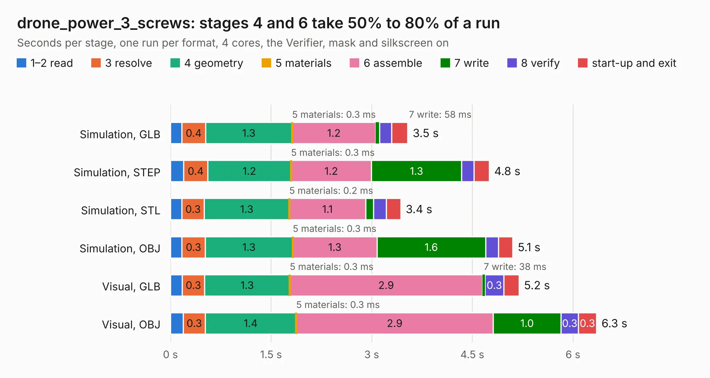

# 1323. drone_power_3_screws

Board 1,323 of the 3,112 of [Corpus Testing](../Corpus-Testing.md), on [Corpus Page 13](../CorpusTestingPages/Corpus-Testing-13.md#1323-drone_power_3_screws).

| Mode and format | 1–2 read | 3 resolve | 4 geometry | 5 materials | 6 assemble | 7 write | 8 verify | start-up and exit | Total |
|---|---:|---:|---:|---:|---:|---:|---:|---:|---:|
| Simulation, GLB | 0.2 | 0.4 | 1.3 | 0.3&nbsp;ms | 1.2 | 58&nbsp;ms | 0.2 | 0.2 | 3.5 |
| Simulation, STEP | 0.2 | 0.4 | 1.2 | 0.3&nbsp;ms | 1.2 | 1.3 | 0.2 | 0.2 | 4.8 |
| Simulation, STL | 0.2 | 0.3 | 1.3 | 0.2&nbsp;ms | 1.1 | 0.1 | 0.2 | 0.2 | 3.4 |
| Simulation, OBJ | 0.2 | 0.3 | 1.3 | 0.3&nbsp;ms | 1.3 | 1.6 | 0.2 | 0.2 | 5.1 |
| Visual, GLB | 0.2 | 0.3 | 1.3 | 0.3&nbsp;ms | 2.9 | 38&nbsp;ms | 0.3 | 0.2 | 5.2 |
| Visual, OBJ | 0.2 | 0.3 | 1.4 | 0.3&nbsp;ms | 2.9 | 1.0 | 0.3 | 0.3 | 6.3 |

<table align="center"><tr><td valign="top">

| Board | Repo: [issuiuc/iss-pcb](https://github.com/issuiuc/iss-pcb) Board: `drone_power_3_screws.kicad_pcb` |
|---|---|
| Folder | boards / Drone_Power / drone_power_3_screws |
| Complexity | 193&nbsp;/&nbsp;1000 (size&nbsp;148, features&nbsp;45) |
| KESE&nbsp;features | through vias, rounded, trapezoid or chamfered pads, filled zones |
| Tested | 9th November 2026 |
| Copper&nbsp;layers | 2 |
| File&nbsp;format | KiCad 8 (20240108) |
| Parts,&nbsp;tracks,&nbsp;vias | 38, 102, 54 |
| Triangles,&nbsp;simulation | 316,950 in 64 parts |
| Verifier | PASS in all six runs |

</td><td valign="top">

<table>
<tr><th>File type</th><th>File size</th><th>Peak memory used</th></tr>
<tr><th colspan="3" align="left">Simulation</th></tr>
<tr><td>GLB</td><td align="right">11&nbsp;MB</td><td align="right">240&nbsp;MB</td></tr>
<tr><td>STEP</td><td align="right">45&nbsp;MB</td><td align="right">267&nbsp;MB</td></tr>
<tr><td>STL</td><td align="right">16&nbsp;MB</td><td align="right">240&nbsp;MB</td></tr>
<tr><td>OBJ</td><td align="right">32&nbsp;MB</td><td align="right">272&nbsp;MB</td></tr>
<tr><th colspan="3" align="left">Visual</th></tr>
<tr><td>GLB</td><td align="right">7.2&nbsp;MB</td><td align="right">241&nbsp;MB</td></tr>
<tr><td>OBJ</td><td align="right">21&nbsp;MB</td><td align="right">240&nbsp;MB</td></tr>
</table>

</td></tr></table>

| Previous | Next |
|:---|---:|
| [1322. drone_power_2_screws_V2](b1322b_iss-pcb_drone-power-2-screws-V2.md) | [1324. EAGLE-MK1-revA](b1324b_iss-pcb_EAGLE-MK1-revA.md) |
