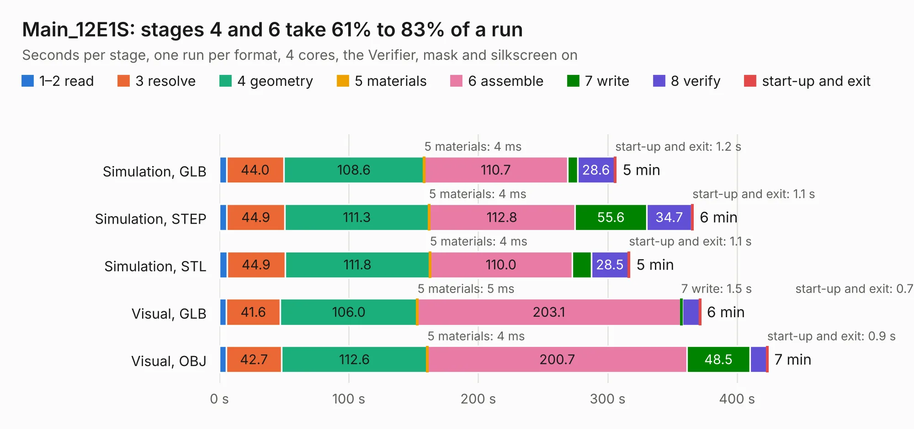

# 1323 Main_12E1S

Board 1,323 of the 3,138 of [Corpus Testing](../Corpus-Testing.md), on [Corpus Page 13](../CorpusTestingPages/Corpus-Testing-13.md#1323-main_12e1s).

| Mode and format | 1–2 read | 3 resolve | 4 geometry | 5 materials | 6 assemble | 7 write | 8 verify | start-up and exit | Total |
|---|---:|---:|---:|---:|---:|---:|---:|---:|---:|
| Simulation, GLB | 5.6 | 44.0 | 108.6 | 4&nbsp;ms | 110.7 | 7.7 | 28.6 | 1.2 | 306.5 |
| Simulation, STEP | 5.7 | 44.9 | 111.3 | 4&nbsp;ms | 112.8 | 55.6 | 34.7 | 1.1 | 366.1 |
| Simulation, STL | 5.9 | 44.9 | 111.8 | 4&nbsp;ms | 110.0 | 14.8 | 28.5 | 1.1 | 317.0 |
| Simulation, OBJ |  |  |  |  |  |  |  |  | exceeded 11 GB on a 15 GB machine (stopped there, not a KESE failure); it will be run again on a machine with more memory |
| Visual, GLB | 5.4 | 41.6 | 106.0 | 5&nbsp;ms | 203.1 | 1.5 | 13.4 | 0.7 | 371.6 |
| Visual, OBJ | 5.4 | 42.7 | 112.6 | 4&nbsp;ms | 200.7 | 48.5 | 13.0 | 0.9 | 423.8 |

<table align="center"><tr><td valign="top">

| Board | Repo: [isarmg/pcie-switch-2](https://github.com/isarmg/pcie-switch-2) Board: `Main_12E1S.kicad_pcb` |
|---|---|
| Folder | outputs / PCIe_E1S_96x45_12VPower_RevV / Main_12E1S |
| Complexity | 447&nbsp;/&nbsp;1000 (size&nbsp;377, features&nbsp;70) |
| KESE&nbsp;features | blind and buried vias, rounded, trapezoid or chamfered pads, filled zones |
| Tested | 9th November 2026 |
| Copper&nbsp;layers | 32 |
| File&nbsp;format | KiCad 10 (20260206) |
| Parts,&nbsp;tracks,&nbsp;vias | 527, 11,010, 2,082 |
| Triangles,&nbsp;simulation | 30,382,184 in 1730 parts |
| Verifier | Simulation, OBJ: exceeded 11 GB on a 15 GB machine (stopped there, not a KESE failure); it will be run again on a machine with more memory |

</td><td valign="top">

<table>
<tr><th>File type</th><th>File size</th><th>Peak memory used</th></tr>
<tr><th colspan="3" align="left">Simulation</th></tr>
<tr><td>GLB</td><td align="right">1.0&nbsp;GB</td><td align="right">6.7&nbsp;GB</td></tr>
<tr><td>STEP</td><td align="right">2.3&nbsp;GB</td><td align="right">6.6&nbsp;GB</td></tr>
<tr><td>STL</td><td align="right">1.5&nbsp;GB</td><td align="right">7.4&nbsp;GB</td></tr>
<tr><td>OBJ</td><td align="right">–</td><td align="right">11&nbsp;GB</td></tr>
<tr><th colspan="3" align="left">Visual</th></tr>
<tr><td>GLB</td><td align="right">250&nbsp;MB</td><td align="right">5.0&nbsp;GB</td></tr>
<tr><td>OBJ</td><td align="right">857&nbsp;MB</td><td align="right">6.1&nbsp;GB</td></tr>
</table>

</td></tr></table>

| Previous | Next |
|:---|---:|
| [1322 Main_12E1S](b1322b_pcie-switch-2_outputs-PCIe-E1S-96x45-12slot-RevU-Main-12E1S_Main-12E1S.md) | [1324 Main_12E1S](b1324b_pcie-switch-2_outputs-PCIe-E1S-96x45-USB12mm-RevW-Main-12E1S_Main-12E1S.md) |
