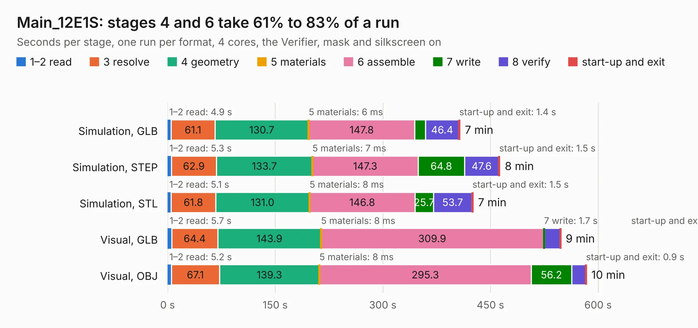

# 1324. Main_12E1S

Board 1,324 of the 3,138 of [Corpus Testing](../Corpus-Testing.md), on [Corpus Page 13](../CorpusTestingPages/Corpus-Testing-13.md#1324-main_12e1s).

| Mode and format | 1–2 read | 3 resolve | 4 geometry | 5 materials | 6 assemble | 7 write | 8 verify | start-up and exit | Total |
|---|---:|---:|---:|---:|---:|---:|---:|---:|---:|
| Simulation, GLB | 4.9 | 61.1 | 130.7 | 6&nbsp;ms | 147.8 | 15.1 | 46.4 | 1.4 | 407.3 |
| Simulation, STEP | 5.3 | 62.9 | 133.7 | 7&nbsp;ms | 147.3 | 64.8 | 47.6 | 1.5 | 463.1 |
| Simulation, STL | 5.1 | 61.8 | 131.0 | 8&nbsp;ms | 146.8 | 25.7 | 53.7 | 1.5 | 425.7 |
| Simulation, OBJ |  |  |  |  |  |  |  |  | exceeded 11 GB on a 16 GB machine (stopped there, not a KESE failure); it will be run again on a machine with more memory |
| Visual, GLB | 5.7 | 64.4 | 143.9 | 8&nbsp;ms | 309.9 | 1.7 | 21.5 | 0.9 | 548.0 |
| Visual, OBJ | 5.2 | 67.1 | 139.3 | 8&nbsp;ms | 295.3 | 56.2 | 19.8 | 0.9 | 583.7 |

<table align="center"><tr><td valign="top">

| Board | Repo: [isarmg/pcie-switch-2](https://github.com/isarmg/pcie-switch-2) Board: `Main_12E1S.kicad_pcb` |
|---|---|
| Folder | outputs / PCIe_E1S_96x45_USB12mm_RevW / Main_12E1S |
| Complexity | 465&nbsp;/&nbsp;1000 (size&nbsp;380, features&nbsp;85) |
| KESE&nbsp;features | through vias, blind and buried vias, rounded, trapezoid or chamfered pads, filled zones |
| Tested | 9th November 2026 |
| Copper&nbsp;layers | 32 |
| File&nbsp;format | KiCad 10 (20260206) |
| Parts,&nbsp;tracks,&nbsp;vias | 572, 9,065, 3,837 |
| Triangles,&nbsp;simulation | 41,775,980 in 1753 parts |
| Verifier | Simulation, OBJ: exceeded 11 GB on a 16 GB machine (stopped there, not a KESE failure); it will be run again on a machine with more memory |

</td><td valign="top">

<table>
<tr><th>File type</th><th>File size</th><th>Peak memory used</th></tr>
<tr><th colspan="3" align="left">Simulation</th></tr>
<tr><td>GLB</td><td align="right">1.4&nbsp;GB</td><td align="right">9.1&nbsp;GB</td></tr>
<tr><td>STEP</td><td align="right">2.6&nbsp;GB</td><td align="right">9.0&nbsp;GB</td></tr>
<tr><td>STL</td><td align="right">2.1&nbsp;GB</td><td align="right">10.0&nbsp;GB</td></tr>
<tr><td>OBJ</td><td align="right">–</td><td align="right">11&nbsp;GB</td></tr>
<tr><th colspan="3" align="left">Visual</th></tr>
<tr><td>GLB</td><td align="right">325&nbsp;MB</td><td align="right">6.4&nbsp;GB</td></tr>
<tr><td>OBJ</td><td align="right">1.1&nbsp;GB</td><td align="right">7.6&nbsp;GB</td></tr>
</table>

</td></tr></table>

| Previous | Next |
|:---|---:|
| [1323. Main_12E1S](b1323b_pcie-switch-2_outputs-PCIe-E1S-96x45-12VPower-RevV-Main-12E1S_Main-12E1S.md) | [1325. Main_10E1S](b1325b_pcie-switch-2_outputs-PCIe-E1S-Only-RevQ-Main-10E1S_Main-10E1S.md) |
