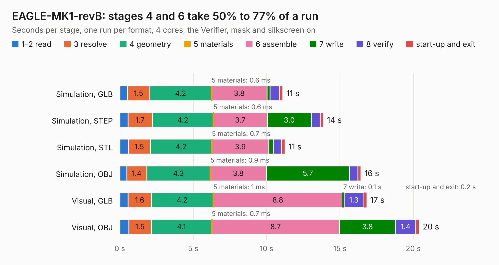

# 1325. EAGLE-MK1-revB

Board 1,325 of the 3,112 of [Corpus Testing](../Corpus-Testing.md), on [Corpus Page 13](../CorpusTestingPages/Corpus-Testing-13.md#1325-eagle-mk1-revb).

| Mode and format | 1–2 read | 3 resolve | 4 geometry | 5 materials | 6 assemble | 7 write | 8 verify | start-up and exit | Total |
|---|---:|---:|---:|---:|---:|---:|---:|---:|---:|
| Simulation, GLB | 0.5 | 1.5 | 4.2 | 0.6&nbsp;ms | 3.8 | 0.2 | 0.6 | 0.2 | 11.1 |
| Simulation, STEP | 0.6 | 1.7 | 4.2 | 0.6&nbsp;ms | 3.7 | 3.0 | 0.6 | 0.2 | 13.9 |
| Simulation, STL | 0.6 | 1.5 | 4.2 | 0.7&nbsp;ms | 3.9 | 0.3 | 0.5 | 0.3 | 11.3 |
| Simulation, OBJ | 0.5 | 1.4 | 4.3 | 0.9&nbsp;ms | 3.8 | 5.7 | 0.6 | 0.2 | 16.4 |
| Visual, GLB | 0.6 | 1.6 | 4.2 | 1&nbsp;ms | 8.8 | 0.1 | 1.3 | 0.2 | 16.8 |
| Visual, OBJ | 0.6 | 1.5 | 4.1 | 0.7&nbsp;ms | 8.7 | 3.8 | 1.4 | 0.2 | 20.4 |

<table align="center"><tr><td valign="top">

| Board | Repo: [issuiuc/iss-pcb](https://github.com/issuiuc/iss-pcb) Board: `EAGLE-MK1-revB.kicad_pcb` |
|---|---|
| Folder | boards / EAGLE-MK1 / EAGLE-MK1-revB |
| Complexity | 308&nbsp;/&nbsp;1000 (size&nbsp;188, features&nbsp;120) |
| KESE&nbsp;features | through vias, slotted holes, custom pads, rounded, trapezoid or chamfered pads, filled zones, copper drawings, curved board outline, stack-up, dielectric εr and tanδ |
| Tested | 9th November 2026 |
| Copper&nbsp;layers | 4 |
| File&nbsp;format | KiCad 9 (20241229) |
| Parts,&nbsp;tracks,&nbsp;vias | 49, 296, 216 |
| Triangles,&nbsp;simulation | 1,248,210 in 143 parts |
| Verifier | PASS in all six runs |

</td><td valign="top">

<table>
<tr><th>File type</th><th>File size</th><th>Peak memory used</th></tr>
<tr><th colspan="3" align="left">Simulation</th></tr>
<tr><td>GLB</td><td align="right">42&nbsp;MB</td><td align="right">559&nbsp;MB</td></tr>
<tr><td>STEP</td><td align="right">160&nbsp;MB</td><td align="right">627&nbsp;MB</td></tr>
<tr><td>STL</td><td align="right">62&nbsp;MB</td><td align="right">559&nbsp;MB</td></tr>
<tr><td>OBJ</td><td align="right">128&nbsp;MB</td><td align="right">900&nbsp;MB</td></tr>
<tr><th colspan="3" align="left">Visual</th></tr>
<tr><td>GLB</td><td align="right">28&nbsp;MB</td><td align="right">635&nbsp;MB</td></tr>
<tr><td>OBJ</td><td align="right">83&nbsp;MB</td><td align="right">647&nbsp;MB</td></tr>
</table>

</td></tr></table>

| Previous | Next |
|:---|---:|
| [1324. EAGLE-MK1-revA](b1324b_iss-pcb_EAGLE-MK1-revA.md) | [1326. Feather_Duo](b1326b_iss-pcb_Feather-Duo.md) |
