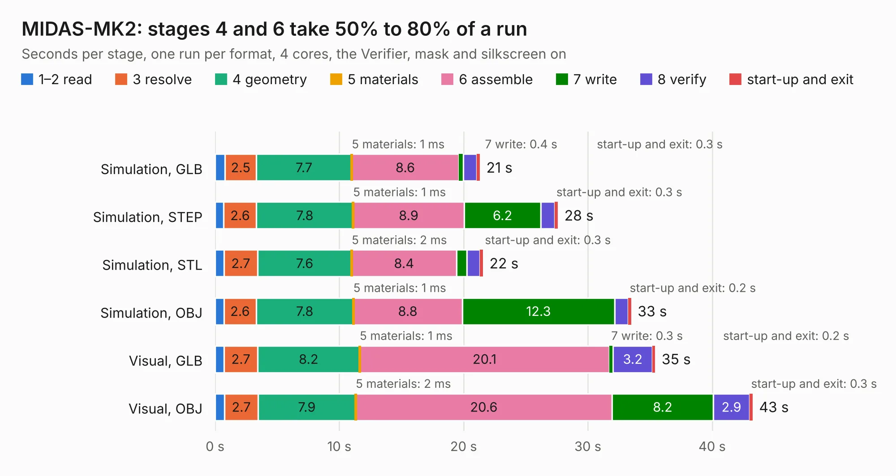

# 1327. MIDAS-MK2

Board 1,327 of the 3,108 of [Corpus Testing](../Corpus-Testing.md), on [Corpus Page 13](../CorpusTestingPages/Corpus-Testing-13.md#1327-midas-mk2).

| Mode and format | 1–2 read | 3 resolve | 4 geometry | 5 materials | 6 assemble | 7 write | 8 verify | start-up and exit | Total |
|---|---:|---:|---:|---:|---:|---:|---:|---:|---:|
| Simulation, GLB | 0.8 | 2.5 | 7.7 | 1&nbsp;ms | 8.6 | 0.4 | 1.1 | 0.3 | 21.3 |
| Simulation, STEP | 0.7 | 2.6 | 7.8 | 1&nbsp;ms | 8.9 | 6.2 | 1.1 | 0.3 | 27.6 |
| Simulation, STL | 0.7 | 2.7 | 7.6 | 2&nbsp;ms | 8.4 | 0.8 | 1.0 | 0.3 | 21.6 |
| Simulation, OBJ | 0.7 | 2.6 | 7.8 | 1&nbsp;ms | 8.8 | 12.3 | 1.1 | 0.2 | 33.5 |
| Visual, GLB | 0.7 | 2.7 | 8.2 | 1&nbsp;ms | 20.1 | 0.3 | 3.2 | 0.2 | 35.4 |
| Visual, OBJ | 0.8 | 2.7 | 7.9 | 2&nbsp;ms | 20.6 | 8.2 | 2.9 | 0.3 | 43.3 |

<table align="center"><tr><td valign="top">

| Board | Repo: [issuiuc/iss-pcb](https://github.com/issuiuc/iss-pcb) Board: `MIDAS-MK2.kicad_pcb` |
|---|---|
| Folder | boards / MIDAS-MK2 / MIDAS-MK2-revA |
| Complexity | 432&nbsp;/&nbsp;1000 (size&nbsp;267, features&nbsp;165) |
| KESE&nbsp;features | through vias, slotted holes, custom pads, rounded, trapezoid or chamfered pads, filled zones, copper drawings, copper text, curved board outline, TrueType text, stack-up, dielectric εr and tanδ, copper finish, mask and silkscreen colours |
| Tested | 9th November 2026 |
| Copper&nbsp;layers | 4 |
| File&nbsp;format | KiCad 8 (20240108) |
| Parts,&nbsp;tracks,&nbsp;vias | 190, 1,192, 401 |
| Triangles,&nbsp;simulation | 2,793,012 in 259 parts |
| Verifier | PASS in all six runs |

</td><td valign="top">

<table>
<tr><th>File type</th><th>File size</th><th>Peak memory used</th></tr>
<tr><th colspan="3" align="left">Simulation</th></tr>
<tr><td>GLB</td><td align="right">95&nbsp;MB</td><td align="right">961&nbsp;MB</td></tr>
<tr><td>STEP</td><td align="right">378&nbsp;MB</td><td align="right">1.1&nbsp;GB</td></tr>
<tr><td>STL</td><td align="right">140&nbsp;MB</td><td align="right">834&nbsp;MB</td></tr>
<tr><td>OBJ</td><td align="right">293&nbsp;MB</td><td align="right">1.8&nbsp;GB</td></tr>
<tr><th colspan="3" align="left">Visual</th></tr>
<tr><td>GLB</td><td align="right">63&nbsp;MB</td><td align="right">1.2&nbsp;GB</td></tr>
<tr><td>OBJ</td><td align="right">197&nbsp;MB</td><td align="right">1.4&nbsp;GB</td></tr>
</table>

</td></tr></table>

| Previous | Next |
|:---|---:|
| [1326. MIDAS-MK1.1](b1326b_iss-pcb_boards-MIDAS-MK1-MIDAS-MK1-1-revB_MIDAS-MK1-1.md) | [1328. MIDAS-MK2.1](b1328b_iss-pcb_boards-MIDAS-MK2-MIDAS-MK2-1-revA_MIDAS-MK2-1.md) |
