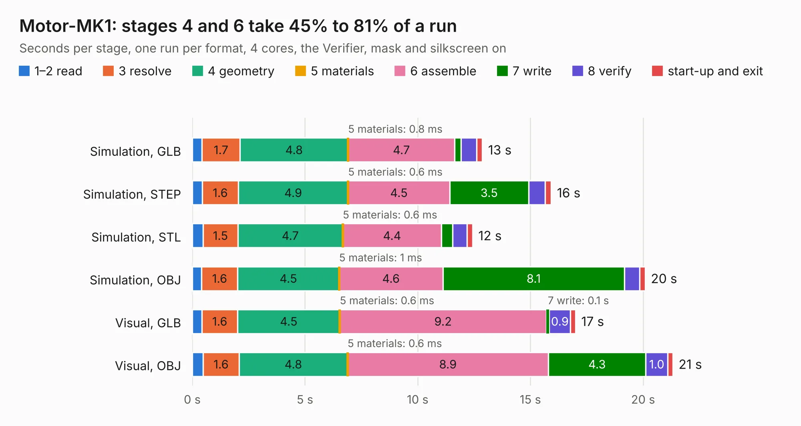

# 1327. Motor-MK1

Board 1,327 of the 3,104 of [Corpus Testing](../Corpus-Testing.md), on [Corpus Page 13](../CorpusTestingPages/Corpus-Testing-13.md#1327-motor-mk1).

| Mode and format | 1–2 read | 3 resolve | 4 geometry | 5 materials | 6 assemble | 7 write | 8 verify | start-up and exit | Total |
|---|---:|---:|---:|---:|---:|---:|---:|---:|---:|
| Simulation, GLB | 0.4 | 1.7 | 4.8 | 0.8&nbsp;ms | 4.7 | 0.3 | 0.7 | 0.3 | 12.9 |
| Simulation, STEP | 0.4 | 1.6 | 4.9 | 0.6&nbsp;ms | 4.5 | 3.5 | 0.7 | 0.3 | 15.9 |
| Simulation, STL | 0.5 | 1.5 | 4.7 | 0.6&nbsp;ms | 4.4 | 0.5 | 0.6 | 0.2 | 12.4 |
| Simulation, OBJ | 0.4 | 1.6 | 4.5 | 1&nbsp;ms | 4.6 | 8.1 | 0.7 | 0.3 | 20.1 |
| Visual, GLB | 0.4 | 1.6 | 4.5 | 0.6&nbsp;ms | 9.2 | 0.1 | 0.9 | 0.2 | 17.0 |
| Visual, OBJ | 0.5 | 1.6 | 4.8 | 0.6&nbsp;ms | 8.9 | 4.3 | 1.0 | 0.2 | 21.3 |

<table align="center"><tr><td valign="top">

| Board | Repo: [issuiuc/iss-pcb](https://github.com/issuiuc/iss-pcb) Board: `Motor-MK1.kicad_pcb` |
|---|---|
| Folder | boards / Motor-MK1 |
| Complexity | 336&nbsp;/&nbsp;1000 (size&nbsp;241, features&nbsp;95) |
| KESE&nbsp;features | through vias, slotted holes, rounded, trapezoid or chamfered pads, filled zones, curved board outline, stack-up, dielectric εr and tanδ |
| Tested | 9th November 2026 |
| Copper&nbsp;layers | 4 |
| File&nbsp;format | KiCad 8 (20240108) |
| Parts,&nbsp;tracks,&nbsp;vias | 63, 431, 240 |
| Triangles,&nbsp;simulation | 1,392,234 in 139 parts |
| Verifier | PASS in all six runs |

</td><td valign="top">

<table>
<tr><th>File type</th><th>File size</th><th>Peak memory used</th></tr>
<tr><th colspan="3" align="left">Simulation</th></tr>
<tr><td>GLB</td><td align="right">46&nbsp;MB</td><td align="right">529&nbsp;MB</td></tr>
<tr><td>STEP</td><td align="right">145&nbsp;MB</td><td align="right">611&nbsp;MB</td></tr>
<tr><td>STL</td><td align="right">70&nbsp;MB</td><td align="right">527&nbsp;MB</td></tr>
<tr><td>OBJ</td><td align="right">142&nbsp;MB</td><td align="right">963&nbsp;MB</td></tr>
<tr><th colspan="3" align="left">Visual</th></tr>
<tr><td>GLB</td><td align="right">25&nbsp;MB</td><td align="right">638&nbsp;MB</td></tr>
<tr><td>OBJ</td><td align="right">78&nbsp;MB</td><td align="right">622&nbsp;MB</td></tr>
</table>

</td></tr></table>

| Previous | Next |
|:---|---:|
| [1326. Mini-MK1](b1326b_iss-pcb_Mini-MK1.md) | [1328. GATOR](b1328b_iss-pcb_GATOR.md) |
