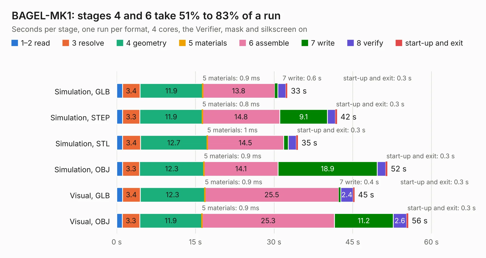

# 1328. BAGEL-MK1

Board 1,328 of the 3,138 of [Corpus Testing](../Corpus-Testing.md), on [Corpus Page 13](../CorpusTestingPages/Corpus-Testing-13.md#1328-bagel-mk1).

| Mode and format | 1–2 read | 3 resolve | 4 geometry | 5 materials | 6 assemble | 7 write | 8 verify | start-up and exit | Total |
|---|---:|---:|---:|---:|---:|---:|---:|---:|---:|
| Simulation, GLB | 1.1 | 3.4 | 11.9 | 0.9&nbsp;ms | 13.8 | 0.6 | 1.5 | 0.3 | 32.5 |
| Simulation, STEP | 1.1 | 3.3 | 11.9 | 0.8&nbsp;ms | 14.8 | 9.1 | 1.5 | 0.3 | 42.0 |
| Simulation, STL | 1.1 | 3.4 | 12.7 | 1&nbsp;ms | 14.5 | 0.9 | 1.5 | 0.3 | 34.6 |
| Simulation, OBJ | 1.1 | 3.3 | 12.3 | 0.9&nbsp;ms | 14.1 | 18.9 | 1.6 | 0.3 | 51.6 |
| Visual, GLB | 1.1 | 3.4 | 12.3 | 0.9&nbsp;ms | 25.5 | 0.4 | 2.4 | 0.3 | 45.4 |
| Visual, OBJ | 1.1 | 3.3 | 11.9 | 0.9&nbsp;ms | 25.3 | 11.2 | 2.6 | 0.3 | 55.6 |

<table align="center"><tr><td valign="top">

| Board | Repo: [issuiuc/iss-pcb](https://github.com/issuiuc/iss-pcb) Board: `BAGEL-MK1.kicad_pcb` |
|---|---|
| Folder | boards / BAGEL-MK1 / BAGEL-MK1-revA |
| Complexity | 402&nbsp;/&nbsp;1000 (size&nbsp;272, features&nbsp;130) |
| KESE&nbsp;features | through vias, custom pads, rounded, trapezoid or chamfered pads, arc tracks, filled zones, copper drawings, curved board outline, stack-up, dielectric εr and tanδ, mask and silkscreen colours |
| Tested | 9th November 2026 |
| Copper&nbsp;layers | 4 |
| File&nbsp;format | KiCad 9 (20241229) |
| Parts,&nbsp;tracks,&nbsp;vias | 192, 1,077, 525 |
| Triangles,&nbsp;simulation | 3,057,576 in 196 parts |
| Verifier | PASS in all six runs |

</td><td valign="top">

<table>
<tr><th>File type</th><th>File size</th><th>Peak memory used</th></tr>
<tr><th colspan="3" align="left">Simulation</th></tr>
<tr><td>GLB</td><td align="right">105&nbsp;MB</td><td align="right">923&nbsp;MB</td></tr>
<tr><td>STEP</td><td align="right">408&nbsp;MB</td><td align="right">1.2&nbsp;GB</td></tr>
<tr><td>STL</td><td align="right">153&nbsp;MB</td><td align="right">966&nbsp;MB</td></tr>
<tr><td>OBJ</td><td align="right">330&nbsp;MB</td><td align="right">2.1&nbsp;GB</td></tr>
<tr><th colspan="3" align="left">Visual</th></tr>
<tr><td>GLB</td><td align="right">61&nbsp;MB</td><td align="right">1.1&nbsp;GB</td></tr>
<tr><td>OBJ</td><td align="right">194&nbsp;MB</td><td align="right">1.3&nbsp;GB</td></tr>
</table>

</td></tr></table>

| Previous | Next |
|:---|---:|
| [1327. Main_10E1S](b1327b_pcie-switch-2_outputs-PCIe-Main-RevM-Main-10E1S_Main-10E1S.md) | [1329. BAGEL-MK1.1-Avocado](b1329b_iss-pcb_BAGEL-MK1-1-Avocado.md) |
