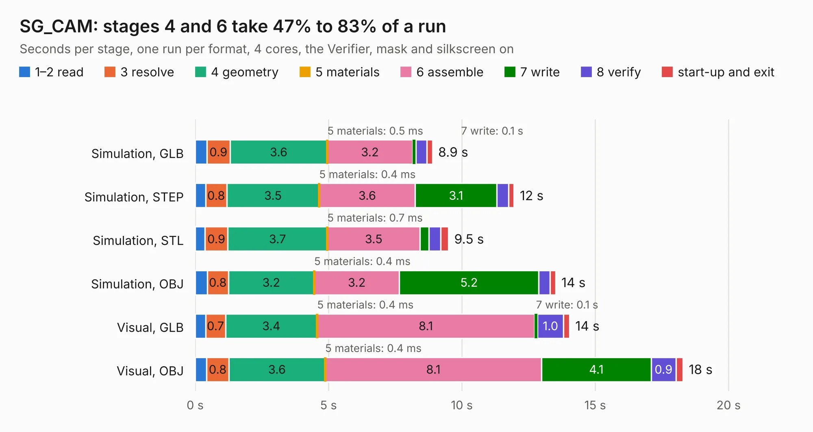

# 1328. SG_CAM

Board 1,328 of the 3,132 of [Corpus Testing](../Corpus-Testing.md), on [Corpus Page 13](../CorpusTestingPages/Corpus-Testing-13.md#1328-sg_cam).

| Mode and format | 1–2 read | 3 resolve | 4 geometry | 5 materials | 6 assemble | 7 write | 8 verify | start-up and exit | Total |
|---|---:|---:|---:|---:|---:|---:|---:|---:|---:|
| Simulation, GLB | 0.4 | 0.9 | 3.6 | 0.5&nbsp;ms | 3.2 | 0.1 | 0.4 | 0.2 | 8.9 |
| Simulation, STEP | 0.4 | 0.8 | 3.5 | 0.4&nbsp;ms | 3.6 | 3.1 | 0.4 | 0.2 | 12.0 |
| Simulation, STL | 0.4 | 0.9 | 3.7 | 0.7&nbsp;ms | 3.5 | 0.3 | 0.4 | 0.3 | 9.5 |
| Simulation, OBJ | 0.5 | 0.8 | 3.2 | 0.4&nbsp;ms | 3.2 | 5.2 | 0.4 | 0.2 | 13.5 |
| Visual, GLB | 0.4 | 0.7 | 3.4 | 0.4&nbsp;ms | 8.1 | 0.1 | 1.0 | 0.2 | 14.0 |
| Visual, OBJ | 0.4 | 0.8 | 3.6 | 0.4&nbsp;ms | 8.1 | 4.1 | 0.9 | 0.3 | 18.3 |

<table align="center"><tr><td valign="top">

| Board | Repo: [issuiuc/iss-pcb](https://github.com/issuiuc/iss-pcb) Board: `SG_CAM.kicad_pcb` |
|---|---|
| Folder | boards / CAM-MK1 |
| Complexity | 326&nbsp;/&nbsp;1000 (size&nbsp;216, features&nbsp;110) |
| KESE&nbsp;features | through vias, slotted holes, rounded, trapezoid or chamfered pads, filled zones, curved board outline, TrueType text, stack-up, dielectric εr and tanδ |
| Tested | 9th November 2026 |
| Copper&nbsp;layers | 2 |
| File&nbsp;format | KiCad 7 (20221018) |
| Parts,&nbsp;tracks,&nbsp;vias | 113, 506, 78 |
| Triangles,&nbsp;simulation | 926,328 in 122 parts |
| Verifier | PASS in all six runs |

</td><td valign="top">

<table>
<tr><th>File type</th><th>File size</th><th>Peak memory used</th></tr>
<tr><th colspan="3" align="left">Simulation</th></tr>
<tr><td>GLB</td><td align="right">32&nbsp;MB</td><td align="right">458&nbsp;MB</td></tr>
<tr><td>STEP</td><td align="right">158&nbsp;MB</td><td align="right">514&nbsp;MB</td></tr>
<tr><td>STL</td><td align="right">46&nbsp;MB</td><td align="right">452&nbsp;MB</td></tr>
<tr><td>OBJ</td><td align="right">94&nbsp;MB</td><td align="right">672&nbsp;MB</td></tr>
<tr><th colspan="3" align="left">Visual</th></tr>
<tr><td>GLB</td><td align="right">24&nbsp;MB</td><td align="right">573&nbsp;MB</td></tr>
<tr><td>OBJ</td><td align="right">73&nbsp;MB</td><td align="right">604&nbsp;MB</td></tr>
</table>

</td></tr></table>

| Previous | Next |
|:---|---:|
| [1327. BAGEL-MK1.1-Butter](b1327b_iss-pcb_BAGEL-MK1-1-Butter.md) | [1329. CAM-MK2](b1329b_iss-pcb_CAM-MK2.md) |
