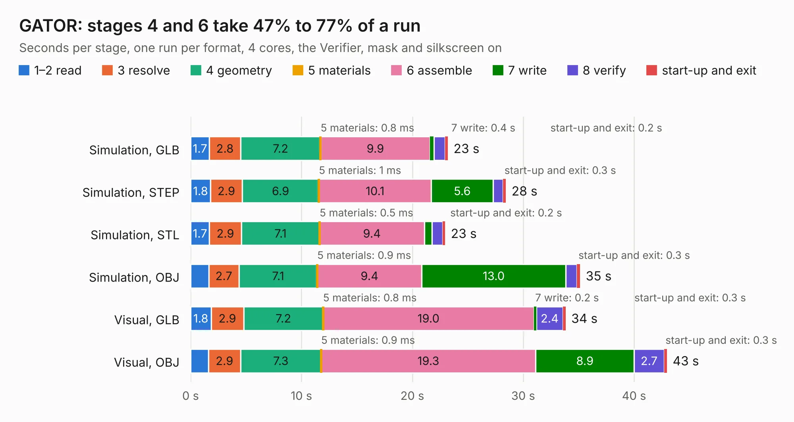

# 1330. GATOR

Board 1,330 of the 3,106 of [Corpus Testing](../Corpus-Testing.md), on [Corpus Page 13](../CorpusTestingPages/Corpus-Testing-13.md#1330-gator).

| Mode and format | 1–2 read | 3 resolve | 4 geometry | 5 materials | 6 assemble | 7 write | 8 verify | start-up and exit | Total |
|---|---:|---:|---:|---:|---:|---:|---:|---:|---:|
| Simulation, GLB | 1.7 | 2.8 | 7.2 | 0.8&nbsp;ms | 9.9 | 0.4 | 1.0 | 0.2 | 23.2 |
| Simulation, STEP | 1.8 | 2.9 | 6.9 | 1&nbsp;ms | 10.1 | 5.6 | 0.9 | 0.3 | 28.4 |
| Simulation, STL | 1.7 | 2.9 | 7.1 | 0.5&nbsp;ms | 9.4 | 0.7 | 1.0 | 0.2 | 23.0 |
| Simulation, OBJ | 1.6 | 2.7 | 7.1 | 0.9&nbsp;ms | 9.4 | 13.0 | 1.0 | 0.3 | 35.1 |
| Visual, GLB | 1.8 | 2.9 | 7.2 | 0.8&nbsp;ms | 19.0 | 0.2 | 2.4 | 0.3 | 33.8 |
| Visual, OBJ | 1.6 | 2.9 | 7.3 | 0.9&nbsp;ms | 19.3 | 8.9 | 2.7 | 0.3 | 43.0 |

<table align="center"><tr><td valign="top">

| Board | Repo: [issuiuc/iss-pcb](https://github.com/issuiuc/iss-pcb) Board: `GATOR.kicad_pcb` |
|---|---|
| Folder | boards / Motor-MK2 (GATOR) |
| Complexity | 376&nbsp;/&nbsp;1000 (size&nbsp;251, features&nbsp;125) |
| KESE&nbsp;features | through vias, slotted holes, custom pads, rounded, trapezoid or chamfered pads, filled zones, copper drawings, curved board outline, stack-up, dielectric εr and tanδ, mask and silkscreen colours |
| Tested | 9th November 2026 |
| Copper&nbsp;layers | 4 |
| File&nbsp;format | KiCad 10 (20260206) |
| Parts,&nbsp;tracks,&nbsp;vias | 79, 705, 397 |
| Triangles,&nbsp;simulation | 2,386,824 in 148 parts |
| Verifier | PASS in all six runs |

</td><td valign="top">

<table>
<tr><th>File type</th><th>File size</th><th>Peak memory used</th></tr>
<tr><th colspan="3" align="left">Simulation</th></tr>
<tr><td>GLB</td><td align="right">84&nbsp;MB</td><td align="right">870&nbsp;MB</td></tr>
<tr><td>STEP</td><td align="right">298&nbsp;MB</td><td align="right">1.1&nbsp;GB</td></tr>
<tr><td>STL</td><td align="right">119&nbsp;MB</td><td align="right">875&nbsp;MB</td></tr>
<tr><td>OBJ</td><td align="right">256&nbsp;MB</td><td align="right">1.7&nbsp;GB</td></tr>
<tr><th colspan="3" align="left">Visual</th></tr>
<tr><td>GLB</td><td align="right">56&nbsp;MB</td><td align="right">1.0&nbsp;GB</td></tr>
<tr><td>OBJ</td><td align="right">171&nbsp;MB</td><td align="right">1.2&nbsp;GB</td></tr>
</table>

</td></tr></table>

| Previous | Next |
|:---|---:|
| [1329. Motor-MK1](b1329b_iss-pcb_Motor-MK1.md) | [1331. 555-Timer-Demo-Circuit](b1331b_iss-pcb_555-Timer-Demo-Circuit.md) |
