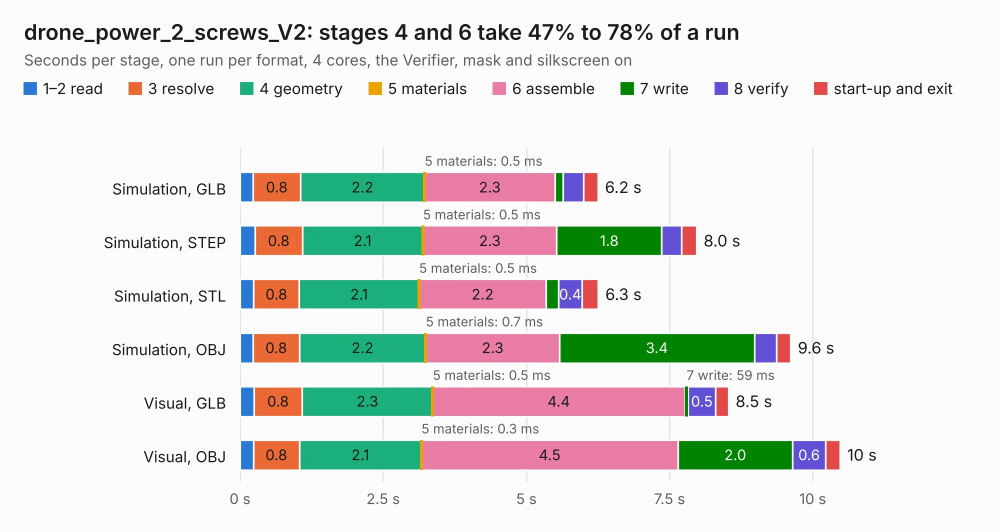

# 1331. drone_power_2_screws_V2

Board 1,331 of the 3,123 of [Corpus Testing](../Corpus-Testing.md), on [Corpus Page 13](../CorpusTestingPages/Corpus-Testing-13.md#1331-drone_power_2_screws_v2).

| Mode and format | 1–2 read | 3 resolve | 4 geometry | 5 materials | 6 assemble | 7 write | 8 verify | start-up and exit | Total |
|---|---:|---:|---:|---:|---:|---:|---:|---:|---:|
| Simulation, GLB | 0.2 | 0.8 | 2.2 | 0.5&nbsp;ms | 2.3 | 0.1 | 0.4 | 0.2 | 6.2 |
| Simulation, STEP | 0.3 | 0.8 | 2.1 | 0.5&nbsp;ms | 2.3 | 1.8 | 0.3 | 0.3 | 8.0 |
| Simulation, STL | 0.2 | 0.8 | 2.1 | 0.5&nbsp;ms | 2.2 | 0.2 | 0.4 | 0.3 | 6.3 |
| Simulation, OBJ | 0.2 | 0.8 | 2.2 | 0.7&nbsp;ms | 2.3 | 3.4 | 0.4 | 0.2 | 9.6 |
| Visual, GLB | 0.2 | 0.8 | 2.3 | 0.5&nbsp;ms | 4.4 | 59&nbsp;ms | 0.5 | 0.2 | 8.5 |
| Visual, OBJ | 0.2 | 0.8 | 2.1 | 0.3&nbsp;ms | 4.5 | 2.0 | 0.6 | 0.3 | 10.5 |

<table align="center"><tr><td valign="top">

| Board | Repo: [issuiuc/iss-pcb](https://github.com/issuiuc/iss-pcb) Board: `drone_power_2_screws_V2.kicad_pcb` |
|---|---|
| Folder | boards / Drone_Power / drone_power_2_screws_V2 |
| Complexity | 298&nbsp;/&nbsp;1000 (size&nbsp;183, features&nbsp;115) |
| KESE&nbsp;features | through vias, custom pads, rounded, trapezoid or chamfered pads, filled zones, copper drawings, curved board outline, stack-up, dielectric εr and tanδ, mask and silkscreen colours |
| Tested | 9th November 2026 |
| Copper&nbsp;layers | 4 |
| File&nbsp;format | KiCad 9 (20241229) |
| Parts,&nbsp;tracks,&nbsp;vias | 56, 129, 163 |
| Triangles,&nbsp;simulation | 688,940 in 78 parts |
| Verifier | PASS in all six runs |

</td><td valign="top">

<table>
<tr><th>File type</th><th>File size</th><th>Peak memory used</th></tr>
<tr><th colspan="3" align="left">Simulation</th></tr>
<tr><td>GLB</td><td align="right">23&nbsp;MB</td><td align="right">387&nbsp;MB</td></tr>
<tr><td>STEP</td><td align="right">62&nbsp;MB</td><td align="right">401&nbsp;MB</td></tr>
<tr><td>STL</td><td align="right">34&nbsp;MB</td><td align="right">387&nbsp;MB</td></tr>
<tr><td>OBJ</td><td align="right">69&nbsp;MB</td><td align="right">523&nbsp;MB</td></tr>
<tr><th colspan="3" align="left">Visual</th></tr>
<tr><td>GLB</td><td align="right">13&nbsp;MB</td><td align="right">393&nbsp;MB</td></tr>
<tr><td>OBJ</td><td align="right">40&nbsp;MB</td><td align="right">384&nbsp;MB</td></tr>
</table>

</td></tr></table>

| Previous | Next |
|:---|---:|
| [1330. drone_power_2_screws](b1330b_iss-pcb_drone-power-2-screws.md) | [1332. drone_power_3_screws](b1332b_iss-pcb_drone-power-3-screws.md) |
