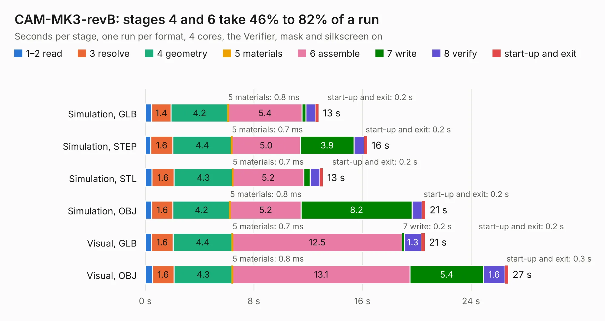

# 1332. CAM-MK3-revB

Board 1,332 of the 3,132 of [Corpus Testing](../Corpus-Testing.md), on [Corpus Page 13](../CorpusTestingPages/Corpus-Testing-13.md#1332-cam-mk3-revb).

| Mode and format | 1–2 read | 3 resolve | 4 geometry | 5 materials | 6 assemble | 7 write | 8 verify | start-up and exit | Total |
|---|---:|---:|---:|---:|---:|---:|---:|---:|---:|
| Simulation, GLB | 0.5 | 1.4 | 4.2 | 0.8&nbsp;ms | 5.4 | 0.3 | 0.7 | 0.2 | 12.8 |
| Simulation, STEP | 0.4 | 1.6 | 4.4 | 0.7&nbsp;ms | 5.0 | 3.9 | 0.8 | 0.2 | 16.4 |
| Simulation, STL | 0.5 | 1.6 | 4.3 | 0.7&nbsp;ms | 5.2 | 0.5 | 0.7 | 0.2 | 13.1 |
| Simulation, OBJ | 0.5 | 1.6 | 4.2 | 0.8&nbsp;ms | 5.2 | 8.2 | 0.7 | 0.2 | 20.6 |
| Visual, GLB | 0.4 | 1.6 | 4.4 | 0.7&nbsp;ms | 12.5 | 0.2 | 1.3 | 0.2 | 20.6 |
| Visual, OBJ | 0.5 | 1.6 | 4.3 | 0.8&nbsp;ms | 13.1 | 5.4 | 1.6 | 0.3 | 26.7 |

<table align="center"><tr><td valign="top">

| Board | Repo: [issuiuc/iss-pcb](https://github.com/issuiuc/iss-pcb) Board: `CAM-MK3-revB.kicad_pcb` |
|---|---|
| Folder | boards / CAM-MK3 / CAM-MK3-revB |
| Complexity | 381&nbsp;/&nbsp;1000 (size&nbsp;241, features&nbsp;140) |
| KESE&nbsp;features | through vias, slotted holes, custom pads, rounded, trapezoid or chamfered pads, filled zones, copper drawings, curved board outline, TrueType text, stack-up, dielectric εr and tanδ, mask and silkscreen colours |
| Tested | 9th November 2026 |
| Copper&nbsp;layers | 4 |
| File&nbsp;format | KiCad 9 (20241229) |
| Parts,&nbsp;tracks,&nbsp;vias | 110, 658, 196 |
| Triangles,&nbsp;simulation | 1,681,368 in 202 parts |
| Verifier | PASS in all six runs |

</td><td valign="top">

<table>
<tr><th>File type</th><th>File size</th><th>Peak memory used</th></tr>
<tr><th colspan="3" align="left">Simulation</th></tr>
<tr><td>GLB</td><td align="right">56&nbsp;MB</td><td align="right">740&nbsp;MB</td></tr>
<tr><td>STEP</td><td align="right">227&nbsp;MB</td><td align="right">773&nbsp;MB</td></tr>
<tr><td>STL</td><td align="right">84&nbsp;MB</td><td align="right">725&nbsp;MB</td></tr>
<tr><td>OBJ</td><td align="right">176&nbsp;MB</td><td align="right">1.1&nbsp;GB</td></tr>
<tr><th colspan="3" align="left">Visual</th></tr>
<tr><td>GLB</td><td align="right">36&nbsp;MB</td><td align="right">684&nbsp;MB</td></tr>
<tr><td>OBJ</td><td align="right">111&nbsp;MB</td><td align="right">852&nbsp;MB</td></tr>
</table>

</td></tr></table>

| Previous | Next |
|:---|---:|
| [1331. CAM-MK3-revA](b1331b_iss-pcb_CAM-MK3-revA.md) | [1333. CAM-MK3-revC](b1333b_iss-pcb_CAM-MK3-revC.md) |
