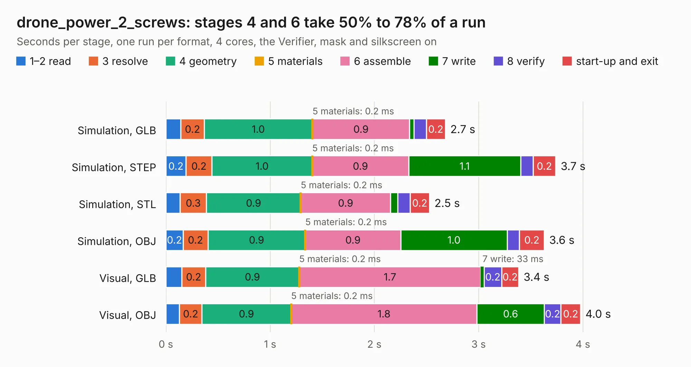

# 1332. drone_power_2_screws

Board 1,332 of the 3,129 of [Corpus Testing](../Corpus-Testing.md), on [Corpus Page 13](../CorpusTestingPages/Corpus-Testing-13.md#1332-drone_power_2_screws).

| Mode and format | 1–2 read | 3 resolve | 4 geometry | 5 materials | 6 assemble | 7 write | 8 verify | start-up and exit | Total |
|---|---:|---:|---:|---:|---:|---:|---:|---:|---:|
| Simulation, GLB | 0.1 | 0.2 | 1.0 | 0.2&nbsp;ms | 0.9 | 42&nbsp;ms | 0.1 | 0.2 | 2.7 |
| Simulation, STEP | 0.2 | 0.2 | 1.0 | 0.2&nbsp;ms | 0.9 | 1.1 | 0.1 | 0.2 | 3.7 |
| Simulation, STL | 0.1 | 0.3 | 0.9 | 0.2&nbsp;ms | 0.9 | 69&nbsp;ms | 0.1 | 0.2 | 2.5 |
| Simulation, OBJ | 0.2 | 0.2 | 0.9 | 0.2&nbsp;ms | 0.9 | 1.0 | 0.1 | 0.2 | 3.6 |
| Visual, GLB | 0.2 | 0.2 | 0.9 | 0.2&nbsp;ms | 1.7 | 33&nbsp;ms | 0.2 | 0.2 | 3.4 |
| Visual, OBJ | 0.1 | 0.2 | 0.9 | 0.2&nbsp;ms | 1.8 | 0.6 | 0.2 | 0.2 | 4.0 |

<table align="center"><tr><td valign="top">

| Board | Repo: [issuiuc/iss-pcb](https://github.com/issuiuc/iss-pcb) Board: `drone_power_2_screws.kicad_pcb` |
|---|---|
| Folder | boards / Drone_Power / drone_power_2_screws |
| Complexity | 197&nbsp;/&nbsp;1000 (size&nbsp;142, features&nbsp;55) |
| KESE&nbsp;features | through vias, rounded, trapezoid or chamfered pads, filled zones, curved board outline |
| Tested | 9th November 2026 |
| Copper&nbsp;layers | 2 |
| File&nbsp;format | KiCad 8 (20240108) |
| Parts,&nbsp;tracks,&nbsp;vias | 37, 109, 26 |
| Triangles,&nbsp;simulation | 259,008 in 47 parts |
| Verifier | PASS in all six runs |

</td><td valign="top">

<table>
<tr><th>File type</th><th>File size</th><th>Peak memory used</th></tr>
<tr><th colspan="3" align="left">Simulation</th></tr>
<tr><td>GLB</td><td align="right">9.0&nbsp;MB</td><td align="right">225&nbsp;MB</td></tr>
<tr><td>STEP</td><td align="right">41&nbsp;MB</td><td align="right">257&nbsp;MB</td></tr>
<tr><td>STL</td><td align="right">13&nbsp;MB</td><td align="right">225&nbsp;MB</td></tr>
<tr><td>OBJ</td><td align="right">26&nbsp;MB</td><td align="right">235&nbsp;MB</td></tr>
<tr><th colspan="3" align="left">Visual</th></tr>
<tr><td>GLB</td><td align="right">6.1&nbsp;MB</td><td align="right">213&nbsp;MB</td></tr>
<tr><td>OBJ</td><td align="right">17&nbsp;MB</td><td align="right">213&nbsp;MB</td></tr>
</table>

</td></tr></table>

| Previous | Next |
|:---|---:|
| [1331. CAM-MK3-revC](b1331b_iss-pcb_CAM-MK3-revC.md) | [1333. drone_power_2_screws_V2](b1333b_iss-pcb_drone-power-2-screws-V2.md) |
