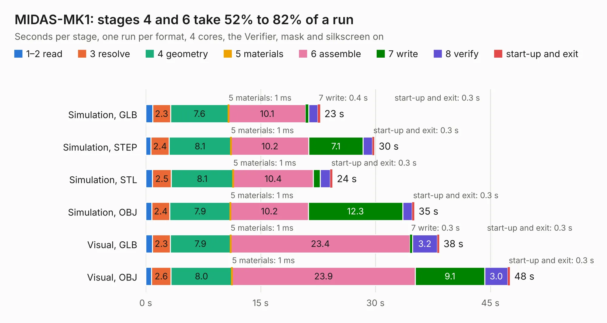

# 1333. MIDAS-MK1

Board 1,333 of the 3,119 of [Corpus Testing](../Corpus-Testing.md), on [Corpus Page 13](../CorpusTestingPages/Corpus-Testing-13.md#1333-midas-mk1).

| Mode and format | 1–2 read | 3 resolve | 4 geometry | 5 materials | 6 assemble | 7 write | 8 verify | start-up and exit | Total |
|---|---:|---:|---:|---:|---:|---:|---:|---:|---:|
| Simulation, GLB | 0.9 | 2.3 | 7.6 | 1&nbsp;ms | 10.1 | 0.4 | 1.2 | 0.3 | 22.8 |
| Simulation, STEP | 0.7 | 2.4 | 8.1 | 1&nbsp;ms | 10.2 | 7.1 | 1.2 | 0.3 | 29.9 |
| Simulation, STL | 0.9 | 2.5 | 8.1 | 1&nbsp;ms | 10.4 | 0.9 | 1.3 | 0.3 | 24.4 |
| Simulation, OBJ | 0.8 | 2.4 | 7.9 | 1&nbsp;ms | 10.2 | 12.3 | 1.2 | 0.3 | 35.1 |
| Visual, GLB | 0.9 | 2.3 | 7.9 | 1&nbsp;ms | 23.4 | 0.3 | 3.2 | 0.3 | 38.3 |
| Visual, OBJ | 0.8 | 2.6 | 8.0 | 1&nbsp;ms | 23.9 | 9.1 | 3.0 | 0.3 | 47.6 |

<table align="center"><tr><td valign="top">

| Board | Repo: [issuiuc/iss-pcb](https://github.com/issuiuc/iss-pcb) Board: `MIDAS-MK1.kicad_pcb` |
|---|---|
| Folder | boards / MIDAS-MK1 / MIDAS-MK1-revA |
| Complexity | 412&nbsp;/&nbsp;1000 (size&nbsp;272, features&nbsp;140) |
| KESE&nbsp;features | through vias, slotted holes, rounded, trapezoid or chamfered pads, filled zones, copper text, curved board outline, TrueType text, stack-up, dielectric εr and tanδ, copper finish, mask and silkscreen colours |
| Tested | 9th November 2026 |
| Copper&nbsp;layers | 4 |
| File&nbsp;format | KiCad 7 (20221018) |
| Parts,&nbsp;tracks,&nbsp;vias | 206, 1,104, 275 |
| Triangles,&nbsp;simulation | 2,663,616 in 346 parts |
| Verifier | PASS in all six runs |

</td><td valign="top">

<table>
<tr><th>File type</th><th>File size</th><th>Peak memory used</th></tr>
<tr><th colspan="3" align="left">Simulation</th></tr>
<tr><td>GLB</td><td align="right">91&nbsp;MB</td><td align="right">847&nbsp;MB</td></tr>
<tr><td>STEP</td><td align="right">391&nbsp;MB</td><td align="right">1.1&nbsp;GB</td></tr>
<tr><td>STL</td><td align="right">133&nbsp;MB</td><td align="right">882&nbsp;MB</td></tr>
<tr><td>OBJ</td><td align="right">281&nbsp;MB</td><td align="right">1.7&nbsp;GB</td></tr>
<tr><th colspan="3" align="left">Visual</th></tr>
<tr><td>GLB</td><td align="right">61&nbsp;MB</td><td align="right">1.1&nbsp;GB</td></tr>
<tr><td>OBJ</td><td align="right">193&nbsp;MB</td><td align="right">1.4&nbsp;GB</td></tr>
</table>

</td></tr></table>

| Previous | Next |
|:---|---:|
| [1332. Feather_Duo](b1332b_iss-pcb_Feather-Duo.md) | [1334. MIDAS-MK1](b1334b_iss-pcb_boards-MIDAS-MK1-MIDAS-MK1-revB_MIDAS-MK1.md) |
