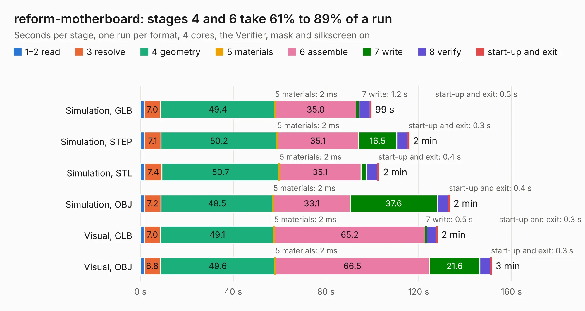

# 1334. reform-motherboard

Board 1,334 of the 3,101 of [Corpus Testing](../Corpus-Testing.md), on [Corpus Page 13](../CorpusTestingPages/Corpus-Testing-13.md#1334-reform-motherboard).

| Mode and format | 1–2 read | 3 resolve | 4 geometry | 5 materials | 6 assemble | 7 write | 8 verify | start-up and exit | Total |
|---|---:|---:|---:|---:|---:|---:|---:|---:|---:|
| Simulation, GLB | 1.7 | 7.0 | 49.4 | 2&nbsp;ms | 35.0 | 1.2 | 4.8 | 0.3 | 99.4 |
| Simulation, STEP | 1.7 | 7.1 | 50.2 | 2&nbsp;ms | 35.1 | 16.5 | 4.9 | 0.3 | 115.8 |
| Simulation, STL | 1.8 | 7.4 | 50.7 | 2&nbsp;ms | 35.1 | 2.3 | 5.0 | 0.4 | 102.8 |
| Simulation, OBJ | 1.7 | 7.2 | 48.5 | 2&nbsp;ms | 33.1 | 37.6 | 4.8 | 0.4 | 133.2 |
| Visual, GLB | 1.7 | 7.0 | 49.1 | 2&nbsp;ms | 65.2 | 0.5 | 4.3 | 0.3 | 128.0 |
| Visual, OBJ | 1.7 | 6.8 | 49.6 | 2&nbsp;ms | 66.5 | 21.6 | 4.8 | 0.3 | 151.4 |

<table align="center"><tr><td valign="top">

| Board | Repo: [jackhumbert/reform](https://github.com/jackhumbert/reform) Board: `reform-motherboard.kicad_pcb` |
|---|---|
| Folder | historic-reform1 / reform-motherboard |
| Complexity | 328&nbsp;/&nbsp;1000 (size&nbsp;283, features&nbsp;45) |
| KESE&nbsp;features | through vias, slotted holes, filled zones |
| Tested | 9th November 2026 |
| Copper&nbsp;layers | 4 |
| File&nbsp;format | KiCad 4 (4) |
| Parts,&nbsp;tracks,&nbsp;vias | 221, 3,746, 531 |
| Triangles,&nbsp;simulation | 6,884,110 in 445 parts |
| Verifier | PASS in all six runs |

</td><td valign="top">

<table>
<tr><th>File type</th><th>File size</th><th>Peak memory used</th></tr>
<tr><th colspan="3" align="left">Simulation</th></tr>
<tr><td>GLB</td><td align="right">241&nbsp;MB</td><td align="right">1.9&nbsp;GB</td></tr>
<tr><td>STEP</td><td align="right">1.0&nbsp;GB</td><td align="right">2.4&nbsp;GB</td></tr>
<tr><td>STL</td><td align="right">344&nbsp;MB</td><td align="right">1.8&nbsp;GB</td></tr>
<tr><td>OBJ</td><td align="right">747&nbsp;MB</td><td align="right">4.5&nbsp;GB</td></tr>
<tr><th colspan="3" align="left">Visual</th></tr>
<tr><td>GLB</td><td align="right">134&nbsp;MB</td><td align="right">2.2&nbsp;GB</td></tr>
<tr><td>OBJ</td><td align="right">426&nbsp;MB</td><td align="right">2.8&nbsp;GB</td></tr>
</table>

</td></tr></table>

| Previous | Next |
|:---|---:|
| [1333. mntcomp-keyboard](b1333b_reform_mntcomp-keyboard.md) | [1335. reform-trackball](b1335b_reform_reform-trackball.md) |
