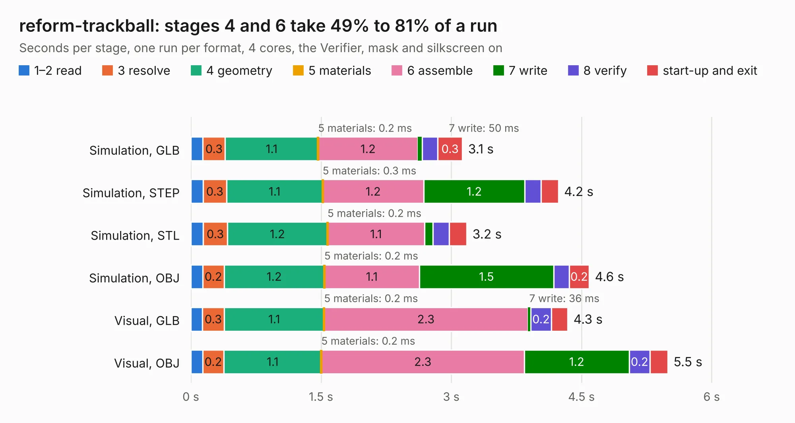

# 1334. reform-trackball

Board 1,334 of the 3,100 of [Corpus Testing](../Corpus-Testing.md), on [Corpus Page 13](../CorpusTestingPages/Corpus-Testing-13.md#1334-reform-trackball).

| Mode and format | 1–2 read | 3 resolve | 4 geometry | 5 materials | 6 assemble | 7 write | 8 verify | start-up and exit | Total |
|---|---:|---:|---:|---:|---:|---:|---:|---:|---:|
| Simulation, GLB | 0.1 | 0.3 | 1.1 | 0.2&nbsp;ms | 1.2 | 50&nbsp;ms | 0.2 | 0.3 | 3.1 |
| Simulation, STEP | 0.1 | 0.3 | 1.1 | 0.3&nbsp;ms | 1.2 | 1.2 | 0.2 | 0.2 | 4.2 |
| Simulation, STL | 0.1 | 0.3 | 1.2 | 0.2&nbsp;ms | 1.1 | 98&nbsp;ms | 0.2 | 0.2 | 3.2 |
| Simulation, OBJ | 0.1 | 0.2 | 1.2 | 0.2&nbsp;ms | 1.1 | 1.5 | 0.2 | 0.2 | 4.6 |
| Visual, GLB | 0.1 | 0.3 | 1.1 | 0.2&nbsp;ms | 2.3 | 36&nbsp;ms | 0.2 | 0.2 | 4.3 |
| Visual, OBJ | 0.1 | 0.2 | 1.1 | 0.2&nbsp;ms | 2.3 | 1.2 | 0.2 | 0.2 | 5.5 |

<table align="center"><tr><td valign="top">

| Board | Repo: [jackhumbert/reform](https://github.com/jackhumbert/reform) Board: `reform-trackball.kicad_pcb` |
|---|---|
| Folder | historic-reform1 / reform-trackball-pcb |
| Complexity | 229&nbsp;/&nbsp;1000 (size&nbsp;184, features&nbsp;45) |
| KESE&nbsp;features | through vias, filled zones, curved board outline |
| Tested | 9th November 2026 |
| Copper&nbsp;layers | 2 |
| File&nbsp;format | KiCad 5 (20171130) |
| Parts,&nbsp;tracks,&nbsp;vias | 15, 275, 35 |
| Triangles,&nbsp;simulation | 302,556 in 43 parts |
| Verifier | PASS in all six runs |

</td><td valign="top">

<table>
<tr><th>File type</th><th>File size</th><th>Peak memory used</th></tr>
<tr><th colspan="3" align="left">Simulation</th></tr>
<tr><td>GLB</td><td align="right">10&nbsp;MB</td><td align="right">238&nbsp;MB</td></tr>
<tr><td>STEP</td><td align="right">47&nbsp;MB</td><td align="right">274&nbsp;MB</td></tr>
<tr><td>STL</td><td align="right">15&nbsp;MB</td><td align="right">240&nbsp;MB</td></tr>
<tr><td>OBJ</td><td align="right">30&nbsp;MB</td><td align="right">259&nbsp;MB</td></tr>
<tr><th colspan="3" align="left">Visual</th></tr>
<tr><td>GLB</td><td align="right">8.0&nbsp;MB</td><td align="right">262&nbsp;MB</td></tr>
<tr><td>OBJ</td><td align="right">23&nbsp;MB</td><td align="right">259&nbsp;MB</td></tr>
</table>

</td></tr></table>

| Previous | Next |
|:---|---:|
| [1333. reform-motherboard](b1333b_reform_reform-motherboard.md) | [1335. reform2-batterypack-upstream](b1335b_reform_reform2-batterypack-upstream.md) |
