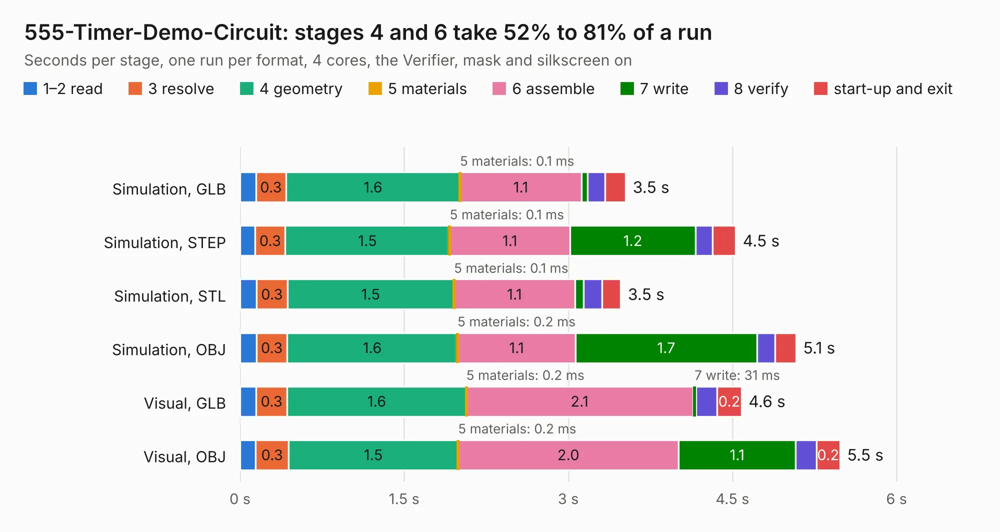

# 1335. 555-Timer-Demo-Circuit

Board 1,335 of the 3,110 of [Corpus Testing](../Corpus-Testing.md), on [Corpus Page 13](../CorpusTestingPages/Corpus-Testing-13.md#1335-555-timer-demo-circuit).

| Mode and format | 1–2 read | 3 resolve | 4 geometry | 5 materials | 6 assemble | 7 write | 8 verify | start-up and exit | Total |
|---|---:|---:|---:|---:|---:|---:|---:|---:|---:|
| Simulation, GLB | 0.1 | 0.3 | 1.6 | 0.1&nbsp;ms | 1.1 | 56&nbsp;ms | 0.2 | 0.2 | 3.5 |
| Simulation, STEP | 0.1 | 0.3 | 1.5 | 0.1&nbsp;ms | 1.1 | 1.2 | 0.2 | 0.2 | 4.5 |
| Simulation, STL | 0.2 | 0.3 | 1.5 | 0.1&nbsp;ms | 1.1 | 77&nbsp;ms | 0.2 | 0.2 | 3.5 |
| Simulation, OBJ | 0.2 | 0.3 | 1.6 | 0.2&nbsp;ms | 1.1 | 1.7 | 0.2 | 0.2 | 5.1 |
| Visual, GLB | 0.1 | 0.3 | 1.6 | 0.2&nbsp;ms | 2.1 | 31&nbsp;ms | 0.2 | 0.2 | 4.6 |
| Visual, OBJ | 0.1 | 0.3 | 1.5 | 0.2&nbsp;ms | 2.0 | 1.1 | 0.2 | 0.2 | 5.5 |

<table align="center"><tr><td valign="top">

| Board | Repo: [issuiuc/iss-pcb](https://github.com/issuiuc/iss-pcb) Board: `555-Timer-Demo-Circuit.kicad_pcb` |
|---|---|
| Folder | boards / Onboarding / 555-Timer-Demo-Circuit |
| Complexity | 168&nbsp;/&nbsp;1000 (size&nbsp;118, features&nbsp;50) |
| KESE&nbsp;features | filled zones, stack-up, dielectric εr and tanδ |
| Tested | 9th November 2026 |
| Copper&nbsp;layers | 2 |
| File&nbsp;format | KiCad 7 (20221018) |
| Parts,&nbsp;tracks,&nbsp;vias | 20, 64, 0 |
| Triangles,&nbsp;simulation | 340,078 in 21 parts |
| Verifier | PASS in all six runs |

</td><td valign="top">

<table>
<tr><th>File type</th><th>File size</th><th>Peak memory used</th></tr>
<tr><th colspan="3" align="left">Simulation</th></tr>
<tr><td>GLB</td><td align="right">12&nbsp;MB</td><td align="right">248&nbsp;MB</td></tr>
<tr><td>STEP</td><td align="right">47&nbsp;MB</td><td align="right">281&nbsp;MB</td></tr>
<tr><td>STL</td><td align="right">17&nbsp;MB</td><td align="right">251&nbsp;MB</td></tr>
<tr><td>OBJ</td><td align="right">34&nbsp;MB</td><td align="right">265&nbsp;MB</td></tr>
<tr><th colspan="3" align="left">Visual</th></tr>
<tr><td>GLB</td><td align="right">7.2&nbsp;MB</td><td align="right">252&nbsp;MB</td></tr>
<tr><td>OBJ</td><td align="right">21&nbsp;MB</td><td align="right">245&nbsp;MB</td></tr>
</table>

</td></tr></table>

| Previous | Next |
|:---|---:|
| [1334. GATOR](b1334b_iss-pcb_GATOR.md) | [1336. L1-Altimeter](b1336b_iss-pcb_L1-Altimeter.md) |
