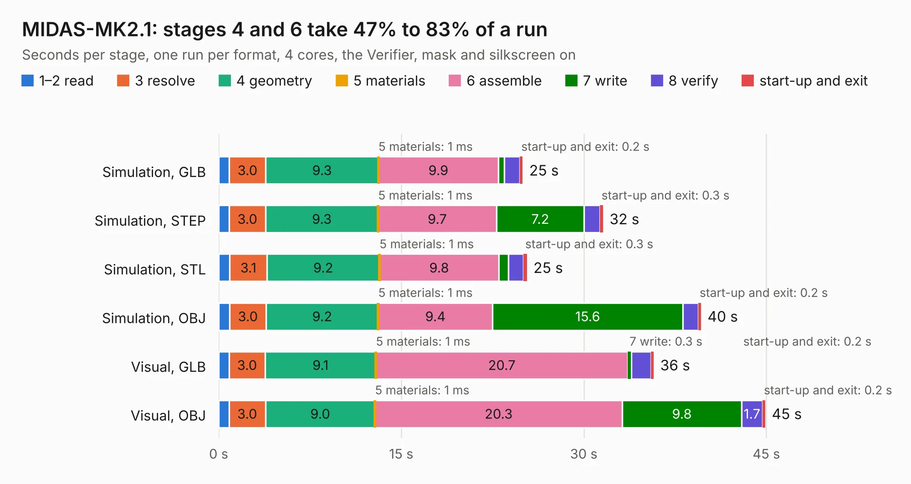

# 1337. MIDAS-MK2.1

Board 1,337 of the 3,117 of [Corpus Testing](../Corpus-Testing.md), on [Corpus Page 13](../CorpusTestingPages/Corpus-Testing-13.md#1337-midas-mk21).

| Mode and format | 1–2 read | 3 resolve | 4 geometry | 5 materials | 6 assemble | 7 write | 8 verify | start-up and exit | Total |
|---|---:|---:|---:|---:|---:|---:|---:|---:|---:|
| Simulation, GLB | 0.9 | 3.0 | 9.3 | 1&nbsp;ms | 9.9 | 0.5 | 1.3 | 0.2 | 25.0 |
| Simulation, STEP | 0.9 | 3.0 | 9.3 | 1&nbsp;ms | 9.7 | 7.2 | 1.3 | 0.3 | 31.6 |
| Simulation, STL | 0.9 | 3.1 | 9.2 | 1&nbsp;ms | 9.8 | 0.8 | 1.3 | 0.3 | 25.3 |
| Simulation, OBJ | 0.9 | 3.0 | 9.2 | 1&nbsp;ms | 9.4 | 15.6 | 1.3 | 0.2 | 39.6 |
| Visual, GLB | 0.9 | 3.0 | 9.1 | 1&nbsp;ms | 20.7 | 0.3 | 1.6 | 0.2 | 35.7 |
| Visual, OBJ | 0.8 | 3.0 | 9.0 | 1&nbsp;ms | 20.3 | 9.8 | 1.7 | 0.2 | 44.9 |

<table align="center"><tr><td valign="top">

| Board | Repo: [issuiuc/iss-pcb](https://github.com/issuiuc/iss-pcb) Board: `MIDAS-MK2.1.kicad_pcb` |
|---|---|
| Folder | boards / MIDAS-MK2 / MIDAS-MK2.1-revB |
| Complexity | 433&nbsp;/&nbsp;1000 (size&nbsp;268, features&nbsp;165) |
| KESE&nbsp;features | through vias, slotted holes, custom pads, rounded, trapezoid or chamfered pads, filled zones, copper drawings, copper text, curved board outline, TrueType text, stack-up, dielectric εr and tanδ, copper finish, mask and silkscreen colours |
| Tested | 9th November 2026 |
| Copper&nbsp;layers | 4 |
| File&nbsp;format | KiCad 8 (20240108) |
| Parts,&nbsp;tracks,&nbsp;vias | 189, 1,223, 478 |
| Triangles,&nbsp;simulation | 2,942,062 in 250 parts |
| Verifier | PASS in all six runs |

</td><td valign="top">

<table>
<tr><th>File type</th><th>File size</th><th>Peak memory used</th></tr>
<tr><th colspan="3" align="left">Simulation</th></tr>
<tr><td>GLB</td><td align="right">100&nbsp;MB</td><td align="right">984&nbsp;MB</td></tr>
<tr><td>STEP</td><td align="right">381&nbsp;MB</td><td align="right">1.2&nbsp;GB</td></tr>
<tr><td>STL</td><td align="right">147&nbsp;MB</td><td align="right">980&nbsp;MB</td></tr>
<tr><td>OBJ</td><td align="right">309&nbsp;MB</td><td align="right">1.9&nbsp;GB</td></tr>
<tr><th colspan="3" align="left">Visual</th></tr>
<tr><td>GLB</td><td align="right">65&nbsp;MB</td><td align="right">1.2&nbsp;GB</td></tr>
<tr><td>OBJ</td><td align="right">205&nbsp;MB</td><td align="right">1.4&nbsp;GB</td></tr>
</table>

</td></tr></table>

| Previous | Next |
|:---|---:|
| [1336. MIDAS-MK2.1](b1336b_iss-pcb_boards-MIDAS-MK2-MIDAS-MK2-1-revA_MIDAS-MK2-1.md) | [1338. Mini-MK1](b1338b_iss-pcb_Mini-MK1.md) |
