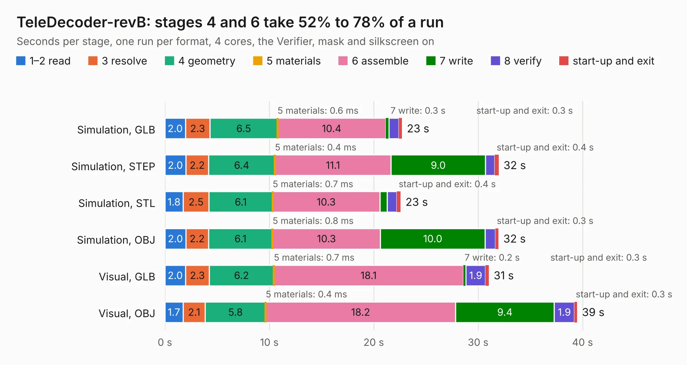

# 1338. TeleDecoder-revB

Board 1,338 of the 3,109 of [Corpus Testing](../Corpus-Testing.md), on [Corpus Page 13](../CorpusTestingPages/Corpus-Testing-13.md#1338-teledecoder-revb).

| Mode and format | 1–2 read | 3 resolve | 4 geometry | 5 materials | 6 assemble | 7 write | 8 verify | start-up and exit | Total |
|---|---:|---:|---:|---:|---:|---:|---:|---:|---:|
| Simulation, GLB | 2.0 | 2.3 | 6.5 | 0.6&nbsp;ms | 10.4 | 0.3 | 1.0 | 0.3 | 22.7 |
| Simulation, STEP | 2.0 | 2.2 | 6.4 | 0.4&nbsp;ms | 11.1 | 9.0 | 0.9 | 0.4 | 32.0 |
| Simulation, STL | 1.8 | 2.5 | 6.1 | 0.7&nbsp;ms | 10.3 | 0.7 | 0.9 | 0.4 | 22.6 |
| Simulation, OBJ | 2.0 | 2.2 | 6.1 | 0.8&nbsp;ms | 10.3 | 10.0 | 1.0 | 0.3 | 31.9 |
| Visual, GLB | 2.0 | 2.3 | 6.2 | 0.7&nbsp;ms | 18.1 | 0.2 | 1.9 | 0.3 | 31.0 |
| Visual, OBJ | 1.7 | 2.1 | 5.8 | 0.4&nbsp;ms | 18.2 | 9.4 | 1.9 | 0.3 | 39.5 |

<table align="center"><tr><td valign="top">

| Board | Repo: [issuiuc/iss-pcb](https://github.com/issuiuc/iss-pcb) Board: `TeleDecoder-revB.kicad_pcb` |
|---|---|
| Folder | boards / TeleDecoder / TeleDecoder-revB |
| Complexity | 346&nbsp;/&nbsp;1000 (size&nbsp;221, features&nbsp;125) |
| KESE&nbsp;features | through vias, slotted holes, custom pads, rounded, trapezoid or chamfered pads, filled zones, copper drawings, curved board outline, stack-up, dielectric εr and tanδ, mask and silkscreen colours |
| Tested | 9th November 2026 |
| Copper&nbsp;layers | 4 |
| File&nbsp;format | KiCad 10 (20260206) |
| Parts,&nbsp;tracks,&nbsp;vias | 64, 282, 81 |
| Triangles,&nbsp;simulation | 1,512,512 in 92 parts |
| Verifier | PASS in all six runs |

</td><td valign="top">

<table>
<tr><th>File type</th><th>File size</th><th>Peak memory used</th></tr>
<tr><th colspan="3" align="left">Simulation</th></tr>
<tr><td>GLB</td><td align="right">53&nbsp;MB</td><td align="right">788&nbsp;MB</td></tr>
<tr><td>STEP</td><td align="right">180&nbsp;MB</td><td align="right">820&nbsp;MB</td></tr>
<tr><td>STL</td><td align="right">76&nbsp;MB</td><td align="right">826&nbsp;MB</td></tr>
<tr><td>OBJ</td><td align="right">162&nbsp;MB</td><td align="right">1.1&nbsp;GB</td></tr>
<tr><th colspan="3" align="left">Visual</th></tr>
<tr><td>GLB</td><td align="right">43&nbsp;MB</td><td align="right">942&nbsp;MB</td></tr>
<tr><td>OBJ</td><td align="right">132&nbsp;MB</td><td align="right">975&nbsp;MB</td></tr>
</table>

</td></tr></table>

| Previous | Next |
|:---|---:|
| [1337. TeleDecoder-revA](b1337b_iss-pcb_TeleDecoder-revA.md) | [1339. Amiga600](b1339b_A600Reborn_Amiga600.md) |
