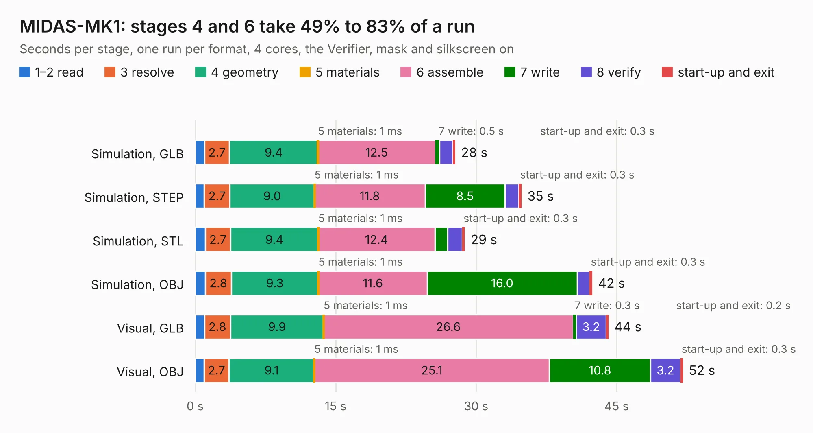

# 1338. MIDAS-MK1

Board 1,338 of the 3,124 of [Corpus Testing](../Corpus-Testing.md), on [Corpus Page 13](../CorpusTestingPages/Corpus-Testing-13.md#1338-midas-mk1).

| Mode and format | 1–2 read | 3 resolve | 4 geometry | 5 materials | 6 assemble | 7 write | 8 verify | start-up and exit | Total |
|---|---:|---:|---:|---:|---:|---:|---:|---:|---:|
| Simulation, GLB | 1.0 | 2.7 | 9.4 | 1&nbsp;ms | 12.5 | 0.5 | 1.4 | 0.3 | 27.8 |
| Simulation, STEP | 1.0 | 2.7 | 9.0 | 1&nbsp;ms | 11.8 | 8.5 | 1.5 | 0.3 | 34.9 |
| Simulation, STL | 1.1 | 2.7 | 9.4 | 1&nbsp;ms | 12.4 | 1.3 | 1.6 | 0.3 | 28.8 |
| Simulation, OBJ | 1.1 | 2.8 | 9.3 | 1&nbsp;ms | 11.6 | 16.0 | 1.3 | 0.3 | 42.4 |
| Visual, GLB | 1.0 | 2.8 | 9.9 | 1&nbsp;ms | 26.6 | 0.3 | 3.2 | 0.2 | 44.1 |
| Visual, OBJ | 1.0 | 2.7 | 9.1 | 1&nbsp;ms | 25.1 | 10.8 | 3.2 | 0.3 | 52.1 |

<table align="center"><tr><td valign="top">

| Board | Repo: [issuiuc/iss-pcb](https://github.com/issuiuc/iss-pcb) Board: `MIDAS-MK1.kicad_pcb` |
|---|---|
| Folder | boards / MIDAS-MK1 / MIDAS-MK1-revB |
| Complexity | 413&nbsp;/&nbsp;1000 (size&nbsp;273, features&nbsp;140) |
| KESE&nbsp;features | through vias, slotted holes, rounded, trapezoid or chamfered pads, filled zones, copper text, curved board outline, TrueType text, stack-up, dielectric εr and tanδ, copper finish, mask and silkscreen colours |
| Tested | 9th November 2026 |
| Copper&nbsp;layers | 4 |
| File&nbsp;format | KiCad 7 (20221018) |
| Parts,&nbsp;tracks,&nbsp;vias | 206, 1,110, 281 |
| Triangles,&nbsp;simulation | 2,713,870 in 346 parts |
| Verifier | PASS in all six runs |

</td><td valign="top">

<table>
<tr><th>File type</th><th>File size</th><th>Peak memory used</th></tr>
<tr><th colspan="3" align="left">Simulation</th></tr>
<tr><td>GLB</td><td align="right">92&nbsp;MB</td><td align="right">867&nbsp;MB</td></tr>
<tr><td>STEP</td><td align="right">399&nbsp;MB</td><td align="right">1.1&nbsp;GB</td></tr>
<tr><td>STL</td><td align="right">136&nbsp;MB</td><td align="right">898&nbsp;MB</td></tr>
<tr><td>OBJ</td><td align="right">286&nbsp;MB</td><td align="right">1.8&nbsp;GB</td></tr>
<tr><th colspan="3" align="left">Visual</th></tr>
<tr><td>GLB</td><td align="right">63&nbsp;MB</td><td align="right">1.2&nbsp;GB</td></tr>
<tr><td>OBJ</td><td align="right">197&nbsp;MB</td><td align="right">1.4&nbsp;GB</td></tr>
</table>

</td></tr></table>

| Previous | Next |
|:---|---:|
| [1337. MIDAS-MK1](b1337b_iss-pcb_boards-MIDAS-MK1-MIDAS-MK1-revA_MIDAS-MK1.md) | [1339. MIDAS-MK1.1](b1339b_iss-pcb_boards-MIDAS-MK1-MIDAS-MK1-1-revA_MIDAS-MK1-1.md) |
