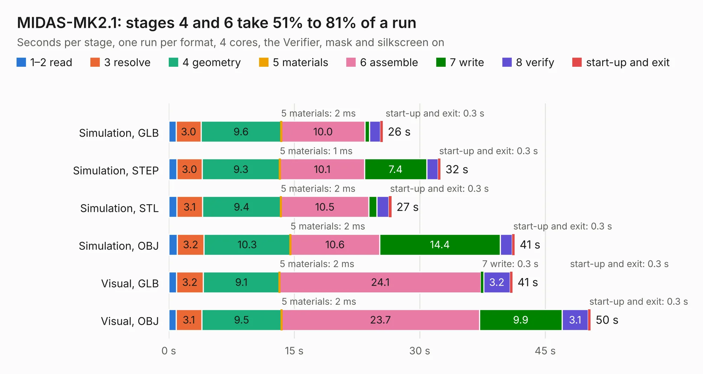

# 1343. MIDAS-MK2.1

Board 1,343 of the 3,129 of [Corpus Testing](../Corpus-Testing.md), on [Corpus Page 13](../CorpusTestingPages/Corpus-Testing-13.md#1343-midas-mk21).

| Mode and format | 1–2 read | 3 resolve | 4 geometry | 5 materials | 6 assemble | 7 write | 8 verify | start-up and exit | Total |
|---|---:|---:|---:|---:|---:|---:|---:|---:|---:|
| Simulation, GLB | 0.9 | 3.0 | 9.6 | 2&nbsp;ms | 10.0 | 0.5 | 1.3 | 0.3 | 25.6 |
| Simulation, STEP | 1.0 | 3.0 | 9.3 | 1&nbsp;ms | 10.1 | 7.4 | 1.4 | 0.3 | 32.5 |
| Simulation, STL | 1.0 | 3.1 | 9.4 | 2&nbsp;ms | 10.5 | 1.0 | 1.4 | 0.3 | 26.6 |
| Simulation, OBJ | 1.0 | 3.2 | 10.3 | 2&nbsp;ms | 10.6 | 14.4 | 1.4 | 0.3 | 41.3 |
| Visual, GLB | 0.9 | 3.2 | 9.1 | 2&nbsp;ms | 24.1 | 0.3 | 3.2 | 0.3 | 41.1 |
| Visual, OBJ | 0.9 | 3.1 | 9.5 | 2&nbsp;ms | 23.7 | 9.9 | 3.1 | 0.3 | 50.4 |

<table align="center"><tr><td valign="top">

| Board | Repo: [issuiuc/iss-pcb](https://github.com/issuiuc/iss-pcb) Board: `MIDAS-MK2.1.kicad_pcb` |
|---|---|
| Folder | boards / MIDAS-MK2 / MIDAS-MK2.1-revA |
| Complexity | 432&nbsp;/&nbsp;1000 (size&nbsp;267, features&nbsp;165) |
| KESE&nbsp;features | through vias, slotted holes, custom pads, rounded, trapezoid or chamfered pads, filled zones, copper drawings, copper text, curved board outline, TrueType text, stack-up, dielectric εr and tanδ, copper finish, mask and silkscreen colours |
| Tested | 9th November 2026 |
| Copper&nbsp;layers | 4 |
| File&nbsp;format | KiCad 8 (20240108) |
| Parts,&nbsp;tracks,&nbsp;vias | 193, 1,196, 432 |
| Triangles,&nbsp;simulation | 2,838,746 in 255 parts |
| Verifier | PASS in all six runs |

</td><td valign="top">

<table>
<tr><th>File type</th><th>File size</th><th>Peak memory used</th></tr>
<tr><th colspan="3" align="left">Simulation</th></tr>
<tr><td>GLB</td><td align="right">97&nbsp;MB</td><td align="right">948&nbsp;MB</td></tr>
<tr><td>STEP</td><td align="right">377&nbsp;MB</td><td align="right">1.1&nbsp;GB</td></tr>
<tr><td>STL</td><td align="right">142&nbsp;MB</td><td align="right">917&nbsp;MB</td></tr>
<tr><td>OBJ</td><td align="right">298&nbsp;MB</td><td align="right">1.8&nbsp;GB</td></tr>
<tr><th colspan="3" align="left">Visual</th></tr>
<tr><td>GLB</td><td align="right">64&nbsp;MB</td><td align="right">1.2&nbsp;GB</td></tr>
<tr><td>OBJ</td><td align="right">199&nbsp;MB</td><td align="right">1.4&nbsp;GB</td></tr>
</table>

</td></tr></table>

| Previous | Next |
|:---|---:|
| [1342. MIDAS-MK2](b1342b_iss-pcb_MIDAS-MK2.md) | [1344. MIDAS-MK2.1](b1344b_iss-pcb_boards-MIDAS-MK2-MIDAS-MK2-1-revB_MIDAS-MK2-1.md) |
