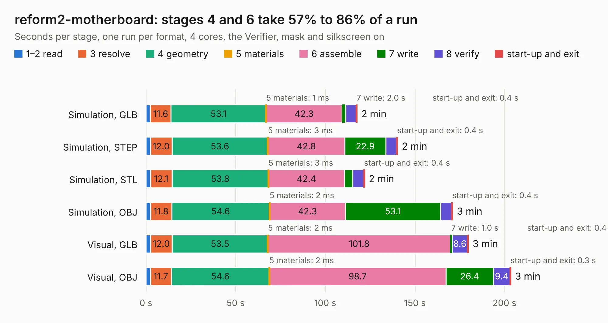

# 1343. reform2-motherboard

Board 1,343 of the 3,103 of [Corpus Testing](../Corpus-Testing.md), on [Corpus Page 13](../CorpusTestingPages/Corpus-Testing-13.md#1343-reform2-motherboard).

| Mode and format | 1–2 read | 3 resolve | 4 geometry | 5 materials | 6 assemble | 7 write | 8 verify | start-up and exit | Total |
|---|---:|---:|---:|---:|---:|---:|---:|---:|---:|
| Simulation, GLB | 2.4 | 11.6 | 53.1 | 1&nbsp;ms | 42.3 | 2.0 | 5.9 | 0.4 | 117.7 |
| Simulation, STEP | 2.5 | 12.0 | 53.6 | 3&nbsp;ms | 42.8 | 22.9 | 6.2 | 0.4 | 140.3 |
| Simulation, STL | 2.5 | 12.1 | 53.8 | 3&nbsp;ms | 42.4 | 4.6 | 6.2 | 0.4 | 121.9 |
| Simulation, OBJ | 2.5 | 11.8 | 54.6 | 2&nbsp;ms | 42.3 | 53.1 | 6.3 | 0.4 | 171.1 |
| Visual, GLB | 2.5 | 12.0 | 53.5 | 2&nbsp;ms | 101.8 | 1.0 | 8.6 | 0.4 | 179.8 |
| Visual, OBJ | 2.5 | 11.7 | 54.6 | 2&nbsp;ms | 98.7 | 26.4 | 9.4 | 0.3 | 203.5 |

<table align="center"><tr><td valign="top">

| Board | Repo: [jackhumbert/reform](https://github.com/jackhumbert/reform) Board: `reform2-motherboard.kicad_pcb` |
|---|---|
| Folder | reform2-motherboard-pcb |
| Complexity | 396&nbsp;/&nbsp;1000 (size&nbsp;326, features&nbsp;70) |
| KESE&nbsp;features | through vias, slotted holes, custom pads, rounded, trapezoid or chamfered pads, filled zones |
| Tested | 9th November 2026 |
| Copper&nbsp;layers | 6 |
| File&nbsp;format | KiCad 5 (20171130) |
| Parts,&nbsp;tracks,&nbsp;vias | 489, 11,666, 1,086 |
| Triangles,&nbsp;simulation | 11,131,628 in 664 parts |
| Verifier | PASS in all six runs |

</td><td valign="top">

<table>
<tr><th>File type</th><th>File size</th><th>Peak memory used</th></tr>
<tr><th colspan="3" align="left">Simulation</th></tr>
<tr><td>GLB</td><td align="right">385&nbsp;MB</td><td align="right">2.7&nbsp;GB</td></tr>
<tr><td>STEP</td><td align="right">1.6&nbsp;GB</td><td align="right">3.9&nbsp;GB</td></tr>
<tr><td>STL</td><td align="right">557&nbsp;MB</td><td align="right">2.5&nbsp;GB</td></tr>
<tr><td>OBJ</td><td align="right">1.2&nbsp;GB</td><td align="right">7.1&nbsp;GB</td></tr>
<tr><th colspan="3" align="left">Visual</th></tr>
<tr><td>GLB</td><td align="right">204&nbsp;MB</td><td align="right">3.2&nbsp;GB</td></tr>
<tr><td>OBJ</td><td align="right">661&nbsp;MB</td><td align="right">4.3&nbsp;GB</td></tr>
</table>

</td></tr></table>

| Previous | Next |
|:---|---:|
| [1342. reform2-keyboard3](b1342b_reform_reform2-keyboard3.md) | [1344. reform2-motherboard25](b1344b_reform_reform2-motherboard25.md) |
