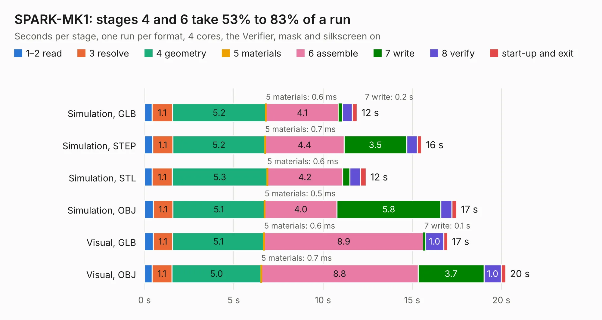

# 1348. SPARK-MK1

Board 1,348 of the 3,123 of [Corpus Testing](../Corpus-Testing.md), on [Corpus Page 13](../CorpusTestingPages/Corpus-Testing-13.md#1348-spark-mk1).

| Mode and format | 1–2 read | 3 resolve | 4 geometry | 5 materials | 6 assemble | 7 write | 8 verify | start-up and exit | Total |
|---|---:|---:|---:|---:|---:|---:|---:|---:|---:|
| Simulation, GLB | 0.4 | 1.1 | 5.2 | 0.6&nbsp;ms | 4.1 | 0.2 | 0.6 | 0.3 | 11.9 |
| Simulation, STEP | 0.5 | 1.1 | 5.2 | 0.7&nbsp;ms | 4.4 | 3.5 | 0.6 | 0.2 | 15.5 |
| Simulation, STL | 0.4 | 1.1 | 5.3 | 0.6&nbsp;ms | 4.2 | 0.4 | 0.6 | 0.3 | 12.4 |
| Simulation, OBJ | 0.5 | 1.1 | 5.1 | 0.5&nbsp;ms | 4.0 | 5.8 | 0.6 | 0.3 | 17.5 |
| Visual, GLB | 0.5 | 1.1 | 5.1 | 0.6&nbsp;ms | 8.9 | 0.1 | 1.0 | 0.2 | 17.0 |
| Visual, OBJ | 0.4 | 1.1 | 5.0 | 0.7&nbsp;ms | 8.8 | 3.7 | 1.0 | 0.3 | 20.2 |

<table align="center"><tr><td valign="top">

| Board | Repo: [issuiuc/iss-pcb](https://github.com/issuiuc/iss-pcb) Board: `SPARK-MK1.kicad_pcb` |
|---|---|
| Folder | boards / SPARK-MK1 |
| Complexity | 301&nbsp;/&nbsp;1000 (size&nbsp;161, features&nbsp;140) |
| KESE&nbsp;features | through vias, custom pads, rounded, trapezoid or chamfered pads, filled zones, copper drawings, curved board outline, knockout text, TrueType text, stack-up, dielectric εr and tanδ |
| Tested | 9th November 2026 |
| Copper&nbsp;layers | 2 |
| File&nbsp;format | KiCad 8 (20240108) |
| Parts,&nbsp;tracks,&nbsp;vias | 74, 254, 40 |
| Triangles,&nbsp;simulation | 1,005,830 in 128 parts |
| Verifier | PASS in all six runs |

</td><td valign="top">

<table>
<tr><th>File type</th><th>File size</th><th>Peak memory used</th></tr>
<tr><th colspan="3" align="left">Simulation</th></tr>
<tr><td>GLB</td><td align="right">34&nbsp;MB</td><td align="right">431&nbsp;MB</td></tr>
<tr><td>STEP</td><td align="right">162&nbsp;MB</td><td align="right">534&nbsp;MB</td></tr>
<tr><td>STL</td><td align="right">50&nbsp;MB</td><td align="right">409&nbsp;MB</td></tr>
<tr><td>OBJ</td><td align="right">102&nbsp;MB</td><td align="right">723&nbsp;MB</td></tr>
<tr><th colspan="3" align="left">Visual</th></tr>
<tr><td>GLB</td><td align="right">23&nbsp;MB</td><td align="right">568&nbsp;MB</td></tr>
<tr><td>OBJ</td><td align="right">68&nbsp;MB</td><td align="right">579&nbsp;MB</td></tr>
</table>

</td></tr></table>

| Previous | Next |
|:---|---:|
| [1347. L1-Altimeter](b1347b_iss-pcb_L1-Altimeter.md) | [1349. TeleDecoder-revA](b1349b_iss-pcb_TeleDecoder-revA.md) |
