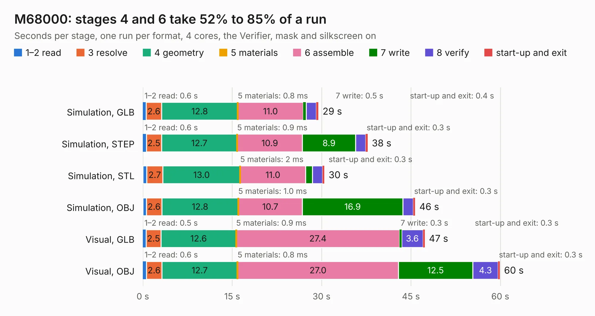

# 1348. M68000

Board 1,348 of the 3,118 of [Corpus Testing](../Corpus-Testing.md), on [Corpus Page 13](../CorpusTestingPages/Corpus-Testing-13.md#1348-m68000).

| Mode and format | 1–2 read | 3 resolve | 4 geometry | 5 materials | 6 assemble | 7 write | 8 verify | start-up and exit | Total |
|---|---:|---:|---:|---:|---:|---:|---:|---:|---:|
| Simulation, GLB | 0.6 | 2.6 | 12.8 | 0.8&nbsp;ms | 11.0 | 0.5 | 1.7 | 0.4 | 29.5 |
| Simulation, STEP | 0.6 | 2.5 | 12.7 | 0.9&nbsp;ms | 10.9 | 8.9 | 1.7 | 0.3 | 37.7 |
| Simulation, STL | 0.6 | 2.7 | 13.0 | 2&nbsp;ms | 11.0 | 1.2 | 1.7 | 0.3 | 30.5 |
| Simulation, OBJ | 0.6 | 2.6 | 12.8 | 1.0&nbsp;ms | 10.7 | 16.9 | 1.7 | 0.3 | 45.7 |
| Visual, GLB | 0.5 | 2.5 | 12.6 | 0.9&nbsp;ms | 27.4 | 0.3 | 3.6 | 0.3 | 47.3 |
| Visual, OBJ | 0.6 | 2.6 | 12.7 | 0.8&nbsp;ms | 27.0 | 12.5 | 4.3 | 0.3 | 59.9 |

<table align="center"><tr><td valign="top">

| Board | Repo: [jack-mil/mcd-pcb](https://github.com/jack-mil/mcd-pcb) Board: `M68000.kicad_pcb` |
|---|---|
| Complexity | 332&nbsp;/&nbsp;1000 (size&nbsp;247, features&nbsp;85) |
| KESE&nbsp;features | through vias, slotted holes, rounded, trapezoid or chamfered pads, filled zones, stack-up, dielectric εr and tanδ |
| Tested | 9th November 2026 |
| Copper&nbsp;layers | 2 |
| File&nbsp;format | KiCad 6 (20211014) |
| Parts,&nbsp;tracks,&nbsp;vias | 70, 1,709, 272 |
| Triangles,&nbsp;simulation | 2,985,686 in 191 parts |
| Verifier | PASS in all six runs |

</td><td valign="top">

<table>
<tr><th>File type</th><th>File size</th><th>Peak memory used</th></tr>
<tr><th colspan="3" align="left">Simulation</th></tr>
<tr><td>GLB</td><td align="right">100&nbsp;MB</td><td align="right">1.2&nbsp;GB</td></tr>
<tr><td>STEP</td><td align="right">460&nbsp;MB</td><td align="right">1.3&nbsp;GB</td></tr>
<tr><td>STL</td><td align="right">149&nbsp;MB</td><td align="right">1.2&nbsp;GB</td></tr>
<tr><td>OBJ</td><td align="right">311&nbsp;MB</td><td align="right">1.9&nbsp;GB</td></tr>
<tr><th colspan="3" align="left">Visual</th></tr>
<tr><td>GLB</td><td align="right">70&nbsp;MB</td><td align="right">1.2&nbsp;GB</td></tr>
<tr><td>OBJ</td><td align="right">221&nbsp;MB</td><td align="right">1.4&nbsp;GB</td></tr>
</table>

</td></tr></table>

| Previous | Next |
|:---|---:|
| [1347. Amiga600](b1347b_A600Reborn_Amiga600.md) | [1349. mntcomp-keyboard](b1349b_reform_mntcomp-keyboard.md) |
