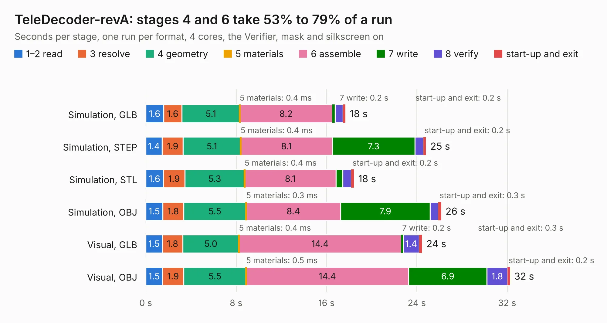

# 1349. TeleDecoder-revA

Board 1,349 of the 3,123 of [Corpus Testing](../Corpus-Testing.md), on [Corpus Page 13](../CorpusTestingPages/Corpus-Testing-13.md#1349-teledecoder-reva).

| Mode and format | 1–2 read | 3 resolve | 4 geometry | 5 materials | 6 assemble | 7 write | 8 verify | start-up and exit | Total |
|---|---:|---:|---:|---:|---:|---:|---:|---:|---:|
| Simulation, GLB | 1.6 | 1.6 | 5.1 | 0.4&nbsp;ms | 8.2 | 0.2 | 0.7 | 0.2 | 17.7 |
| Simulation, STEP | 1.4 | 1.9 | 5.1 | 0.4&nbsp;ms | 8.1 | 7.3 | 0.7 | 0.2 | 24.8 |
| Simulation, STL | 1.6 | 1.9 | 5.3 | 0.4&nbsp;ms | 8.1 | 0.6 | 0.8 | 0.2 | 18.4 |
| Simulation, OBJ | 1.5 | 1.8 | 5.5 | 0.3&nbsp;ms | 8.4 | 7.9 | 0.7 | 0.3 | 26.2 |
| Visual, GLB | 1.5 | 1.8 | 5.0 | 0.4&nbsp;ms | 14.4 | 0.2 | 1.4 | 0.3 | 24.5 |
| Visual, OBJ | 1.5 | 1.9 | 5.5 | 0.5&nbsp;ms | 14.4 | 6.9 | 1.8 | 0.2 | 32.2 |

<table align="center"><tr><td valign="top">

| Board | Repo: [issuiuc/iss-pcb](https://github.com/issuiuc/iss-pcb) Board: `TeleDecoder-revA.kicad_pcb` |
|---|---|
| Folder | boards / TeleDecoder / TeleDecoder-revA |
| Complexity | 337&nbsp;/&nbsp;1000 (size&nbsp;217, features&nbsp;120) |
| KESE&nbsp;features | through vias, slotted holes, custom pads, rounded, trapezoid or chamfered pads, filled zones, copper drawings, curved board outline, stack-up, dielectric εr and tanδ |
| Tested | 9th November 2026 |
| Copper&nbsp;layers | 4 |
| File&nbsp;format | KiCad 10 (20260206) |
| Parts,&nbsp;tracks,&nbsp;vias | 64, 282, 45 |
| Triangles,&nbsp;simulation | 1,445,822 in 92 parts |
| Verifier | PASS in all six runs |

</td><td valign="top">

<table>
<tr><th>File type</th><th>File size</th><th>Peak memory used</th></tr>
<tr><th colspan="3" align="left">Simulation</th></tr>
<tr><td>GLB</td><td align="right">51&nbsp;MB</td><td align="right">788&nbsp;MB</td></tr>
<tr><td>STEP</td><td align="right">178&nbsp;MB</td><td align="right">827&nbsp;MB</td></tr>
<tr><td>STL</td><td align="right">72&nbsp;MB</td><td align="right">779&nbsp;MB</td></tr>
<tr><td>OBJ</td><td align="right">152&nbsp;MB</td><td align="right">1.1&nbsp;GB</td></tr>
<tr><th colspan="3" align="left">Visual</th></tr>
<tr><td>GLB</td><td align="right">42&nbsp;MB</td><td align="right">833&nbsp;MB</td></tr>
<tr><td>OBJ</td><td align="right">126&nbsp;MB</td><td align="right">945&nbsp;MB</td></tr>
</table>

</td></tr></table>

| Previous | Next |
|:---|---:|
| [1348. SPARK-MK1](b1348b_iss-pcb_SPARK-MK1.md) | [1350. TeleDecoder-revB](b1350b_iss-pcb_TeleDecoder-revB.md) |
