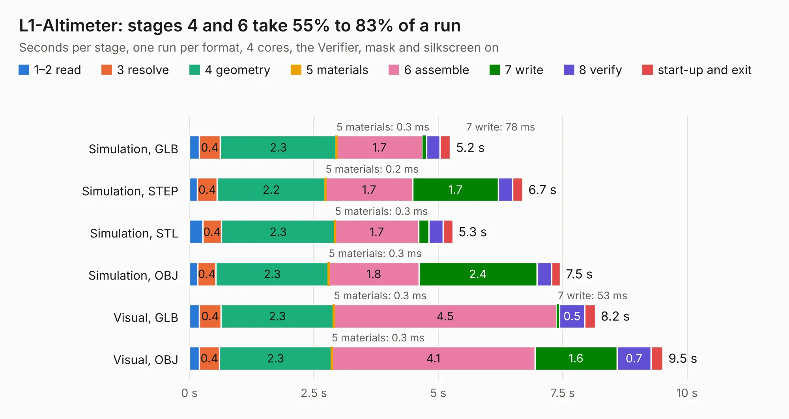

# 1350. L1-Altimeter

Board 1,350 of the 3,131 of [Corpus Testing](../Corpus-Testing.md), on [Corpus Page 13](../CorpusTestingPages/Corpus-Testing-13.md#1350-l1-altimeter).

| Mode and format | 1–2 read | 3 resolve | 4 geometry | 5 materials | 6 assemble | 7 write | 8 verify | start-up and exit | Total |
|---|---:|---:|---:|---:|---:|---:|---:|---:|---:|
| Simulation, GLB | 0.2 | 0.4 | 2.3 | 0.3&nbsp;ms | 1.7 | 78&nbsp;ms | 0.3 | 0.2 | 5.2 |
| Simulation, STEP | 0.2 | 0.4 | 2.2 | 0.2&nbsp;ms | 1.7 | 1.7 | 0.3 | 0.2 | 6.7 |
| Simulation, STL | 0.3 | 0.4 | 2.3 | 0.3&nbsp;ms | 1.7 | 0.2 | 0.3 | 0.2 | 5.3 |
| Simulation, OBJ | 0.2 | 0.4 | 2.3 | 0.3&nbsp;ms | 1.8 | 2.4 | 0.3 | 0.2 | 7.5 |
| Visual, GLB | 0.2 | 0.4 | 2.3 | 0.3&nbsp;ms | 4.5 | 53&nbsp;ms | 0.5 | 0.2 | 8.2 |
| Visual, OBJ | 0.2 | 0.4 | 2.3 | 0.3&nbsp;ms | 4.1 | 1.6 | 0.7 | 0.2 | 9.5 |

<table align="center"><tr><td valign="top">

| Board | Repo: [issuiuc/iss-pcb](https://github.com/issuiuc/iss-pcb) Board: `L1-Altimeter.kicad_pcb` |
|---|---|
| Folder | boards / Onboarding / L1-Altimeter |
| Complexity | 279&nbsp;/&nbsp;1000 (size&nbsp;204, features&nbsp;75) |
| KESE&nbsp;features | through vias, rounded, trapezoid or chamfered pads, filled zones, stack-up, dielectric εr and tanδ |
| Tested | 9th November 2026 |
| Copper&nbsp;layers | 2 |
| File&nbsp;format | KiCad 7 (20221018) |
| Parts,&nbsp;tracks,&nbsp;vias | 42, 260, 44 |
| Triangles,&nbsp;simulation | 574,084 in 67 parts |
| Verifier | PASS in all six runs |

</td><td valign="top">

<table>
<tr><th>File type</th><th>File size</th><th>Peak memory used</th></tr>
<tr><th colspan="3" align="left">Simulation</th></tr>
<tr><td>GLB</td><td align="right">20&nbsp;MB</td><td align="right">324&nbsp;MB</td></tr>
<tr><td>STEP</td><td align="right">86&nbsp;MB</td><td align="right">373&nbsp;MB</td></tr>
<tr><td>STL</td><td align="right">29&nbsp;MB</td><td align="right">339&nbsp;MB</td></tr>
<tr><td>OBJ</td><td align="right">58&nbsp;MB</td><td align="right">425&nbsp;MB</td></tr>
<tr><th colspan="3" align="left">Visual</th></tr>
<tr><td>GLB</td><td align="right">13&nbsp;MB</td><td align="right">394&nbsp;MB</td></tr>
<tr><td>OBJ</td><td align="right">40&nbsp;MB</td><td align="right">389&nbsp;MB</td></tr>
</table>

</td></tr></table>

| Previous | Next |
|:---|---:|
| [1349. 555-Timer-Demo-Circuit](b1349b_iss-pcb_555-Timer-Demo-Circuit.md) | [1351. SPARK-MK1](b1351b_iss-pcb_SPARK-MK1.md) |
