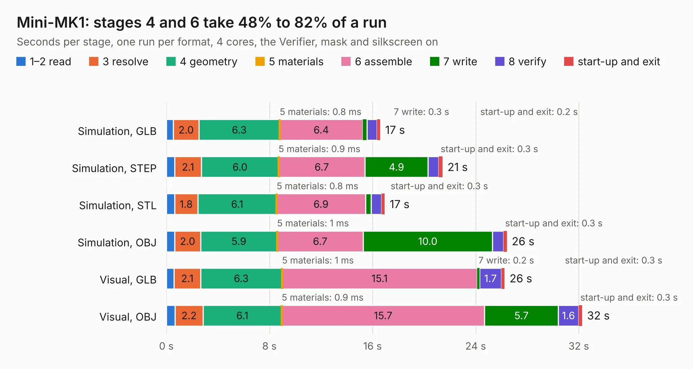

# 1350 Mini-MK1

Board 1,350 of the 3,138 of [Corpus Testing](../Corpus-Testing.md), on [Corpus Page 13](../CorpusTestingPages/Corpus-Testing-13.md#1350-mini-mk1).

| Mode and format | 1–2 read | 3 resolve | 4 geometry | 5 materials | 6 assemble | 7 write | 8 verify | start-up and exit | Total |
|---|---:|---:|---:|---:|---:|---:|---:|---:|---:|
| Simulation, GLB | 0.5 | 2.0 | 6.3 | 0.8&nbsp;ms | 6.4 | 0.3 | 0.8 | 0.2 | 16.6 |
| Simulation, STEP | 0.6 | 2.1 | 6.0 | 0.9&nbsp;ms | 6.7 | 4.9 | 0.8 | 0.3 | 21.4 |
| Simulation, STL | 0.6 | 1.8 | 6.1 | 0.8&nbsp;ms | 6.9 | 0.4 | 0.8 | 0.3 | 16.9 |
| Simulation, OBJ | 0.6 | 2.0 | 5.9 | 1&nbsp;ms | 6.7 | 10.0 | 0.9 | 0.3 | 26.4 |
| Visual, GLB | 0.6 | 2.1 | 6.3 | 1&nbsp;ms | 15.1 | 0.2 | 1.7 | 0.3 | 26.2 |
| Visual, OBJ | 0.7 | 2.2 | 6.1 | 0.9&nbsp;ms | 15.7 | 5.7 | 1.6 | 0.3 | 32.3 |

<table align="center"><tr><td valign="top">

| Board | Repo: [issuiuc/iss-pcb](https://github.com/issuiuc/iss-pcb) Board: `Mini-MK1.kicad_pcb` |
|---|---|
| Folder | boards / Mini-MK1 |
| Complexity | 348&nbsp;/&nbsp;1000 (size&nbsp;208, features&nbsp;140) |
| KESE&nbsp;features | through vias, slotted holes, custom pads, rounded, trapezoid or chamfered pads, filled zones, copper drawings, curved board outline, TrueType text, stack-up, dielectric εr and tanδ, mask and silkscreen colours |
| Tested | 9th November 2026 |
| Copper&nbsp;layers | 4 |
| File&nbsp;format | KiCad 9 (20241229) |
| Parts,&nbsp;tracks,&nbsp;vias | 125, 697, 353 |
| Triangles,&nbsp;simulation | 2,044,106 in 172 parts |
| Verifier | PASS in all six runs |

</td><td valign="top">

<table>
<tr><th>File type</th><th>File size</th><th>Peak memory used</th></tr>
<tr><th colspan="3" align="left">Simulation</th></tr>
<tr><td>GLB</td><td align="right">69&nbsp;MB</td><td align="right">728&nbsp;MB</td></tr>
<tr><td>STEP</td><td align="right">255&nbsp;MB</td><td align="right">905&nbsp;MB</td></tr>
<tr><td>STL</td><td align="right">102&nbsp;MB</td><td align="right">741&nbsp;MB</td></tr>
<tr><td>OBJ</td><td align="right">216&nbsp;MB</td><td align="right">1.4&nbsp;GB</td></tr>
<tr><th colspan="3" align="left">Visual</th></tr>
<tr><td>GLB</td><td align="right">44&nbsp;MB</td><td align="right">820&nbsp;MB</td></tr>
<tr><td>OBJ</td><td align="right">137&nbsp;MB</td><td align="right">1.0&nbsp;GB</td></tr>
</table>

</td></tr></table>

| Previous | Next |
|:---|---:|
| [1349 MIDAS-MK2.1](b1349b_iss-pcb_boards-MIDAS-MK2-MIDAS-MK2-1-revB_MIDAS-MK2-1.md) | [1351 Motor-MK1](b1351b_iss-pcb_Motor-MK1.md) |
