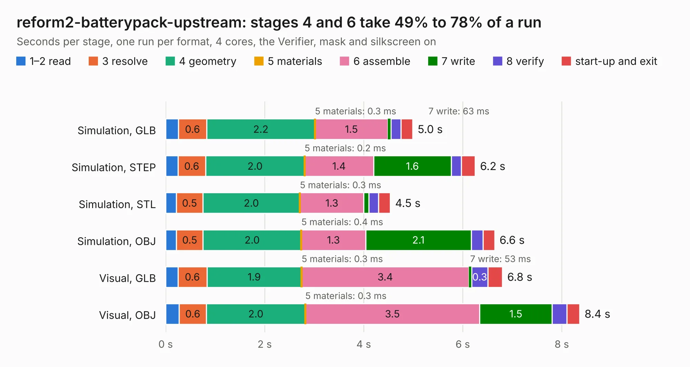

# 1353. reform2-batterypack-upstream

Board 1,353 of the 3,119 of [Corpus Testing](../Corpus-Testing.md), on [Corpus Page 13](../CorpusTestingPages/Corpus-Testing-13.md#1353-reform2-batterypack-upstream).

| Mode and format | 1–2 read | 3 resolve | 4 geometry | 5 materials | 6 assemble | 7 write | 8 verify | start-up and exit | Total |
|---|---:|---:|---:|---:|---:|---:|---:|---:|---:|
| Simulation, GLB | 0.3 | 0.6 | 2.2 | 0.3&nbsp;ms | 1.5 | 63&nbsp;ms | 0.2 | 0.2 | 5.0 |
| Simulation, STEP | 0.2 | 0.6 | 2.0 | 0.2&nbsp;ms | 1.4 | 1.6 | 0.2 | 0.3 | 6.2 |
| Simulation, STL | 0.2 | 0.5 | 2.0 | 0.3&nbsp;ms | 1.3 | 0.1 | 0.2 | 0.2 | 4.5 |
| Simulation, OBJ | 0.2 | 0.5 | 2.0 | 0.4&nbsp;ms | 1.3 | 2.1 | 0.2 | 0.2 | 6.6 |
| Visual, GLB | 0.2 | 0.6 | 1.9 | 0.3&nbsp;ms | 3.4 | 53&nbsp;ms | 0.3 | 0.3 | 6.8 |
| Visual, OBJ | 0.3 | 0.6 | 2.0 | 0.3&nbsp;ms | 3.5 | 1.5 | 0.3 | 0.3 | 8.4 |

<table align="center"><tr><td valign="top">

| Board | Repo: [jackhumbert/reform](https://github.com/jackhumbert/reform) Board: `reform2-batterypack-upstream.kicad_pcb` |
|---|---|
| Folder | reform2-batterypack-pcb |
| Complexity | 197&nbsp;/&nbsp;1000 (size&nbsp;152, features&nbsp;45) |
| KESE&nbsp;features | through vias, slotted holes, rounded, trapezoid or chamfered pads, curved board outline |
| Tested | 9th November 2026 |
| Copper&nbsp;layers | 2 |
| File&nbsp;format | KiCad 5 (20171130) |
| Parts,&nbsp;tracks,&nbsp;vias | 32, 288, 28 |
| Triangles,&nbsp;simulation | 344,852 in 41 parts |
| Verifier | PASS in all six runs |

</td><td valign="top">

<table>
<tr><th>File type</th><th>File size</th><th>Peak memory used</th></tr>
<tr><th colspan="3" align="left">Simulation</th></tr>
<tr><td>GLB</td><td align="right">12&nbsp;MB</td><td align="right">275&nbsp;MB</td></tr>
<tr><td>STEP</td><td align="right">70&nbsp;MB</td><td align="right">297&nbsp;MB</td></tr>
<tr><td>STL</td><td align="right">17&nbsp;MB</td><td align="right">269&nbsp;MB</td></tr>
<tr><td>OBJ</td><td align="right">36&nbsp;MB</td><td align="right">290&nbsp;MB</td></tr>
<tr><th colspan="3" align="left">Visual</th></tr>
<tr><td>GLB</td><td align="right">8.7&nbsp;MB</td><td align="right">260&nbsp;MB</td></tr>
<tr><td>OBJ</td><td align="right">25&nbsp;MB</td><td align="right">265&nbsp;MB</td></tr>
</table>

</td></tr></table>

| Previous | Next |
|:---|---:|
| [1352. reform-trackball](b1352b_reform_reform-trackball.md) | [1354. reform2-batterypack](b1354b_reform_reform2-batterypack.md) |
