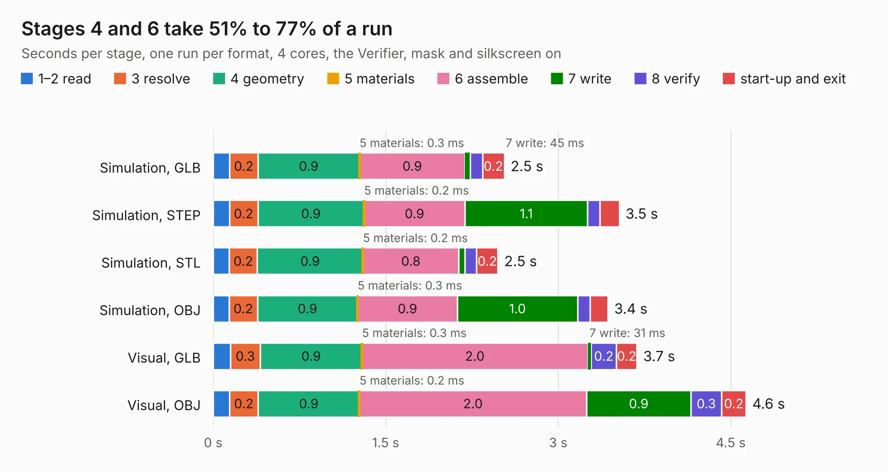

# 1355. reform2-protected-batterypack-pcb

Board 1,355 of the 3,112 of [Corpus Testing](../Corpus-Testing.md), on [Corpus Page 13](../CorpusTestingPages/Corpus-Testing-13.md#1355-reform2-protected-batterypack-pcb).

| Mode and format | 1–2 read | 3 resolve | 4 geometry | 5 materials | 6 assemble | 7 write | 8 verify | start-up and exit | Total |
|---|---:|---:|---:|---:|---:|---:|---:|---:|---:|
| Simulation, GLB | 0.1 | 0.2 | 0.9 | 0.3&nbsp;ms | 0.9 | 45&nbsp;ms | 0.1 | 0.2 | 2.5 |
| Simulation, STEP | 0.1 | 0.2 | 0.9 | 0.2&nbsp;ms | 0.9 | 1.1 | 0.1 | 0.2 | 3.5 |
| Simulation, STL | 0.1 | 0.2 | 0.9 | 0.2&nbsp;ms | 0.8 | 51&nbsp;ms | 0.1 | 0.2 | 2.5 |
| Simulation, OBJ | 0.1 | 0.2 | 0.9 | 0.3&nbsp;ms | 0.9 | 1.0 | 0.1 | 0.2 | 3.4 |
| Visual, GLB | 0.1 | 0.3 | 0.9 | 0.3&nbsp;ms | 2.0 | 31&nbsp;ms | 0.2 | 0.2 | 3.7 |
| Visual, OBJ | 0.1 | 0.2 | 0.9 | 0.2&nbsp;ms | 2.0 | 0.9 | 0.3 | 0.2 | 4.6 |

<table align="center"><tr><td valign="top">

| Board | Repo: [jackhumbert/reform](https://github.com/jackhumbert/reform) Board: `reform2-protected-batterypack-pcb.kicad_pcb` |
|---|---|
| Folder | reform2-protected-batterypack-pcb |
| Complexity | 196&nbsp;/&nbsp;1000 (size&nbsp;151, features&nbsp;45) |
| KESE&nbsp;features | through vias, slotted holes, rounded, trapezoid or chamfered pads, curved board outline |
| Tested | 9th November 2026 |
| Copper&nbsp;layers | 2 |
| File&nbsp;format | KiCad 6 (20211014) |
| Parts,&nbsp;tracks,&nbsp;vias | 33, 297, 19 |
| Triangles,&nbsp;simulation | 258,834 in 48 parts |
| Verifier | PASS in all six runs |

</td><td valign="top">

<table>
<tr><th>File type</th><th>File size</th><th>Peak memory used</th></tr>
<tr><th colspan="3" align="left">Simulation</th></tr>
<tr><td>GLB</td><td align="right">9.0&nbsp;MB</td><td align="right">233&nbsp;MB</td></tr>
<tr><td>STEP</td><td align="right">47&nbsp;MB</td><td align="right">268&nbsp;MB</td></tr>
<tr><td>STL</td><td align="right">13&nbsp;MB</td><td align="right">234&nbsp;MB</td></tr>
<tr><td>OBJ</td><td align="right">26&nbsp;MB</td><td align="right">235&nbsp;MB</td></tr>
<tr><th colspan="3" align="left">Visual</th></tr>
<tr><td>GLB</td><td align="right">7.2&nbsp;MB</td><td align="right">248&nbsp;MB</td></tr>
<tr><td>OBJ</td><td align="right">21&nbsp;MB</td><td align="right">245&nbsp;MB</td></tr>
</table>

</td></tr></table>

| Previous | Next |
|:---|---:|
| [1354. reform2-oled](b1354b_reform_reform2-oled.md) | [1356. reform2-trackball](b1356b_reform_reform2-trackball.md) |
